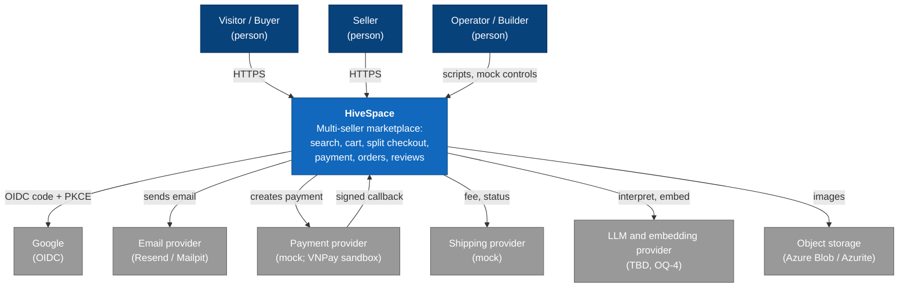
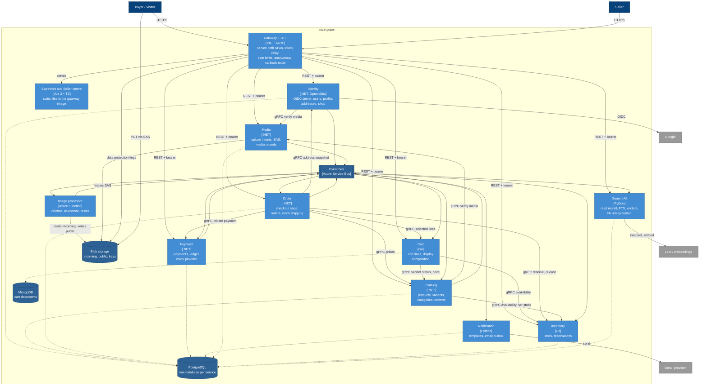
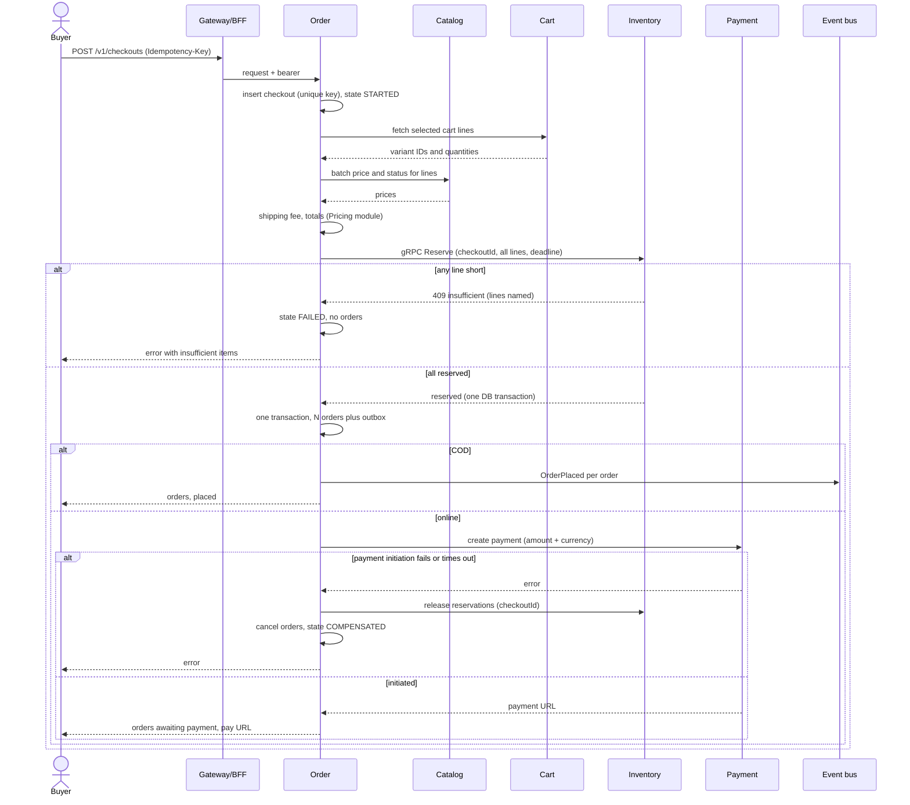
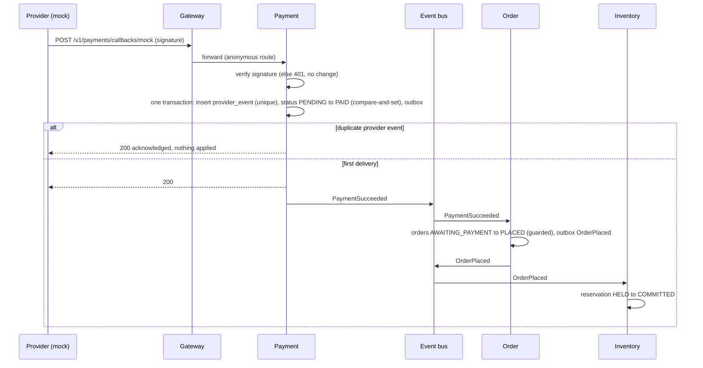
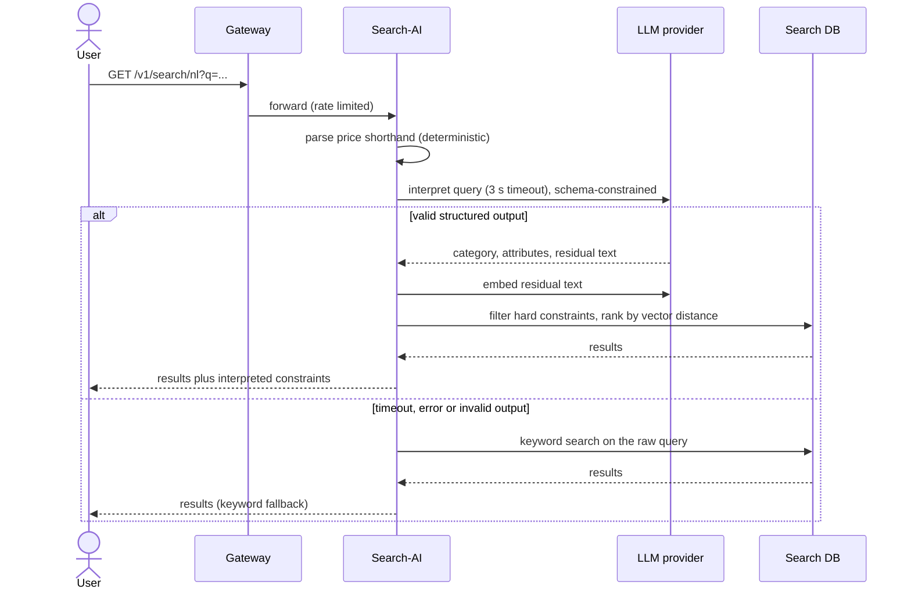
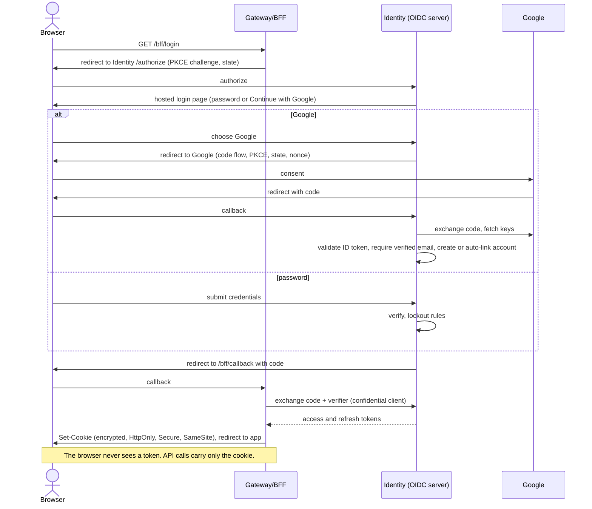
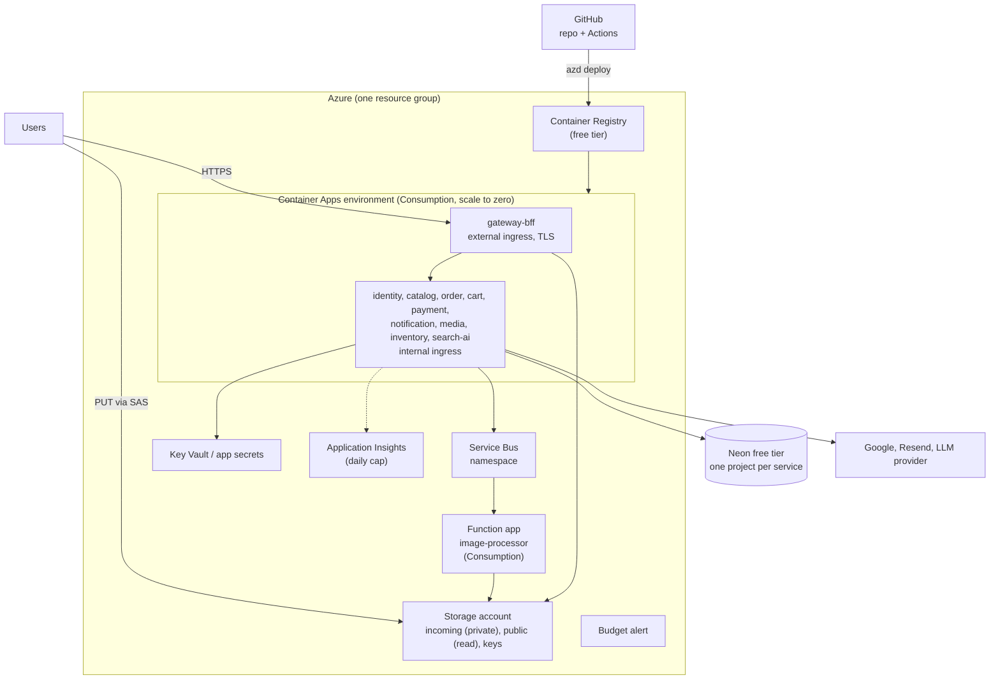

# Architecture: HiveSpace (MVP)

> Status: Draft · Last updated: 2026-11-15 · Author: Software architecture (Claude)
> Inputs: `docs/srs.md` v0.11, `docs/use-cases.md`, `docs/dev-standards.md` v0.1. Decisions are recorded in `docs/adr/` (index in section 9).

## 1. Introduction and goals

HiveSpace is a Shopee-inspired multi-seller marketplace built by one person as a learning and portfolio project (SRS §1.1). This document turns the SRS into a structure: which services exist, who owns which data, how they talk, how it runs locally and on Azure, and why. It does not repeat requirements. Requirements live in [`srs.md`](srs.md); use cases in [`use-cases.md`](use-cases.md).

**Quality goals, in priority order.** When two goals collide, the higher one wins.

| # | Goal | Drivers | What it means for the design |
| :-- | :-- | :-- | :-- |
| 1 | **Correctness of checkout, stock and payment** | NFR-SCAL-001, NFR-REL-001, NFR-REL-002, NFR-REL-003, NFR-REL-005, CON-7 | Orchestrated saga with compensation, atomic stock reservation in the database, idempotent callbacks, outbox and inbox on every event path |
| 2 | **Cost under $5 per month** | NFR-COST-001, NFR-COST-003, NFR-PORT-002 | Scale-to-zero everywhere, free tiers, short deploy window, heavy jobs local only |
| 3 | **Resilience to dependency failure** | NFR-REL-008, NFR-COST-002 | Every external dependency behind an interface with a timeout and a fallback; checkout, cart, browse, keyword search and password sign-in never depend on LLM, email, storage, Google or shipping |
| 4 | **Reviewable engineering** | NFR-MNT-001..006, NFR-OBS-001, NFR-DEM-001..003 | Contracts first, one-command local stack, one trace per checkout, ADRs |

**Stakeholders.** The builder (maintainability, learning, speed) and the reviewer or recruiter who watches a 3-minute demo and reads the repo (NFR-DEM, NFR-MNT).

## 2. Constraints

| Constraint | Source | Effect |
| :-- | :-- | :-- |
| Solo builder, about 390 hours | CON-1 | The service count is a real risk (section 11). A cut order is defined. |
| About $5 per month for Azure and AI | CON-2, NFR-COST-001 | No always-on replicas, free tiers, no AKS, no Azure AI Search (CON-5) |
| .NET core, Go inventory, Python AI | CON-3 | Three stacks; cross-stack behaviour defined by contracts, not shared code |
| Separate services, one database each | CON-4, OQ-9 | See ADR-0001 |
| Azure hosting that scales to zero; Aspire locally | NFR-PORT-001, NFR-PORT-002 | See ADR-0005, ADR-0015 |
| Local dependencies are **Azure emulators**, never real cloud resources | User decision | ADR-0015 |
| Demo runs about 1 hour a day | User decision | Provision and tear-down is a viable cost lever (ADR-0005) |
| `hivespace.web` is a reference only | CON-6 | New `web/` workspace |
| Standards: OpenAPI first, Gherkin contract tests, Conventional Commits | `dev-standards.md` | Applied as written; this document adds no competing rule |

**Lock-in tolerance.** Medium. Azure is the single cloud and Azure Service Bus is the production broker, but every external dependency sits behind an interface (NFR-MNT-006, NFR-MNT-010), so the core domain stays portable.

## 3. Context and scope

**External interfaces.** Every external service has an interface in code and a configuration switch (SRS §3.2). Only two inbound external paths exist: browsers through the gateway, and payment callbacks through the gateway's anonymous callback route (EIR-COM-002).

| External | Interface | Local | Demo |
| :-- | :-- | :-- | :-- |
| Google sign-in | `IExternalLoginProvider` (OIDC) | Fake IdP in tests; real Google test client for manual runs | Google OAuth client with test users (OQ-32) |
| Email | `IEmailSender` | Mailpit | Resend (OQ-29) |
| Payment | `IPaymentProvider` | Mock (in the Payment service) | Mock; VNPay sandbox optional |
| Shipping | `IShippingProvider` | Mock | Mock |
| LLM, embeddings | `ILlmProvider`, `IEmbeddingProvider` | Decide later (ADR-0014) | Decide later |
| Object storage | `IObjectStorage` | Azurite | Azure Blob Storage |
| Event bus | `IEventBus` | Azure Service Bus emulator (RabbitMQ optional) | Azure Service Bus |

## 4. Solution strategy

| Decision | Summary | ADR |
| :-- | :-- | :-- |
| Separate services, database per service | Gateway/BFF plus 9 services and 1 Azure Function; PostgreSQL per service; no cross-database access | 0001 |
| Switchable event bus with outbox and inbox | `IEventBus` over Service Bus (and optional RabbitMQ); JSON envelope; at-least-once with dedupe | 0002 |
| gRPC between services | Internal synchronous calls use gRPC with `contracts/proto/`, `buf` checks and deadlines; the public API stays REST/OpenAPI; events stay on the broker | 0019 |
| Postgres for search | Full text (unaccent, trigram) plus pgvector in the Search-AI read model | 0003 |
| Payment idempotency | Unique provider-event row in the same transaction as the state change; compare-and-set status | 0004 |
| Azure Container Apps, scale to zero, Neon | One public ingress; images in ACR; free-tier Postgres; deploy mechanism deferred | 0005 |
| Orchestrated checkout saga in Order | Synchronous batch reserve, one local transaction for N orders, events for payment | 0006 |
| Atomic reservation in Inventory (Go) | Conditional update, sorted rows, lazy expiry | 0007 |
| OIDC authorization server plus gateway as BFF | OpenIddict in Identity; gateway holds tokens in an encrypted cookie; pluggable social login | 0008 |
| UUID v7 public IDs | Opaque, time-ordered, no auto-increment exposure | 0009 |
| Money as amount plus currency, isolated total pipeline | Integer minor units; `Money` type per language | 0010 |
| Media service with presigned uploads and a Function | Browser uploads straight to blob; Function validates and re-encodes | 0011 |
| Timers survive scale-to-zero | Catch-up sweeps and lazy expiry; no always-on replica | 0012 |
| OpenTelemetry end to end | One trace per checkout, context carried through the broker | 0013 |
| AI behind provider interfaces | Deterministic price parser plus LLM; model identity stored with vectors; runtime undecided | 0014 |
| Aspire locally with Azure emulators | One command; same config shape as the cloud | 0015 |

## 5. Building block view

### 5.1 Containers

The arrows to `bus` and from it are simplified; section 5.4 lists what each service publishes and consumes. Every service has its own database (ADR-0001); the diagram shows one dotted line type for brevity.

### 5.2 Services and ownership

| Block | Stack | Owns (data and behaviour) | FR areas |
| :-- | :-- | :-- | :-- |
| **Gateway / BFF** | .NET, YARP | Routing, the OIDC client, encrypted session cookie, token relay and refresh, rate limits, CORS-free single origin, static hosting of the two SPAs, correlation ID, the anonymous payment-callback route | FR-AUTH-015, FR-AUTH-016, EIR-COM-001, NFR-SEC-005 |
| **Identity** | .NET, OpenIddict, ASP.NET Core Identity | Users, credentials, lockout, Google and other external logins, tokens, profile, address book, shop (profile, pickup address, bank details, seller role), audit log | FR-AUTH, FR-ROLE, FR-SHOP, FR-ADDR, FR-PROF, FR-LOC-002 (profile side), NFR-SEC-002, NFR-SEC-008, NFR-SEC-009, NFR-SEC-014, NFR-SEC-015 |
| **Catalog** | .NET | Category tree (vi, en), products, variants, attributes, product image references, deactivation, reviews and rating aggregates, a projection of completed order items (for verified purchase) | FR-CAT, FR-REV, FR-CAT-016 (seed), FR-LOC-007 |
| **Cart** | Go | Cart lines per user, price snapshot for the changed-price flag, cart display composition (calls Catalog and Inventory), add-time checks (own shop, sold out, stock), removal after `CheckoutCompleted` | FR-CART |
| **Order** | .NET | Checkout saga state, orders, status timeline, mock shipping (`IShippingProvider`), order-total pipeline, payment-window and auto-completion sweepers | FR-CHK, FR-ORD, FR-SHIP, NFR-MNT-007 |
| **Payment** | .NET | Payments and status history, refunds, ledger states, `IPaymentProvider` (mock, VNPay optional), callback endpoint, mock-provider controls | FR-PAY, NFR-REL-003, NFR-SEC-011 |
| **Inventory** | Go | On-hand, reserved, available, reservations, movements, expiry sweeper | FR-INV, NFR-SCAL-001, NFR-REL-001, NFR-PERF-005 |
| **Search-AI** | Python | Product read model, full-text index, embeddings, keyword and NL search, query interpretation, evaluation script | FR-SRCH, FR-NLS, NFR-PERF-002, NFR-PERF-003, NFR-SEC-010 |
| **Notification** | Python | Contact projection (user email, language, shop owner), templates (vi, en), email records, retries, dedupe | FR-NOTIF, NFR-REL-004, UC-018 |
| **Media** | .NET | Upload intents, SAS issuing, media records (pending, ready, rejected, detached), blob cleanup | FR-MEDIA, NFR-SEC-013 (policy side), NFR-MNT-010 |
| **Image processor** | .NET Azure Function | Signature validation, re-encode, metadata strip, resize, write to the public container | FR-MEDIA-004, FR-MEDIA-006, FR-MEDIA-007, NFR-PERF-007 |
| **Web** | Vue 3, TypeScript | Storefront (`/`) and seller centre (`/seller`), generated API client, vue-i18n | EIR-UI-001..004 |

**Allocation calls the SRS left open.**
- **Cart is its own service (Go).** It is a separate concern with its own data and load. It composes the cart display from Catalog and Inventory by batch call. The checkout saga reads the selected lines from Cart but never trusts its prices: Order re-fetches authoritative prices from Catalog. Purchased lines are removed when Cart consumes `CheckoutCompleted`.
- **Shop lives in Identity.** Granting the Seller role and creating the shop must commit together (FR-ROLE-002). Catalog keeps a shop snapshot fed by `ShopChanged` events.
- **Reviews live in Catalog.** Product page reads (rating, review list) stay local. Verified purchase comes from a projection of `OrderCompleted` events.
- **Mock shipping lives in Order** behind `IShippingProvider`; **mock payment lives in Payment** behind `IPaymentProvider`.
- **Stock lives in Inventory.** Catalog creates variants and Inventory creates the stock row from `VariantCreated`. Seller stock edits go through Catalog, which calls Inventory synchronously so FR-INV-010 can reject at once.

### 5.3 Synchronous calls between services (gRPC)

All internal calls are gRPC (ADR-0019), use internal ingress only, pass a deadline, carry the caller's bearer token when acting for a user, have a timeout and a retry policy from ServiceDefaults (or the hand-written equivalent in Go and Python).

| Caller → callee | Purpose | If the callee is down |
| :-- | :-- | :-- |
| Order → Catalog | Authoritative price and status for checkout lines | Checkout fails with a retry message (no stale prices) |
| Order → Inventory | Batch reserve, release | Reserve failure fails checkout and compensates |
| Order → Cart | Selected cart lines at checkout start | Checkout fails with a retry message; browsing is unaffected |
| Cart → Catalog | Variant status, price, shop (add time and display) | Add fails clearly; the cart view shows lines without fresh prices |
| Cart → Inventory | Availability for display and advisory stock check | Availability shown as unknown |
| Order → Payment | Initiate online payment | Saga compensates (FR-CHK-006) |
| Order → Identity | Address snapshot at checkout | Checkout fails with a retry message |
| Catalog → Inventory | Availability on the product page; set on-hand | Product page shows availability as unknown; stock edit fails |
| Catalog, Identity → Media | Confirm a media item is ready and owned by the caller | Attach fails; the existing image is kept (FR-MEDIA-008) |

### 5.4 Events

All events use the envelope in ADR-0002 and have a JSON schema in `contracts/events/`. Consumers are idempotent (NFR-REL-005).

| Event | Producer | Consumers | Notes |
| :-- | :-- | :-- | :-- |
| `UserRegistered`, `UserProfileChanged`, `PasswordChanged`, `ExternalLoginLinked` | Identity | Notification | Carry email, language, display name; `UserRegistered` carries the verification token (risk R-6) |
| `ShopRegistered`, `ShopChanged` | Identity | Catalog, Notification, Search-AI | Shop snapshot, owner ID |
| `CategoryTreeChanged` | Catalog | Search-AI | Seeded; used by NL interpretation |
| `ProductChanged` | Catalog | Search-AI | Full snapshot with a monotonic `version`; stale versions ignored (FR-CAT-018, FR-NLS-007) |
| `VariantCreated` | Catalog | Inventory | Initial on-hand |
| `ReviewChanged` | Catalog | Search-AI | Rating and count for result cards |
| `CheckoutCompleted` | Order | Cart | Lines purchased; Cart removes them idempotently (FR-CHK-010) |
| `OrderPlaced` | Order | Inventory, Notification, Payment | Inventory commits the reservation; COD payment recorded as pending |
| `OrderShipped` | Order | Inventory, Notification | Inventory consumes reservation |
| `OrderCancelled` | Order | Inventory, Payment, Notification | Release stock; refund or mark payment cancelled |
| `OrderDelivered`, `OrderCompleted` | Order | Payment, Catalog | Payment: COD collected, released to seller; Catalog: purchased-items projection |
| `PaymentSucceeded`, `PaymentFailed`, `PaymentRefunded` | Payment | Order | Drive `awaiting payment` transitions |
| `MediaUploaded` | Media | Image processor | |
| `MediaProcessed`, `MediaRejected` | Image processor | Media | |
| `MediaDetached` | Identity, Catalog | Media | Triggers blob deletion |

### 5.5 Inside a service (pattern)

Every service has the same outer shell and one of two inner shapes (ADR-0020). **Rich** services (Order, Payment, Catalog, Identity, Inventory) use ports and adapters with a pure domain layer; in .NET that is `Api`, `Application`, `Domain`, `Infrastructure`, and the domain has no framework or vendor reference. **Lean** services (Media, Cart, Search-AI, Notification) use vertical feature slices. Folder layouts per stack and shape are in [`repo-structure.md`](repo-structure.md); rules are in dev-standards §8. Each service owns an `outbox` and an `inbox` table. The Order service's `Pricing` module is isolated so discounts can be added later without touching checkout (NFR-MNT-007, ADR-0010).

## 6. Runtime view

### 6.1 Checkout with stock reservation and compensation [UC-011, UC-012]

- All of FR-CHK-004 to FR-CHK-008 live in the Order service. State is persisted after every step, so a crashed process resumes or compensates on the next wake (ADR-0012).
- A repeat of the same `Idempotency-Key` returns the stored outcome (FR-CHK-008).
- After a successful checkout Order publishes `CheckoutCompleted`; Cart removes the purchased lines (FR-CHK-010), and the response lists them so the UI hides them at once.
- If the release call itself fails, the saga stays `COMPENSATING` and a sweeper retries. The Inventory hold expiry is the final backstop (FR-INV-007).
- The step timeout is 10 s (OQ-13). A timeout counts as failure (FR-CHK-007).
- The failure-injection test (NFR-REL-002) injects a fault at each arrow above and asserts 0 orphan orders and 0 held reservations.

### 6.2 Payment callback, three deliveries [UC-012, NFR-REL-003]

A success callback that arrives after the orders were cancelled finds the payment in `CANCELLED` (set by `OrderCancelled`) and triggers a refund through the provider interface instead (FR-PAY-011).

### 6.3 Natural-language search with fallback [UC-008]

The deterministic parser means a "300k" bound survives an LLM outage. Query embedding failure also falls back to keyword. The LLM output is parsed into a fixed Pydantic model and nothing else (NFR-SEC-010).

### 6.4 Sign-in through the BFF, including Google [UC-002, UC-025]

On later calls the gateway decrypts the cookie, refreshes the access token when it is near expiry, and relays it to the service. Google being down only affects the Google button (FR-AUTH-023).

## 7. Deployment view

**Deployed environments.** One: `demo`. Local is not listed (it is universal). There is no staging; `main` is deployed on demand (dev-standards §12).

- **Region.** One Azure region near Vietnam (for example Southeast Asia) and the Neon region closest to it. Final choice at provisioning.
- **Cost levers (ADR-0005).** Scale to zero; free grant of Container Apps; free tiers for Neon, Functions and Application Insights; the Service Bus namespace billed per hour, so the deploy window matters. The choice between "provision and tear down daily" and "keep it provisioned" is deferred.
- **MongoDB for Cart.** Not shown in the diagram: the demo host (Atlas free tier or Cosmos DB for the MongoDB API) is undecided (ADR-0018, ADR-0005).
- **Scaling.** One replica per app is enough (NFR-REL-006). Maximum replicas for the gateway stay at one while its rate limiter is in memory.
- **Not here:** variable names, the secret mechanism and the exact azd parameters; those belong to the deployment step.

## 8. Cross-cutting concepts

### 8.1 Security

- **Authentication.** Standard OIDC code flow with PKCE. Identity is the authorization server; the gateway is a confidential client and BFF; the browser only holds an encrypted cookie (ADR-0008). Access tokens last 15 minutes and refresh tokens 7 days with rotation (NFR-SEC-004). Password change and reset revoke older refresh tokens (NFR-SEC-015).
- **Authorization.** The gateway rejects unauthenticated calls to protected routes. Every service validates the JWT and enforces role and ownership itself (FR-ROLE-004, FR-ROLE-005). The shared authorization test suite is mandatory (dev-standards §9.2).
- **Internal calls.** gRPC over internal ingress; the user's bearer token travels as call metadata and each service validates it (ADR-0019).
- **Social login.** `IExternalLoginProvider` registry in Identity. Google first; another provider is configuration plus claim mapping. Auto-link only on a verified email (FR-AUTH-021).
- **Internal network.** Only the gateway has external ingress. The callback route is anonymous but signature-verified (FR-PAY-008).
- **Secrets.** Never in the repo (NFR-SEC-007). Aspire parameters locally; Container Apps secrets or Key Vault in the demo. Bank numbers encrypted at rest (NFR-SEC-008).
- **Uploads.** Presigned write-only URLs into a private container; nothing is served until the Function has validated and re-encoded it (NFR-SEC-013, ADR-0011).
- **LLM.** Text in as data, fixed schema out, no tools (NFR-SEC-010).
- **Audit.** Each service writes its own audit rows (sign-in, lockout, role grant in Identity; order and payment status history in their services), purged after 90 days (NFR-SEC-009).
- **Rate limits** at the gateway (NFR-SEC-005).

### 8.2 Data

- **Store.** PostgreSQL for every service except Cart (relational, transactional; pgvector in Search-AI only). Cart uses MongoDB, one document per user with a TTL index (ADR-0018). Catalog's store is open until the crawl review (ADR-0018); it stays behind a repository interface. Locally one Postgres container with one database per service plus a MongoDB container; in the demo one Neon project per service, and a MongoDB host to be decided (ADR-0005).
- **Ownership.** No service reads another's tables. Data crosses by API or event.
- **Consistency.** Strong inside a service; eventual across services. The saga and outbox cover the places where a cross-service guarantee is required.
- **Money.** `{ amount, currency }`, integer minor units, VND exponent 0 (ADR-0010).
- **Time.** UTC everywhere; Asia/Ho_Chi_Minh at the UI edge (NFR-L10N-002).
- **IDs.** UUID v7 public IDs; human-readable order numbers are separate (ADR-0009).
- **Migrations.** EF Core, golang-migrate and Alembic (MongoDB: versioned startup scripts that create the collection, validator and indexes); run by the AppHost locally and by a deploy step in the cloud. Restore from migrations plus seed in 10 minutes (NFR-REL-007).
- **Localization.** Error codes are stable and shared in `contracts/`; messages are resolved in the request language from a shared catalog with vi and en. Platform content (categories, statuses) has vi and en text. Fallback is vi (FR-LOC-008).

### 8.3 Resilience and error handling

| Dependency | If it fails | Mechanism |
| :-- | :-- | :-- |
| LLM or embeddings | NL search falls back to keyword search | 3 s timeout, schema check, cap (FR-NLS-005, NFR-COST-002) |
| Email provider | Retried 5 times with backoff over 1 hour, never blocks the originating action | Notification outbox (NFR-REL-004) |
| Google | Only the Google button fails | Interface and timeout (FR-AUTH-023) |
| Blob storage or the Function | Upload fails, existing image kept | Presign failure path, lifecycle cleanup (FR-MEDIA-008) |
| Shipping mock | Checkout uses a configured fallback fee, or fails clearly | Interface and timeout (NFR-REL-008) |
| Inventory or Payment | Checkout fails and compensates | Saga (FR-CHK-006) |
| Broker | Producers keep writing to the outbox; delivery resumes later | Outbox relay (ADR-0002) |

All state-changing retryable operations are idempotent (checkout key, reservation per checkout line, release once, callback event ID, email per event and recipient). Consumers deduplicate by `eventId` in an inbox table.

### 8.4 Observability

OpenTelemetry in every service; .NET through ServiceDefaults, Go and Python configured to the same attributes. The trace context travels in HTTP headers and in the broker envelope so one checkout is one trace (NFR-OBS-001). Logs are structured JSON with a correlation ID and follow the personal-data rule (NFR-OBS-002). Every service exposes `/health` and `/ready`. Locally the Aspire dashboard; in the demo Application Insights with a daily cap (ADR-0013).

### 8.5 Performance and scaling

Targets are NFR-PERF-001..007. The design supports them as follows. Product page: one Catalog query plus one batch availability call. Keyword search: Postgres full text on a denormalized read model. NL search: bounded by a 3 s interpretation timeout. Reservation: a single conditional update per row in one transaction (NFR-PERF-005). Image variants are generated once at upload, not on request. The main performance risk is cold starts stacking after scale-to-zero (risk R-4, NFR-PERF-006).

### 8.6 Testing

Risk-based, as defined in dev-standards §8 and §9; this document adds only the realization.

| Layer | Frameworks | Coverage stance |
| :-- | :-- | :-- |
| Unit and integration | xUnit with Testcontainers (.NET); `go test -race` with a real Postgres container (Go); pytest (Python); Vitest (Vue) | No coverage threshold. Test depth follows risk, and checkout, inventory and payment get the most. |
| API contract | cucumber-js (`tests/contract`, ADR-0025) over shared `.feature` files in `contracts/features/` | One feature per operation and per use-case exception flow |
| Mandatory risk tests | Oversell with k6 (NFR-SCAL-001), saga failure injection (NFR-REL-002), triple callback (NFR-REL-003), duplicate event delivery (NFR-REL-005), authorization, dependency failure, upload | Run from the repo with documented commands (NFR-MNT-005) |
| End to end | Playwright, journeys as Gherkin through playwright-bdd (ADR-0026) | Thin: the hero flow only (UC-001, UC-007, UC-009, UC-010, UC-011, UC-012, UC-014, UC-016, UC-017), plus one Google sign-in run against a fake IdP (UC-025) |

## 9. Architecture decisions

Each ADR is a file in `docs/adr/`.

| ADR | Decision | Status |
| :-- | :-- | :-- |
| [0001](adr/0001-separate-services-database-per-service.md) | Separate services, database per service, capability allocation | Accepted |
| [0002](adr/0002-event-bus-abstraction-outbox-inbox.md) | Event bus abstraction (Service Bus, optional RabbitMQ), outbox and inbox | Accepted |
| [0003](adr/0003-search-store-postgres-fts-pgvector.md) | Search store: Postgres full text and pgvector | Accepted |
| [0004](adr/0004-payment-idempotency.md) | Payment callback idempotency | Accepted |
| [0005](adr/0005-hosting-azure-container-apps-neon.md) | Hosting: Container Apps, Neon, ACR, deploy window | Proposed (deploy mechanism deferred) |
| [0006](adr/0006-checkout-saga.md) | Orchestrated checkout saga in Order | Accepted |
| [0007](adr/0007-inventory-atomic-reservation.md) | Inventory: atomic reservation and lazy expiry | Accepted |
| [0008](adr/0008-oidc-identity-and-bff-gateway.md) | OIDC authorization server and gateway as BFF | Accepted |
| [0009](adr/0009-public-ids-uuid-v7.md) | Public IDs: UUID v7 | Accepted |
| [0010](adr/0010-money-model-and-pricing-pipeline.md) | Money model and isolated pricing pipeline | Accepted |
| [0011](adr/0011-media-service-presigned-upload-function.md) | Media service, presigned uploads, image-processor Function | Accepted |
| [0012](adr/0012-timers-under-scale-to-zero.md) | Timers and expiry under scale-to-zero | Accepted |
| [0013](adr/0013-observability-opentelemetry.md) | Observability with OpenTelemetry | Accepted |
| [0014](adr/0014-ai-provider-interfaces.md) | AI provider interfaces; runtime undecided | Proposed (OQ-4) |
| [0015](adr/0015-aspire-and-azure-emulators.md) | Aspire orchestration with Azure emulators locally | Accepted |
| [0016](adr/0016-notification-in-python.md) | Notification service in Python | Accepted |
| [0017](adr/0017-cart-service-in-go.md) | Cart as a separate service in Go | Accepted |
| [0018](adr/0018-per-service-data-stores.md) | Data stores per service: PostgreSQL default, MongoDB for Cart, Catalog open | Accepted for Cart; Catalog and Mongo host open |
| [0019](adr/0019-grpc-for-internal-calls.md) | gRPC for internal service-to-service calls | Accepted |
| [0020](adr/0020-service-shapes-and-copier-templates.md) | Service shapes (rich and lean) and Copier templates | Accepted |
| [0021](adr/0021-design-tokens-and-theming.md) | Design tokens (DTCG) and Tailwind v4 theme, light and dark | Accepted |
| [0022](adr/0022-modal-on-native-dialog.md) | Modals are built on the native `<dialog>` element | Accepted (review on trigger) |
| [0023](adr/0023-native-date-and-time-inputs.md) | Date and time fields use native inputs first | Accepted (review on trigger) |
| [0024](adr/0024-port-ui-subset-from-reference.md) | Port a UI subset from the reference shared package instead of consuming it | Accepted |

## 10. Quality scenarios

| Scenario | Target | Verified by |
| :-- | :-- | :-- |
| 200 buyers race for 10 units | Exactly 10 reservations, 0 oversold, 3 runs | k6, NFR-SCAL-001, NFR-REL-001 |
| Fault injected at each checkout step | 0 orphan orders, 0 held reservations | Saga test, NFR-REL-002 |
| Same payment callback delivered 3 times | 1 payment effect, 1 order transition | NFR-REL-003 |
| Any event delivered twice | No duplicate side effect | NFR-REL-005 |
| LLM, email, Google, storage or shipping down | Checkout, cart, browse, keyword search, password sign-in still work | NFR-REL-008 |
| Product page at 50 users, seed data | p95 ≤ 300 ms | NFR-PERF-001 |
| Checkout with 5 sellers at 20 concurrent | p95 ≤ 3 s | NFR-PERF-004 |
| Reservation at 200 concurrent | p95 recorded, target ≤ 200 ms | NFR-PERF-005 |
| Image up to 5 MB | Visible within 5 s (p95) | NFR-PERF-007 (see R-4) |
| Cold start after idle | First request ≤ 30 s | NFR-PERF-006 |
| Fresh clone | Full stack with one command | NFR-PORT-001 |

## 11. Risks and technical debt

| # | Risk or debt | Impact | Mitigation or revisit trigger |
| :-- | :-- | :-- | :-- |
| R-1 | **Service count for one builder.** 9 services, 1 Function, 1 gateway, 3 stacks, against about 390 hours and an SRS that expected about 6 services (CON-4). | Schedule | Build the walking skeleton first. Cut order if behind: Image processor and Media (fall back to direct upload through Identity and Catalog), then Notification as a module of Order (which would put it back in .NET), then Cart back into Order as a module, never the saga or inventory (CON-7). |
| R-2 | **Azure Service Bus cost.** The Standard tier (needed for topics) is billed per hour while the namespace exists (about $10 a month if left up; verify). | NFR-COST-001 | Provision per deploy window, or amend the budget, or swap `IEventBus` to RabbitMQ on a free host. Decision deferred in ADR-0005. |
| R-3 | **Neon free-tier limits.** Storage cap per project (sources disagree: 0.5 or 1 GB), 100 compute-hours per project per month, policy changes. | Demo data | One project per service; seed sized under the cap; the database is plain Postgres so it can move. |
| R-4 | **Cold starts stack.** App scale-from-zero plus Neon wake plus Function start can exceed the 5 s upload target and strain the 30 s first-request target. | NFR-PERF-006, NFR-PERF-007 | Warm the stack before a demo; measure and record; consider a Function plan with pre-warmed instances only if cost allows. |
| R-5 | **Gateway rate limiter is in memory.** | Limits wrong with 2+ replicas | Pin the gateway to one replica; revisit with a shared store if scaled. |
| R-6 | **Verification and reset tokens travel in events** to Notification. | Secret in broker and logs | Hash-only storage in Identity, redaction in logs, short lifetime; revisit if Notification needs less. |
| R-7 | **Internal trust.** Services trust the network plus a validated JWT; no mutual TLS or service identity. | Lateral movement if one service is compromised | Acceptable for a demo with no real money; revisit before any real use. |
| R-8 | **Access tokens are not individually revocable.** Revocation applies to refresh tokens. | Up to 15 minutes of access after sign-out | Resolved in SRS v0.12 (CR-3): FR-AUTH-015 reworded and NFR-SEC-004 tightened to 15 minutes. Accepted residual risk. |
| R-9 | **Image processing relies on a Function with a Service Bus trigger and an Aspire local run.** Local Function support in Aspire may be preview. | Local run friction | Verify at scaffolding; fall back to a worker process with the same handler. |
| R-10 | **Embedding model identity** must match between index time and query time. | Wrong ranking | Model ID stored per row; mismatch rejected; ADR-0014 decides the runtime. |
| R-11 | **OpenIddict and hosted login pages** add UI and protocol work not in the original estimate. | Schedule | Keep the pages minimal; use framework templates. |
| R-12 | **At-least-once plus out-of-order delivery** can apply an older product snapshot. | Stale search | `version` on `ProductChanged`; consumer ignores older. |
| R-13 | **Second store type and undecided MongoDB host.** MongoDB has no Azure emulator and its demo host (Atlas or Cosmos DB for MongoDB) is open. | Cost, local-run friction | Plain container locally; Cart restricted to single-document atomic updates so no replica set is needed; decide the host with ADR-0005; verify the free-tier limits. |
| R-14 | **A second contract language across three stacks.** gRPC adds `.proto` files, `buf` and stub generation next to OpenAPI. | Tooling effort, harder manual debugging | Generated stubs, `buf` lint and breaking checks in CI, `grpcurl` for inspection; verify Container Apps internal HTTP/2 and the Aspire setup at scaffolding (ADR-0019). |

**Deliberate shortcuts.** No Admin role or console. Mock payment and shipping only. No separate staging. Single region. Revisit if the project grows past the MVP.

**Open items:** OQ-4 (AI runtime), R-2 (Service Bus cost), OQ-13 (timeout values, proposed values used). OQ-5, OQ-10 and R-8 were resolved in SRS v0.12 (CR-3).

## 12. Glossary

Terms from the SRS glossary apply. Additional terms:

| Term | Meaning |
| :-- | :-- |
| BFF | Backend for frontend: the gateway keeps tokens server-side and gives the browser only a cookie |
| Outbox, inbox | Tables that make "change state and publish an event" atomic, and "process an event once" safe |
| SAS | Shared access signature: a short-lived, scoped URL for writing to blob storage |
| HELD, COMMITTED, CONSUMED, RELEASED | Reservation states in Inventory |
| Walking skeleton | The thinnest end-to-end path built first |
