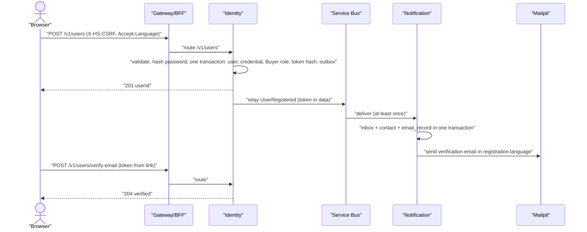
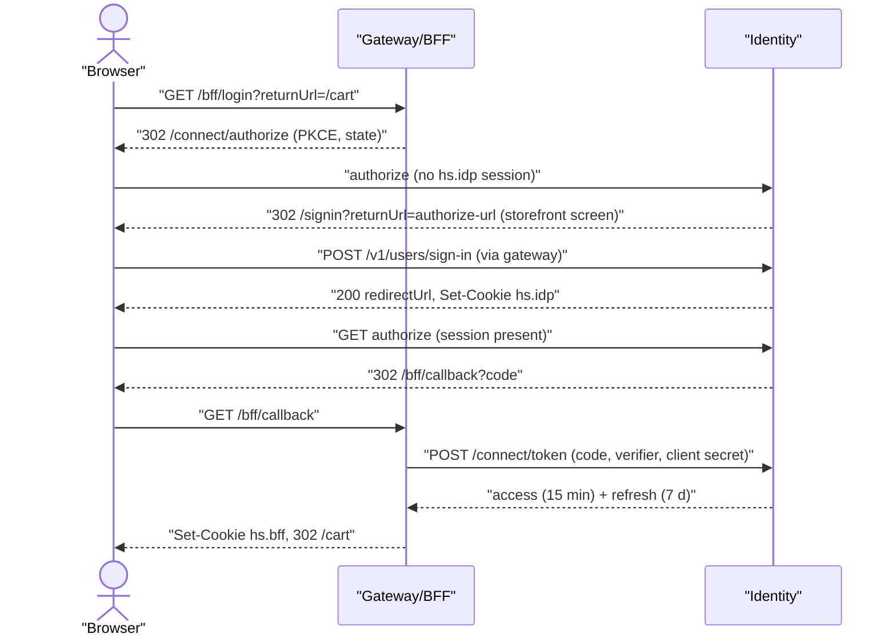

# Technical Design: FEAT-001 — Register, verify email, password sign-in and sign-out

> Feature from: docs/implementation-plan.md · Epic: E1 Identity & Access
> Implements: FR-AUTH-001..010, FR-AUTH-013, FR-AUTH-014, FR-ROLE-001, FR-NOTIF-002, FR-NOTIF-001 (p), FR-LOC-005 (p); also covers FR-AUTH-015, FR-AUTH-016 (Foundations in the RTM, acceptance criterion 8 of the plan), FR-AUTH-008 (p, record only), FR-LOC-004 (first real use)
> Realizes: UC-001, UC-002 · Screens: SCR-STF-012, SCR-STF-013, SCR-STF-014 (designed by ui-design)
> Status: Draft · Date: 2026-11-18
> Diagram: [design-flow.html](design-flow.html) (interactive flow diagram, html-flow-diagram)

## 1. Intent
A visitor registers, receives a verification email, opens the link, signs in and signs out. Every later slice needs a signed-in user with roles, so this one is first. It also proves the riskiest plumbing early: OpenIddict as the authorization server, the gateway as a confidential BFF with an encrypted cookie (ADR-0008, R-11), 15-minute access tokens with silent refresh (NFR-SEC-004), and the first real cross-stack event (Identity outbox → Service Bus → Python Notification → Mailpit) with the verification token in the event (R-6).

## 2. Codebase context
Surveyed on 2026-11-18. The design conforms to the following.

- **Identity** is the generated rich .NET service (`Api → Infrastructure → Application`, `Domain` standalone). Domain, Application and Infrastructure hold only marker classes. There is no DbContext, migration, auth or messaging. `Program.cs` has only the `GET /v1/identity/ping` stub (replaced by this slice). **Last migration: none**; this feature creates `0001`.
- **Reference slice: Catalog.** Copy its shape: `Endpoints/*Endpoints.cs`, `Infrastructure/DependencyInjection.cs` (`AddNpgsqlDbContext`, `AddEventBus<TContext>`, `EfEventOutbox`), `Persistence/{DbContext, DesignTimeFactory, Migrations}`, migrate on start behind `Database:MigrateOnStartup`, test projects Architecture, Contract, Integration, Unit.
- **Messaging** (`libs/dotnet/HiveSpace.BuildingBlocks.Messaging`): `EventEnvelope.Create<T>` (UUID v7 event ID), `OutboxRelay<TContext>` (1 s poll, 50 rows, at-least-once), `AddOutboxAndInbox()`, `AddEventBus<TContext>(connection, new MessagingOptions(topic, producer))`. All events share the topic `hivespace-events`; consumers filter by `eventType`. The `notification-events` subscription has no filter rules.
- **Errors** (`BuildingBlocks.Errors`): envelope `{code, message, details[{field, code, message?}]}`; only 6 `common.*` codes. **`UseApiErrors()` is a 500-only placeholder** that does not localize or map to 4xx; its comment says localization "arrives with FEAT-001". This slice builds it (document says reality needs work: FR-LOC-004).
- **Contracts:** `contracts/errors/error-codes.yaml` (`code: {http}`), `messages.{vi,en}.yaml` (flat, key parity checked in CI), `contracts/events/<Name>/v<N>.schema.json` (only `Ping/v1`), `contracts/features/<service>/*.feature` with `@service:`, `@operation:` and requirement tags, bound by Reqnroll (Catalog's `ContractTests.csproj` is the pattern). `openapi/identity.yaml` is the ping stub; there is no `Idempotency-Key`, `Accept-Language` or security scheme anywhere yet.
- **Gateway** (YARP): no auth, cookie, OIDC, data protection or rate limiter. `GatewayTransforms` strips inbound `X-User-Id`/`X-User-Roles` and, in Development only, injects `dev-user` (the stub this slice replaces). Routes: `/v1/identity/*`, `/v1/catalog/*`, `/v1/categories/*`, etc. `/v1/users/*`, `/bff/*`, `/connect/*` are not routed; in Development the SPA catch-all (`/{**rest}`, order 1000) would swallow them.
- **Notification** (Python, lean): `consumer.py` only records the inbox and logs; no event dispatch, contact projection, email sending, templates, or mail settings (`ConnectionStrings__mailpit` is injected by the AppHost but unread). Vendor SDKs may live only under `providers/` (import-linter). mypy strict, ruff.
- **AppHost:** Identity has no database, messaging or blob reference. Connection names `catalogdb`, `messaging`, `mailpit`, Azurite `blobs`.
- **Web:** `web/packages/ui` holds ported presentational components (Button, Input, Alert, ...), with labels passed in (ADR-0024). Only `api.ts` files may import the API client; features import each other only through `index.ts` (Sheriff). Generated client lives in `web/packages/api-client` (only Catalog so far).
- **Divergences recorded** (reality wins): (1) `UseApiErrors` does not meet FR-LOC-004 yet; (2) the plan's `POST /v1/users*` paths are not under the gateway's `/v1/identity/*` route, so a route is added; (3) ADR-0008 says Identity hosts the sign-in/register/verify pages, but the UX documents make them storefront screens and the user chose shared Vue components (§7, D-1); (4) `Idempotency-Key` and `Accept-Language` conventions do not exist yet and this slice defines `Accept-Language`.

## 3. API contracts

Conventions: JSON, camelCase, errors use the shared `Error` schema, request language from `Accept-Language` (`vi` default, `en` supported; D-2). All mutating calls through the gateway must carry `X-HS-CSRF: 1` (D-5); this is a gateway rule, not repeated per endpoint.

### 3.1 Identity REST (routed via gateway `/v1/users/*`)

| Endpoint | Auth | Request | Success | Errors |
| :-- | :-- | :-- | :-- | :-- |
| `POST /v1/users` (`registerUser`) | anonymous | `{email, displayName, password}`; language taken from `Accept-Language` | `201 {userId}` | `400 common.validation_failed` with one `details` entry per failure; `409 identity.email_in_use` |
| `POST /v1/users/verify-email` (`verifyEmail`) | anonymous | `{token}` | `204` | `400 identity.verification_token_invalid`, `400 identity.verification_token_expired`, `409 identity.email_already_verified` |
| `POST /v1/users/verification-email` (`resendVerificationEmail`) | anonymous | `{email}` | `202` always (no enumeration) | `400 common.validation_failed` for a malformed email only |
| `POST /v1/users/sign-in` (`signIn`) | anonymous | `{email, password, returnUrl?}` | `200 {redirectUrl}` and sets the Identity session cookie `hs.idp` | `401 identity.invalid_credentials` (same body for unknown email, wrong password, no password; FR-AUTH-010, FR-AUTH-026 forward-compat) |

Validation rules (FR-AUTH-002..004, NFR-SEC-003), each reported as a `details` item `{field, code}` and **all unmet rules listed together**:
- `email`: required, well-formed, ≤254 chars → `identity.email_required`, `identity.email_invalid`.
- `displayName`: required, trimmed 1–60 chars → `identity.display_name_required`, `identity.display_name_too_long`.
- `password`: ≥8 chars, ≥1 letter, ≥1 digit → `identity.password_too_short`, `identity.password_needs_letter`, `identity.password_needs_digit`. Max 128 chars → `identity.password_too_long`.
- Email uniqueness is checked on the normalized (trimmed, lower-invariant) address and again by the unique index (race → `identity.email_in_use`).

Behavior notes:
- `registerUser` creates the user (unverified, Buyer role), credential and verification token, and writes `UserRegistered` to the outbox **in one transaction**. It never waits for email (UC-001 4a).
- `resendVerificationEmail` for an unknown, or already verified, address does nothing and still answers `202`. For an unverified user it marks every earlier unused token invalidated, issues a new one and writes `VerificationEmailRequested` (FR-AUTH-007). Rate limiting lands in FEAT-005 (hook only here).
- `verifyEmail` hashes the presented token and looks it up. Unknown → invalid. Used or already verified → `email_already_verified`. Past `expires_at`, or invalidated by a resend → `expired` (invalidated tokens are reported as expired, so the UI offers a new link, FR-AUTH-006). Success sets `email_verified_at`, marks the token used, and is idempotent per token.
- `signIn` verifies the password with the hasher, **does not require a verified email** (FR-AUTH-009), and signs the principal into the cookie scheme `hs.idp` (HttpOnly, Secure, SameSite=Lax, path `/`). The `redirectUrl` is `returnUrl` only if it is a local path starting with `/connect/authorize`; otherwise `/`. The wrong-password path does a dummy hash verification for unknown emails to keep timing comparable. Lockout (FR-AUTH-011/012) is FEAT-005 and is not built here.
- Errors are localized by the new `UseApiErrors` using the catalog (§5.4).

### 3.2 OpenIddict endpoints (routed via gateway `/connect/*`, `/.well-known/*`)
- `GET|POST /connect/authorize` — authorization code + PKCE (S256 only). If there is no `hs.idp` session, redirect to `/signin?returnUrl=<url-encoded local authorize URL>` (the storefront screen, D-1). Otherwise issue a code.
- `POST /connect/token` — `authorization_code` and `refresh_token` grants. Access token **15 min** (ES256 JWT), refresh token **7 days with rotation**, `offline_access` scope. Claims in the access token: `sub` (user ID), `email`, `email_verified`, `name`, `role` (one claim per role), `lang`. The ID token carries the same identity claims.
- `POST /connect/revoke` — revokes the presented refresh token (FR-AUTH-013). Used server to server by the gateway.
- `GET /connect/logout` — end-session: clears `hs.idp`, redirects to a registered `post_logout_redirect_uri`.
- `GET /.well-known/openid-configuration`, `GET /.well-known/jwks` — discovery and keys.
- One registered client, `hivespace-gateway`: confidential, code + refresh, PKCE required, redirect URI `{PublicBaseUrl}/bff/callback`, post-logout `{PublicBaseUrl}/`. Seeded at startup from configuration; the secret comes from configuration (AppHost parameter locally, never committed).
- No consent screen (first-party client).

### 3.3 BFF endpoints (served by the gateway itself, before the proxy and the SPA fallbacks)

| Endpoint | Behavior |
| :-- | :-- |
| `GET /bff/login?returnUrl=` | Starts the OIDC challenge. `returnUrl` must be a local path (else `/`); kept in the auth properties. |
| `GET /bff/callback` | Completes the OIDC code exchange at Identity (server to server), stores tokens in the encrypted cookie, redirects to the validated `returnUrl`. |
| `POST /bff/logout` | Same-origin form POST (D-4). Revokes the refresh token at Identity, deletes the BFF cookie, redirects to Identity `/connect/logout`, which clears `hs.idp` and returns to `/`. |
| `GET /bff/user` | `200 {isAuthenticated:false}` when there is no session, otherwise `200 {isAuthenticated:true, userId, email, displayName, emailVerified, roles[], language}`. Never returns tokens. Refreshes first when the access token is near expiry. |

### 3.4 Gateway enforcement (FR-AUTH-015, FR-AUTH-016)
- Cookie `hs.bff`: encrypted (ASP.NET Data Protection, keys in Azurite blob `dataprotection`), HttpOnly, Secure (relaxed for `http://localhost` in Development only), SameSite=Lax, sliding none, absolute 7 days (refresh lifetime).
- **Refresh:** when the access token expires in less than 60 s, the gateway calls `/connect/token` with the refresh token before relaying the request; the rotated tokens replace those in the cookie. If refresh fails (revoked, expired), the session is cleared and the request gets `401 common.unauthenticated` (FR-AUTH-014, NFR-SEC-004).
- **Route policy:** every route has an authorization policy in configuration: `anonymous` (current catalog and category routes, `/v1/users/*`, `/connect/*`, `/.well-known/*`, `/bff/*`) or `authenticated` (default for any new `/v1/*` route that does not say otherwise).
- **Token relay transform:** for authenticated routes the gateway checks the access token itself (signature via the Identity JWKS, expiry, issuer, audience) and rejects missing, malformed, expired or badly signed tokens with `401 common.unauthenticated` (FR-AUTH-015). On success it sets `Authorization: Bearer <jwt>` and `X-User-Id`, `X-User-Roles` (comma-separated), after stripping any inbound copies (replaces the `dev-user` stub).
- **CSRF:** any non-GET/HEAD request under `/v1/*` without `X-HS-CSRF: 1` gets `403 common.forbidden`.
- **Rate-limit hook:** a named `auth` limiter policy exists and is attached to `/v1/users/*` with a generous placeholder limit; real rules arrive in FEAT-005.

### 3.5 OpenAPI and client
- `contracts/openapi/identity.yaml` gains the four REST operations, `securitySchemes`, and the shared `Accept-Language` parameter (new in `shared/components.yaml`). The ping operation is removed.
- New `contracts/openapi/gateway.yaml` documents `/bff/*` so the web client has typed access to `/bff/user`.
- The web client regenerates into `web/packages/api-client` (generated, never edited).

### 3.6 Events (contracts/events)
- `UserRegistered/v1`: `{userId, email, displayName, language, verificationToken, verificationTokenExpiresAt}`; `additionalProperties:false`.
- `VerificationEmailRequested/v1`: same fields (a resend, so Notification does not mistake it for a new account; D-6).
- Producer `identity`. **Redaction rule (R-6):** `verificationToken` is never logged by any service; Identity deletes sent outbox rows older than 24 h; Notification stores no token (neither in its inbox nor in the email record).

### 3.7 Error codes (add to `error-codes.yaml`, vi and en messages)
`identity.email_required` 400 · `identity.email_invalid` 400 · `identity.email_in_use` 409 · `identity.display_name_required` 400 · `identity.display_name_too_long` 400 · `identity.password_too_short` 400 · `identity.password_needs_letter` 400 · `identity.password_needs_digit` 400 · `identity.password_too_long` 400 · `identity.verification_token_invalid` 400 · `identity.verification_token_expired` 400 · `identity.email_already_verified` 409 · `identity.invalid_credentials` 401.
Field-level codes appear inside `details` of a `common.validation_failed` (400) response; the top-level code is `common.validation_failed`, except single-purpose errors above, which are top-level.

## 4. Schema changes

**Identity database (`identitydb`), migration `0001_InitialIdentity`** (nothing exists before it; down = drop all).

| Table | Columns | Entity (architecture §5) |
| :-- | :-- | :-- |
| `users` | `id uuid pk` (v7, app-generated), `email varchar(254) not null`, `normalized_email varchar(254) not null` **unique**, `display_name varchar(60) not null`, `language varchar(2) not null default 'vi'` check in (`vi`,`en`), `email_verified_at timestamptz null`, `created_at timestamptz not null`, `updated_at timestamptz not null` | User |
| `credentials` | `user_id uuid pk fk users`, `password_hash text not null` (argon2id PHC string), `updated_at timestamptz not null` | Credential (no row for Google-only accounts, FEAT-004) |
| `role_grants` | `user_id uuid fk`, `role varchar(16)` in (`Buyer`,`Seller`), `granted_at timestamptz`, pk (`user_id`,`role`) | Role grant |
| `verification_tokens` | `id uuid pk`, `user_id uuid fk index`, `token_hash bytea not null` **unique** (SHA-256), `expires_at timestamptz not null`, `used_at timestamptz null`, `invalidated_at timestamptz null`, `created_at timestamptz not null` | Verification token |
| `outbox`, `inbox` | per `AddOutboxAndInbox()`; plus index on (`sent_at`) for the cleanup job | Messaging (ADR-0002) |
| `openiddict_applications`, `_authorizations`, `_scopes`, `_tokens` | created by `UseOpenIddict()` EF Core stores | Refresh/access token records (vendor-owned) |

**Notification database (`notificationdb`), Alembic revision `0002_contacts_and_emails`** (after `0001_outbox_inbox`):

| Table | Columns | Entity |
| :-- | :-- | :-- |
| `contacts` | `user_id uuid pk`, `email text`, `display_name text`, `language varchar(2)`, `updated_at timestamptz` | Contact projection |
| `email_records` | `id uuid pk`, `event_id uuid not null`, `template varchar(64) not null`, `recipient_user_id uuid not null`, `recipient_email text not null`, `language varchar(2)`, `status varchar(16)` in (`pending`,`sent`,`failed`), `attempts int default 0`, `created_at`, `sent_at null`, `last_error text null`, **unique** (`event_id`,`template`) | Email record |

All entities exist in the architecture's conceptual model (Identity: users, credentials, tokens, roles; Notification: contact projection, email records); no escalation.

## 5. Component design

### 5.1 Flows

### 5.2 Identity (rich .NET)
- **Domain** (no framework references): `User` (create unverified, `VerifyEmail`, roles), `Credential`, `VerificationToken` (issue, expire, use, invalidate), `Email` and `DisplayName` value objects, `PasswordPolicy` (returns every unmet rule), `Role` enum. UUID v7 via `Guid.CreateVersion7()` (ADR-0009). Time through an injected clock.
- **Application:** handlers `RegisterUser`, `VerifyEmail`, `ResendVerificationEmail`, `SignIn`; ports `IUserRepository`, `IPasswordHasher`, `IVerificationTokenGenerator`, `IEventOutbox`, `IClock`. Failure results map to the error codes in §3.7.
- **Infrastructure:** `IdentityDbContext` (`AddOutboxAndInbox()`, `UseOpenIddict()`), repositories, `Argon2idPasswordHasher` (D-3), `Sha256TokenGenerator` (32 random bytes → base64url; stored as SHA-256), outbox adapter (copy Catalog's `EfEventOutbox`), `OutboxCleanup` hosted service (24 h).
- **Api:** `UsersEndpoints` (§3.1), `ConnectEndpoints` (OpenIddict pass-through handlers for authorize/logout), cookie scheme `hs.idp`, OpenIddict server setup (ES256 signing key and encryption key from configuration PEM; D-7), client seeding service, `Database:MigrateOnStartup`.
- **Replaces:** `GET /v1/identity/ping` and `contracts/features/identity/ping.feature`.

### 5.3 Gateway
- New: cookie auth + OpenID Connect (confidential client; `MetadataAddress` points at Identity's internal address while `Authority` is the public origin, D-7), `BffEndpoints`, `TokenRefresh` logic, access token validation (JWKS), `RoutePolicy` wiring from config, `CsrfHeaderMiddleware`, `auth` rate-limit policy, Data Protection keys in Azurite.
- Changed: `GatewayTransforms` replaces the `dev-user` branch with the validated-claims relay; `appsettings*.json` add routes `/v1/users/{**rest}`, `/connect/{**rest}`, `/.well-known/{**rest}` → `identity` with orders below the SPA catch-all; SPA fallbacks must not capture `/bff/*`, `/connect/*`, `/.well-known/*`.

### 5.4 Shared .NET (`BuildingBlocks.Errors`)
- New `ApiException(code, status?, details)` for expected failures, a `MessageCatalog` loading `contracts/errors/messages.{vi,en}.yaml` as embedded resources (vi fallback), a request-language resolver, and an upgraded `UseApiErrors()` that maps `ApiException` and validation failures to the right status with a localized message, and keeps the 500 catch-all. Keys come from `error-codes.yaml`, so code, status and both messages stay in sync (a test checks every code has both messages).

### 5.5 Notification (Python)
- `features/contacts/consumer.py` becomes an event dispatcher (by `eventType`) with `contacts` handling `UserRegistered`/`VerificationEmailRequested` (upsert contact) and a new feature `features/emails/` that creates the email record and sends. The two features do not import each other; the dispatcher in `main.py` wires them, or `emails` reads the contact through its own repository (import-linter stays green).
- `providers/email.py` defines the `EmailSender` protocol; `providers/smtp.py` implements it with `aiosmtplib` against `ConnectionStrings__mailpit`. The only place a vendor SDK is imported.
- Templates: `features/emails/templates/verification.{vi,en}.html` and `.txt` (Jinja2, autoescape), rendered in the event's `language`; link = `{PUBLIC_BASE_URL}/verify-email?token=…` (`PUBLIC_BASE_URL` is a new setting). The chosen language is the one in the event (registration language, FR-LOC-005 partial).
- Exactly-once effect: in one transaction insert the inbox row, upsert the contact and insert `email_records(event_id, template)` as `pending`; a duplicate delivery hits the inbox (or the unique key) and is skipped. After commit, send and mark `sent`/`failed`. A send failure marks `failed`, logs without the token and does not fail the handler; the user can request a new link (FR-AUTH-007). Retries with backoff belong to FEAT-032 (FR-NOTIF-009).

### 5.6 Web
- **Shared `AuthLayout`** (D-1, user decision of 2026-11-19), ported from the reference's `packages/shared/src/components/layout/AuthLayout.vue` into `web/packages/ui` (with its decorative grid shape, which `docs/shared-ui-review.md` deferred to "the first auth screen"). It is presentational: props `title`, `subtitle`, a side panel (`imageSrc`, `imageAlt`, `imageHeading`, `imageBody`), a default slot for the form, and a `corner` slot that hosts the `LanguageSwitcher` (bordered variant) and `ThemeToggle`; the panel art is the mockup's three-hexagon illustration (`auth-hex.svg`). No API client, router or i18n lookup inside; text arrives as props. It is restyled to the design tokens (semantic roles, not the reference's raw `gray-*` utilities, per ADR-0024) and is a full-screen layout (no storefront header or footer). Both SPAs can use it.
- **Storefront feature `features/auth/`:** `api.ts` (the only API-client import), and three pages that each wrap `AuthLayout`: `SignInPage` (`/signin`), `RegisterPage` (`/register`, including the check-your-email notice) and `VerifyEmailPage` (`/verify-email`). The forms are page-local, built from the `ui` Input and Button, as in the reference. Also a session store fed by `GET /bff/user`, header account menu states, and sign-out as a same-origin form POST to `/bff/logout`. Sends `X-HS-CSRF: 1` and `Accept-Language` on every API call. Hides the Google button and the email-code link until FEAT-004 and FEAT-006. The router marks these routes as using the full-screen layout so `StorefrontLayout` is not applied.
- Seller centre: unchanged now. Later slices (FEAT-009) can use the same `AuthLayout` for their own auth pages; an unauthenticated seller route redirects to `/bff/login`, which lands on the storefront's `/signin`.
- Screen layouts and states: owned by ui-design (next step).

### 5.7 AppHost and config
`identitydb` database; Identity gets `WithReference(identitydb)`, `WithReference(messaging)`, `WaitFor` both, plus issuer, client secret and key parameters. Gateway gets `WithReference(blobs)` and the Identity base URL. Notification gets `PUBLIC_BASE_URL`. No new topics or subscriptions (shared topic; Notification already subscribes).

## 6. Acceptance criteria

| # | Criterion | Cites |
| :-- | :-- | :-- |
| AC-1 | Given a valid email, display name and a policy-compliant password, when a visitor registers, then the API returns 201, an unverified user with the Buyer role exists, and `credentials.password_hash` is an argon2id hash that does not contain the password. | FR-AUTH-001, FR-ROLE-001, NFR-SEC-002 |
| AC-2 | Given the email is already registered (case-insensitive), registration returns 409 `identity.email_in_use`; two concurrent registrations for one email leave exactly one user. | FR-AUTH-002, UC-001 2a |
| AC-3 | Given a password of 5 chars with no digit, registration returns 400 `common.validation_failed` listing `password_too_short` and `password_needs_digit`. A password of 8+ chars with a letter and a digit is accepted. | FR-AUTH-003, NFR-SEC-003 |
| AC-4 | Given a missing email, an email `a@`, and an empty display name, registration returns 400 with a `details` entry for each field. | FR-AUTH-004 |
| AC-5 | Error messages come back in the request's language (`vi` or `en`, `vi` by default) while the codes stay identical. Every code in §3.7 has vi and en text. | FR-LOC-004 |
| AC-6 | Registration writes `UserRegistered` to the outbox in the same transaction as the user; it validates against `contracts/events/UserRegistered/v1.schema.json`; if Service Bus is down, registration still returns 201 and the event is relayed later. | UC-001 4a, ADR-0002 |
| AC-7 | When Notification receives `UserRegistered`, exactly one verification email reaches Mailpit, in the registration language, containing a working link; delivering the same event twice still produces one email and one `email_records` row. | FR-NOTIF-002, FR-NOTIF-001 (p), FR-LOC-005 (p), NFR-REL-005 |
| AC-8 | The token is not present in logs (all services), not stored in plain form in Identity, and not stored by Notification; the outbox row is removed after 24 h. | R-6 |
| AC-9 | Given a valid link, verification returns 204 and sets `email_verified_at`; the `email_verified` claim is true on the next token. | FR-AUTH-005 |
| AC-10 | A token past 24 h, a token invalidated by a resend, and a never-issued token each return their designed error (`expired`, `expired`, `invalid`); a reused token returns `email_already_verified`. | FR-AUTH-006 |
| AC-11 | Requesting a new link for an unverified account returns 202, creates a new token and invalidates earlier ones; the same request for an unknown or verified email returns the same 202 and sends nothing. | FR-AUTH-007 |
| AC-12 | Correct credentials sign in (verified or not) and, after the authorize flow, the browser holds only the encrypted HttpOnly `hs.bff` cookie; no response body, URL or storage contains an access or refresh token. | FR-AUTH-009, ADR-0008 |
| AC-13 | Unknown email, wrong password, and (later) no-password accounts all return the same 401 `identity.invalid_credentials` body, with no timing-based enumeration beyond normal variance. | FR-AUTH-010 |
| AC-14 | After the access token's 15-minute lifetime, a request still succeeds because the gateway refreshes with the rotated refresh token; token lifetimes are 15 min and 7 days. | FR-AUTH-014, NFR-SEC-004 |
| AC-15 | After sign-out the refresh token is revoked: replaying the old cookie cannot refresh and returns 401; `hs.idp` is cleared so `/bff/login` asks for credentials again. | FR-AUTH-013, UC-002 3b |
| AC-16 | A protected route with no cookie, a tampered token, an expired token or a wrong-signature token returns 401 at the gateway; with a valid session the downstream service receives `X-User-Id` and `X-User-Roles` and inbound copies are stripped. | FR-AUTH-015, FR-AUTH-016 |
| AC-17 | A non-GET `/v1/*` request without `X-HS-CSRF: 1` returns 403; `returnUrl` values that are absolute or not under `/connect/authorize` (sign-in) or not local (`/bff/login`) are ignored. | ADR-0008 |
| AC-18 | An unverified user can sign in and browse; their token carries `email_verified=false`. (The order-placement rule is enforced in FEAT-022 via FR-CHK-013 and noted in `docs/rtm.md` Plan ref.) | FR-AUTH-008 (p) |
| AC-19 | Gherkin features for register, verify, resend and sign-in pass in Reqnroll; one Playwright test runs register → read Mailpit → verify → sign in → sign out on the storefront. | Plan §5 criterion 10 |

## 7. Decisions

- **D-1 Auth screens are SPA pages on a shared `AuthLayout`, not Identity-hosted pages.** Driver: user decisions on 2026-11-18 ("create page in share so both storefront and seller can use") and 2026-11-19 (a shared Auth layout in `packages/ui` that the storefront's sign-in and other auth pages reuse, as in the reference), SCR-STF-012..014 in ux-foundations, ui-design per feature. The layout is shared; the forms stay in the storefront. Rejected: Razor pages in Identity as ADR-0008 describes (two UI stacks, no design-system reuse). Consequence: Identity's authorize endpoint redirects to the storefront's `/signin` route through the gateway, the same origin, so cookies work; ADR-0008's "hosted pages" bullet is superseded in practice and needs an amendment note (§8).
- **D-2 Language convention.** `Accept-Language` (`vi` default, `en`) selects the error message language and is stored as the user's language at registration (drives the email, FR-LOC-005). Driver: FR-LOC-004, FR-LOC-005; no prior convention exists. Alternative rejected: a `language` body field (two sources of truth).
- **D-3 Argon2id via Konscious.Security.Cryptography behind `IPasswordHasher`.** Driver: ADR-0008, NFR-SEC-002. Rejected: bcrypt (allowed but weaker against GPUs), full ASP.NET Core Identity stores (drags `IdentityUser` into the domain, which must stay framework-free). Parameters (memory 19 MiB, 2 iterations, parallelism 1) are the OWASP minimum; pin the package version at implementation time and run it on the demo container size.
- **D-4 Sign-out is a same-origin POST that ends in OIDC end-session.** Driver: FR-AUTH-013 plus the need to clear `hs.idp`, else `/bff/login` would silently sign the user back in. The gateway checks `Sec-Fetch-Site: same-origin` because a form post cannot add `X-HS-CSRF`. Rejected: a fetch call with the header (cannot clear the `hs.idp` cookie on the redirect chain).
- **D-5 CSRF header `X-HS-CSRF: 1` on all non-GET `/v1/*` requests.** Driver: ADR-0008 ("custom header as CSRF protection"). The name is ours; the SPA client adds it in one place.
- **D-6 A separate `VerificationEmailRequested` event for resend.** Driver: FR-AUTH-007 needs a new link emailed; re-publishing `UserRegistered` would also re-run any consumer that treats it as account creation (FR-NOTIF-001). Consequence: architecture §5 event list (line 254) should add it (§8).
- **D-7 Issuer and keys.** The issuer is the public gateway origin (`Identity:Issuer`, `http://localhost:5080` locally) because browsers reach `/connect/*` through the gateway; the gateway fetches discovery from Identity's internal address via `MetadataAddress`. Signing (ES256) and encryption keys load from configuration PEM so tokens survive restarts; in dev the AppHost generates them as parameters; Azure uses Key Vault or container secrets (FEAT-037). Rejected: ephemeral dev certificates (break all sessions on every restart, fail in Linux containers).
- **D-8 Credential in its own table.** Driver: FR-AUTH-026 and FEAT-004 (Google-created accounts have no password); a missing row is cleaner than a nullable hash column.
- **D-9 `/bff/user` returns 200 with `isAuthenticated:false`** rather than 401, so the SPA's session probe on every page load is not treated as an error.

## 8. Escalations & open items
- **Architecture note (no new entity):** add `VerificationEmailRequested` to the event catalog (architecture §5, `UserRegistered…` row) and amend ADR-0008's "hosted pages" bullet to say the pages are SPA screens (D-1). Both are documentation edits for the architecture owner; no boundary changes.
- **Plan correction suggested:** FR-AUTH-015 and FR-AUTH-016 are tagged "Foundations" in the RTM but plan §5 criterion 8 makes FEAT-001 prove them; this design covers them (AC-16). Suggest tagging them FEAT-001 as well.
- **Deferred, named:** lockout and sign-in/resend rate limits (FEAT-005; hook only); email retries (FEAT-032); service-side JWT validation library (first protected service endpoint is FEAT-002; the gateway already forwards the bearer token); seller-centre wiring (FEAT-009); `Idempotency-Key` convention (FEAT-022).
- **Open at implementation time:** confirm the Konscious (or Isopoh) package version and argon2 parameters on the demo container; confirm that Docker Desktop is healthy for the AppHost, system and Playwright runs (scaffold-notes §9 lists them as pending).
- **Known gap:** until FEAT-032, a failed first verification email is not retried; the user recovers with "resend" (FR-AUTH-007). Documented, not a defect.
