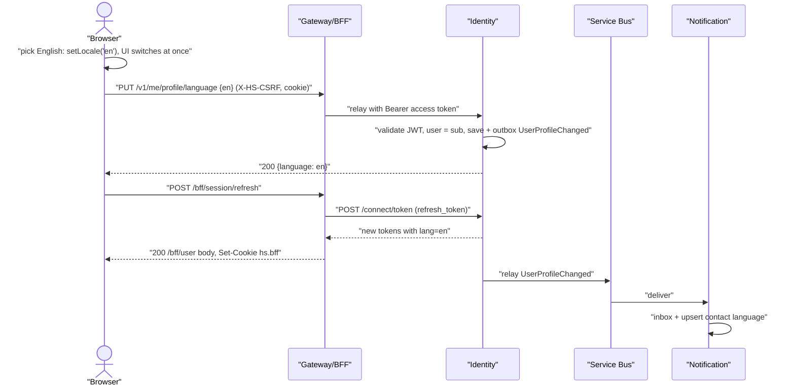

# Technical Design: FEAT-002 — Profile and preferred language

> Feature from: docs/implementation-plan.md · Epic: E1 Identity & Access
> Implements: FR-PROF-001 (avatar shown as a placeholder until FEAT-035), FR-PROF-002, FR-PROF-003, FR-PROF-004, FR-PROF-006, FR-LOC-002; supports FR-LOC-005 (saved language reaches Notification)
> Realizes: UC-027 · Screens: SCR-STF-016 (designed by ui-design)
> Depends on: FEAT-001 (users, tokens, gateway BFF, Notification contacts)
> Status: Draft · Date: 2026-11-19
> Diagram: [design-flow.html](design-flow.html)

## 1. Intent
A signed-in user opens their profile, edits display name, phone, gender and date of birth, and picks Vietnamese or English. The language switches at once and is saved to the profile, so it follows the user to other browsers and into emails. This is the first endpoint that a service protects on its own (architecture §8.1: every service validates the JWT), and the first time a token claim (`name`, `lang`) changes during a session.

## 2. Codebase context
Surveyed on 2026-11-19, against branch `feat/001-register-and-sign-in` (FEAT-001 at task T8). The design conforms to the following.

- **Identity domain:** `User` (`services/identity/src/Identity.Domain/User.cs`) has id, email, normalized email, display name, language (`vi`/`en`), verified-at, roles. No phone, gender, date of birth or avatar. `DisplayName` allows 1–60 chars. Value objects return `(value, Violation?)`; `Violation(Field, Code)`.
- **Application:** handlers return `Result<T>` with `Failure(Code, Violations)` (`Identity.Application/Abstractions/Ports.cs`); ports `IUserRepository`, `IEventOutbox`, `IClock`. Events are queued with `IEventOutbox.Enqueue(eventType, version, correlationId, data)` and commit with `SaveChangesAsync`.
- **Api:** `UsersEndpoints` maps failures to `ApiException` with `FieldError`s; language from `LanguageResolver.Resolve(Accept-Language)`. Identity's only auth scheme is the `hs.idp` cookie. **It does not validate bearer tokens yet** (FEAT-001 §8 deferred this to FEAT-002).
- **Schema:** one migration, `20261119151119_InitialIdentity`. `users.display_name varchar(60)`, `users.language varchar(2)` with check `ck_users_language`.
- **Tokens:** `ConnectEndpoints.BuildPrincipal` puts `sub, email, email_verified, name, lang, role` in the access and ID tokens, re-read from the database on every `/connect/token` exchange. Audience `hivespace-api`.
- **Gateway (FEAT-001 T8, uncommitted):** `/bff/user` reads `name` and `lang` from the access token in the `hs.bff` cookie; `SessionTokens.GetFreshAsync` refreshes only when the token expires within 60 s. So after a profile edit, `/bff/user` is stale for up to 15 minutes. Routes are in `gateway/src/Gateway/appsettings.json`; `/v1/me/*` is not routed. New routes default to `authenticated`. CSRF header `X-HS-CSRF: 1` on non-GET `/v1/*`.
- **Notification:** the contacts projection and dispatcher by `eventType` come from FEAT-001 T9 (not built yet).
- **Web:** `web/packages/core/src/i18n.ts` has `detectLocale` and `setLocale` (localStorage `hs-locale`); its comment says the profile-backed choice arrives with FEAT-002. `StorefrontLayout.vue` hosts `LanguageSwitcher`. FEAT-001 ui-design adds the account dropdown with only "Sign out" ("more items arrive with FEAT-002+").
- **Divergences recorded** (reality wins): (1) the plan entry says `GET/PATCH /v1/me/profile`; the user set a project rule on 2026-11-19 that updates use PUT, never PATCH (D-1, dev-standards §6.7); (2) FEAT-001 chose a 60-char display name with no requirement behind it, while FR-PROF-003 says 80; the user chose 80 everywhere (D-2).

## 3. API contracts

Conventions inherited from FEAT-001: JSON, camelCase, shared `Error` schema, `Accept-Language` sets the message language, `X-HS-CSRF: 1` on non-GET calls through the gateway. **New convention:** updates are `PUT` with the full editable representation (dev-standards §6.7).

### 3.1 Identity REST (gateway route `/v1/me/{**rest}` → identity, policy `authenticated`)

| Endpoint | Auth | Request | Success | Errors |
| :-- | :-- | :-- | :-- | :-- |
| `GET /v1/me/profile` (`getMyProfile`) | bearer | — | `200 Profile` | `401 common.unauthenticated` |
| `PUT /v1/me/profile` (`updateMyProfile`) | bearer | `ProfileUpdate` | `200 Profile` | `400 common.validation_failed` (one `details` entry per invalid field), `401` |
| `PUT /v1/me/profile/language` (`updateMyLanguage`) | bearer | `{language}` | `200 {language}` | `400 common.validation_failed` (`identity.language_unsupported`), `401` |

Schemas:
- `Profile`: `{userId, email, displayName, phone: string|null, gender: Gender|null, dateOfBirth: date|null, avatarUrl: string|null, language: "vi"|"en"}`. `email` is read-only (FR-PROF-004). `avatarUrl` is always `null` until FEAT-035; the UI shows initials.
- `ProfileUpdate`: `{displayName, phone, gender, dateOfBirth}`, all four required keys, the last three nullable (`null` clears the field). `additionalProperties: false`. Language is not part of it: it has its own sub-resource so the header switcher does not need to read and resend the whole profile.
- `Gender`: `male | female | other | prefer_not_to_say` (FR-PROF-002 notes).

Validation rules (FR-PROF-003), each a `details` item `{field, code}`, **all unmet rules listed together**:
- `displayName`: required, trimmed 1–80 chars → `identity.display_name_required`, `identity.display_name_too_long` (existing codes).
- `phone`: optional; spaces, dots and dashes ignored; accepted forms `0` + 9 digits or `+84` + 9 digits, where the first of the 9 digits is `3, 5, 7, 8, 9` (mobile) or `2` (landline area codes) → `identity.phone_invalid`. Stored normalized as E.164 `+84xxxxxxxxx` (D-3); returned in that form.
- `gender`: one of the four values → `identity.gender_invalid`.
- `dateOfBirth`: optional, ISO date `YYYY-MM-DD` → `identity.date_of_birth_invalid` if unparsable; after today in Asia/Ho_Chi_Minh (NFR-L10N-002) → `identity.date_of_birth_in_future`; more than 120 years before today → `identity.date_of_birth_too_old`.
- `email` or any other unknown key in the body → `identity.email_read_only` for `email`, `common.validation_failed` for others (FR-PROF-004).
- `language`: `vi` or `en` → `identity.language_unsupported`.

Behavior notes:
- The user is always `sub` from the validated token. There is no user ID in the path, and `X-User-Id` or a body field is never used to pick the user (FR-ROLE-004 style ownership, D-5).
- `PUT /v1/me/profile` saves and, when display name changed, writes `UserProfileChanged` in the same transaction. Unchanged values still return 200 and write no event.
- `PUT /v1/me/profile/language` saves and, when changed, writes `UserProfileChanged`. Same value → 200, no event (idempotent).
- After either call succeeds the SPA calls `POST /bff/session/refresh` (§3.2) so the header name and `/bff/user` language are current.

### 3.2 Gateway BFF
| Endpoint | Behavior |
| :-- | :-- |
| `POST /bff/session/refresh` (new) | Requires `X-HS-CSRF: 1`. Forces a refresh-token exchange (same single-flight logic as `SessionTokens.GetFreshAsync`, ignoring the 60 s window), rewrites `hs.bff`, returns the `/bff/user` body. No session → `200 {isAuthenticated:false}`; refresh failure → cookie cleared, `200 {isAuthenticated:false}` (consistent with D-9 of FEAT-001). |

Route added: `"me": { "ClusterId": "identity", "Match": { "Path": "/v1/me/{**rest}" } }` (default `authenticated`, below the SPA catch-all order).

### 3.3 OpenAPI and client
- `contracts/openapi/identity.yaml` gains the three operations, the `Profile`, `ProfileUpdate`, `Gender` schemas, and `security: bearer` on them.
- `contracts/openapi/gateway.yaml` gains `POST /bff/session/refresh`.
- `contracts/.spectral.yaml` gains rule `hs-no-patch` (D-1). Client regenerates into `web/packages/api-client`.

### 3.4 Event `UserProfileChanged/v1`
`{userId, email, displayName, language, changedFields: ("displayName"|"language")[]}`, `additionalProperties: false`, producer `identity`. Phone, gender and date of birth never leave Identity (D-6, NFR-LEG-001). Consumer: Notification `contacts` upserts its row (so later emails use the saved language, FR-LOC-005). The architecture event table (§5.4) already lists this event.

### 3.5 Error codes (add to `error-codes.yaml`, with vi and en messages)
`identity.phone_invalid` 400 · `identity.gender_invalid` 400 · `identity.date_of_birth_invalid` 400 · `identity.date_of_birth_in_future` 400 · `identity.date_of_birth_too_old` 400 · `identity.language_unsupported` 400 · `identity.email_read_only` 400. All appear as `details` codes under `common.validation_failed`.

## 4. Schema changes

**Identity database (`identitydb`), EF migration `AddUserProfile`** (after `20261119151119_InitialIdentity`; down reverses each step):

| Change | Detail | Entity |
| :-- | :-- | :-- |
| alter `users.display_name` | `varchar(60)` → `varchar(80)` (D-2; widening, no data change) | User |
| add `users.phone` | `varchar(16) null` (E.164) | User |
| add `users.gender` | `varchar(20) null`, check `ck_users_gender` in (`male`,`female`,`other`,`prefer_not_to_say`) | User |
| add `users.date_of_birth` | `date null` | User |

No index needed (never queried by these fields). Down: drop the three columns and narrow `display_name` back to 60. The down step does not truncate data: if a name longer than 60 exists, Postgres rejects the narrowing and the rollback fails loudly (stated in a comment in the migration).

**Notification:** no schema change; `contacts` (FEAT-001 Alembic `0002`) already holds `display_name` and `language`.

All changes are attributes of the User entity that architecture §5.2 gives to Identity ("profile"). No new entity, no escalation.

## 5. Component design

### 5.1 Flow

### 5.2 Identity
- **Domain:** new value objects `PhoneNumber` (parse and normalize to E.164), `Gender` (enum + parse), `DateOfBirth` (parse; rules take `today` as input), `Language` (`vi`/`en`). `DisplayName.MaxLength = 80`. `User` gains `Phone`, `Gender`, `DateOfBirth` and two methods: `UpdateProfile(DisplayName, PhoneNumber?, Gender?, DateOfBirth?, now)` and `ChangeLanguage(Language, now)`, each returning the changed event-relevant fields. `User.Register` keeps its `language` handling.
- **Application:** `GetMyProfileHandler` (`Guid userId` → `ProfileView`), `UpdateMyProfileHandler` (collects every violation first, then applies), `UpdateMyLanguageHandler`. Both update handlers enqueue `UserProfileChanged` only when `changedFields` is not empty. "Today" for the date rules is `IClock.UtcNow` converted to Asia/Ho_Chi_Minh.
- **Infrastructure:** `IdentityDbContext` maps the three columns and the gender check; migration `AddUserProfile`.
- **Api:** `MeEndpoints` (`/v1/me/profile`, `/v1/me/profile/language`), `.RequireAuthorization("me")`. The body is read as `JsonElement` first so unknown keys (`email`) become field errors instead of being dropped silently. Bearer validation: `AddOpenIddict().AddValidation(o => { o.UseLocalServer(); o.UseAspNetCore(); o.AddAudiences("hivespace-api"); })`, and a `me` policy on the OpenIddict validation scheme. The `hs.idp` cookie scheme stays the default for `/connect/authorize` only; the `me` policy never accepts the cookie (D-5).

### 5.3 Gateway
- `appsettings.json`: route `me`.
- `BffEndpoints`: `POST /bff/session/refresh`; `SessionTokens` gains `ForceRefreshAsync(HttpContext)` that reuses `RefreshOnceAsync` (single-flight per refresh token) and the cookie rewrite. The `/bff/user` body builder is shared by both endpoints.

### 5.4 Notification
- `features/contacts`: handle `UserProfileChanged` → upsert `contacts(user_id)` with `email`, `display_name`, `language`, `updated_at`; inbox makes duplicates no-ops. Validates against `UserProfileChanged/v1.schema.json` (generated `hivespace_contacts` models).

### 5.5 Web (storefront)
- **`features/profile/`**: `api.ts` (only API-client import), `ProfilePage.vue` at `/profile` (SCR-STF-016; layout and states from ui-design), exported through `index.ts`. Route meta `requiresAuth`: with no session, redirect to `/bff/login?returnUrl=/profile`.
- **Session store** (`features/auth`, FEAT-001): gains `refresh()` calling `POST /bff/session/refresh`; the profile feature calls it after a save.
- **Language (FR-LOC-002, UC-027 3, 3a):** `StorefrontLayout`'s switcher calls `setLocale` at once (UI switches), then, when signed in, `PUT /v1/me/profile/language` and the session refresh. A failed save keeps the new UI language for this visit (it is also in localStorage) and shows a toast with the server message. Signed out: browser only, as today.
- **On session load:** when `/bff/user` is signed in and its `language` differs from the active locale, apply it with `setLocale` (so it is also written to localStorage). The profile choice wins over the browser's (D-7).
- **Account menu:** adds "Profile" → `/profile` above "Sign out".
- `core/i18n.ts`: update the comment; no behavior change needed (`setLocale` already writes storage and `<html lang>`).
- **Seller centre:** language stays browser-only until FEAT-009 wires its session; then it calls the same endpoint.

## 6. Acceptance criteria

| # | Criterion | Cites |
| :-- | :-- | :-- |
| AC-1 | Given a signed-in user, `GET /v1/me/profile` returns display name, email, phone, gender, date of birth, avatar (`null`) and language; the profile page shows them, with the email read-only and initials in place of the avatar. | FR-PROF-001, FR-PROF-004, UC-027 1 |
| AC-2 | `PUT /v1/me/profile` with a new display name, phone `0912 345 678`, gender `female` and date of birth `1995-04-30` returns 200; a new `GET` returns the same values with phone `+84912345678`. Sending `null` for phone, gender and date of birth clears them. | FR-PROF-002, UC-027 4 |
| AC-3 | A `PUT` with an empty display name, an 81-char display name (separately), phone `12345`, gender `x`, and a date of birth tomorrow returns 400 `common.validation_failed` with one `details` entry per field, all in one response; a date 121 years ago returns `identity.date_of_birth_too_old`; nothing is saved. | FR-PROF-003, UC-027 4a |
| AC-4 | A `PUT` body containing `email` returns 400 with `details` `{field: email, code: identity.email_read_only}`; the email is unchanged. | FR-PROF-004 |
| AC-5 | `PUT /v1/me/profile/language` with `en` returns 200 and persists; `fr` returns `identity.language_unsupported`; repeating `en` returns 200 and writes no event. | FR-PROF-006, FR-LOC-002 |
| AC-6 | Selecting English while signed in switches the UI before the request completes; after reload, and after signing in from another browser, the UI is English. A visitor's choice is kept only in the browser and sends no request. | FR-LOC-002, UC-027 3, 3a |
| AC-7 | After a successful save and `POST /bff/session/refresh`, `/bff/user` returns the new display name and language without waiting for the 15-minute token expiry. | FR-PROF-002, FR-LOC-002 |
| AC-8 | Changing display name or language writes one `UserProfileChanged` in the same transaction that validates against its schema and contains no phone, gender or date of birth; changing only the phone writes none. Notification receiving it twice updates the contact once. | FR-PROF-006 → FR-LOC-005, NFR-REL-005, NFR-LEG-001 |
| AC-9 | With no session, the three endpoints return 401 at the gateway; called directly with no token, a tampered token or a token for another audience, Identity returns 401. A spoofed `X-User-Id` header never changes whose profile is read or written. | FR-AUTH-015, FR-AUTH-016, architecture §8.1 |
| AC-10 | Error messages for every code in §3.5 come back in the request's language (vi, en); each code has both messages. | FR-LOC-004 |
| AC-11 | Registration now accepts a display name of 61–80 chars and rejects 81 (one rule for both, D-2). | FR-PROF-003, FR-AUTH-004 |
| AC-12 | Gherkin feature `contracts/features/identity/profile.feature` covers the three operations (success and each designed error) and passes in Reqnroll. | dev-standards §9.1 |

## 7. Decisions
- **D-1 Updates use PUT, never PATCH (project rule, user decision 2026-11-19).** `PUT /v1/me/profile` replaces the four editable fields; the language, which the UI changes on its own from the header, is a PUT on the sub-resource `/v1/me/profile/language`. Recorded as dev-standards §6.7 and enforced by Spectral `hs-no-patch`. Rejected: `PATCH` with absent-versus-null semantics (the plan entry's wording).
- **D-2 Display name is 1–80 chars everywhere (user decision 2026-11-19).** Driver: FR-PROF-003 is the only stated limit; FEAT-001's 60 had no requirement behind it. Consequence: column widened, `DisplayName.MaxLength = 80`, FEAT-001's too-long test moves to 81 chars.
- **D-3 Phone stored as E.164 `+84…`.** Driver: one canonical form for later uses (shipping contact, FEAT-022). Accepts the common written forms; rejects anything else. Rejected: a phone library (libphonenumber-csharp) for one country's rules; revisit if more countries arrive.
- **D-4 Forced session refresh after a profile change.** Driver: the header name and the language on reload come from token claims that would be stale for up to 15 minutes (AC-7). Rejected: reading the profile on every `/bff/user` call (an extra Identity call on every page load), and a response-header trigger the gateway acts on (hidden coupling through the proxy).
- **D-5 Identity validates bearer tokens with OpenIddict local validation.** Driver: architecture §8.1 (every service validates the JWT) and FEAT-001 §8. Identity is the issuer, so `UseLocalServer()` needs no JWKS fetch. The shared .NET validation setup for other services is built with the first protected non-Identity endpoint (FEAT-009 or FEAT-012). Rejected: trusting `X-User-Id` from the gateway.
- **D-6 `UserProfileChanged` carries only what consumers use** (email, display name, language). Driver: NFR-LEG-001 data minimisation; no consumer needs phone, gender or date of birth.
- **D-7 After sign-in the profile language wins over the browser's saved choice.** Driver: FR-LOC-002 makes the profile the store for signed-in users; otherwise two browsers would disagree.

## 8. Escalations & open items
- **Plan correction suggested (implementation-planning owns it):** FEAT-002 row says `GET/PATCH /v1/me/profile`; it should read `GET/PUT /v1/me/profile`, `PUT /v1/me/profile/language` (D-1).
- **Dependencies:** FEAT-001 T8 (gateway BFF and token relay) must be done before T6, and FEAT-001 T9 (Notification contacts and dispatcher) before T7.
- **Deferred, named:** avatar upload and display (FEAT-035, FR-MEDIA-001; FR-PROF-001 is partial for the avatar until then); seller-centre language persistence (FEAT-009); masked public profile (FR-PROF-005, FEAT-033).
- **No architecture escalation:** profile fields are attributes of the existing User entity owned by Identity.
