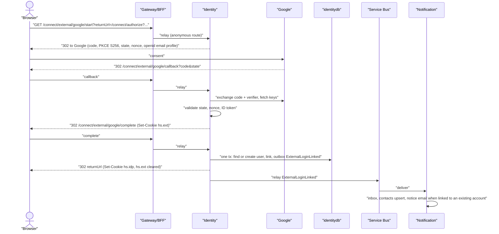

# Technical Design: FEAT-004 — Google sign-in with auto-link

> Feature from: docs/implementation-plan.md · Epic: E1 Identity & Access
> Implements: FR-AUTH-020, FR-AUTH-021, FR-AUTH-022, FR-AUTH-023, FR-AUTH-026, FR-NOTIF-015, EIR-SW-006, NFR-SEC-014
> Realizes: UC-025 (main flow, alternate 3a, exceptions 1a and 2a); UC-002 (the no-password case, FR-AUTH-026) · Screens: SCR-STF-012 and SCR-STF-013 (designed by ui-design)
> Depends on: FEAT-001 (credential, argon2id hasher, OpenIddict tokens, `/signin` page, gateway BFF, Notification emails), FEAT-003 (the `pwd_at` stamp on `hs.idp`, `ISessionRevoker`, `identity.password_not_set`)
> Status: Verified (self-check clean); D-5 confirmed by the user 2026-11-23 · Date: 2026-11-23
> Diagram: [design-flow.html](design-flow.html) (interactive flow diagram, html-flow-diagram)

## 1. Intent
A visitor signs in with Google on the sign-in screen. A new verified Buyer account is created when the verified Google email matches nobody, and the Google identity is linked to the existing account when it does. The owner of a linked account gets a notice email. Google being down, refused or invalid never blocks password sign-in. This is the last Must slice of Identity, it completes UC-025, and it is the first feature that lets an account exist **without a password** (FR-AUTH-026), which FEAT-003 already prepared for (`identity.password_not_set`).

## 2. Codebase context
Surveyed on 2026-11-23 on branch `feat/003-change-password` (FEAT-003 is done there but not merged to `main`; FEAT-004 must start from a branch that contains it, see §8). The design conforms to the following.

- **Identity domain:** `User.Register(...)` makes an unverified Buyer; `Credential` is a separate optional row (FEAT-001 D-8), with `Stamp` = `UpdatedAt` in Unix ms. `VerificationToken.Invalidate(now)` exists. `DisplayName.Create` trims and rejects more than 80 characters.
- **Application:** handlers return `Result<T>`; `IUserRepository.SaveChangesAsync` commits everything including outbox rows and maps the unique index on the normalized email to `EmailInUseException`; `ISessionRevoker.RevokeOtherSessionsAsync(userId, keep)` stages revocations in the same unit of work (FEAT-003 D-2); `IEventOutbox.Enqueue(type, version, key, data)`. `SignInHandler` already fails the same way for "no credential" as for a wrong password and runs a dummy hash check first (FR-AUTH-010), so FR-AUTH-026 holds in code today and needs only a test.
- **Api:** the storefront `/signin` page is the sign-in UI, reached from `/connect/authorize` when `hs.idp` is missing (FEAT-001 D-1). `POST /v1/users/sign-in` verifies and calls `SignInAsync("hs.idp", ToPrincipal(user, stamp))`, then returns a `redirectUrl` that `SignInHandler.SafeRedirect` limits to `/connect/authorize…` or `/`. `ConnectEndpoints.AuthorizeAsync` accepts `hs.idp` only when its `pwd_at` matches the credential's stamp (FEAT-003 D-4).
- **Gateway:** route `/connect/{**rest}` → identity is `anonymous`; it strips only its own `hs.bff*` cookies; CSRF header applies to non-GET only. A browser navigation to `/connect/external/google/*` therefore passes, with Identity's `Set-Cookie` headers and redirects coming back. **No gateway change is needed.** Identity's public origin is `Identity:Issuer` (the storefront origin, ADR-0027); the seller centre signs in through the same storefront Identity host.
- **Schema:** last migration `20261120171033_AddUserProfile` (FEAT-003 added none). Tables: `users`, `role_grants`, `credentials`, `verification_tokens`, outbox/inbox, OpenIddict.
- **Notification:** `features/emails/service.py` has a template table `KINDS` keyed by event type (FEAT-003); `email_records` is unique on `(event_id, template)`; the `contacts` projection is fed by `CONTACT_EVENTS` (`UserRegistered`, `VerificationEmailRequested`, `UserProfileChanged`).
- **Web:** `features/auth/SignInPage.vue` (SCR-STF-012) renders the password form only; its Google button and divider are hidden until this feature (FEAT-001 ui-design). Navigation to Identity uses `goTo` from `features/auth/navigation.ts`.
- **Tests:** `tests/contract` (cucumber-js over `contracts/features/`), `tests/e2e` (playwright-bdd, local AppHost stack), Identity integration tests with Testcontainers and `IdentityApiFactory`.
- **Divergences recorded** (reality wins):
  1. Architecture §6.4 draws a "hosted login page" served by Identity with the Google button. Reality: the sign-in page is the storefront SPA (`/signin`), and the button is a browser navigation to Identity through the gateway. The sequence of calls is the same.
  2. FR-AUTH-020's note says the Google picture prefills the profile. The profile has no avatar yet (FEAT-035), so only the display name is prefilled here (§8).
  3. The plan's data column says only "External login"; this feature also needs the `ExternalLoginLinked` flag fields in §3.3.

## 3. API contracts

Google sign-in is a **browser redirect flow**, not a JSON API. Like `/connect/*` (which `contracts/openapi/identity.yaml` also leaves out), its three endpoints are described here and covered by a Gherkin feature, not added to the OpenAPI operations (so no client is generated for them). There is **no new JSON endpoint**. Conventions inherited: errors are stable codes from `contracts/errors/error-codes.yaml` with vi and en messages; the SPA shows them from its own i18n keys because a redirect has no body.

### 3.1 Identity browser endpoints (gateway route `/connect/{**rest}`, anonymous)

| Endpoint | What it does | Result |
| :-- | :-- | :-- |
| `GET /connect/external/{provider}/start?returnUrl=` | Starts the flow. `provider` is a registered name (`google`); unknown → `404`. `returnUrl` is kept only when it passes `SignInHandler.SafeRedirect` (local `/connect/authorize…`), otherwise dropped. | `302` to Google (§3.2), or `302 /signin?error=identity.external_login_unavailable[&returnUrl=…]` when Google or its metadata cannot be reached within 5 s (UC-025 1a) |
| `GET /connect/external/{provider}/callback` | Google's redirect URI, handled by the OpenID Connect handler, never by our code. It validates state, nonce and the ID token (§3.2), then writes the short-lived `hs.ext` cookie. | `302 /connect/external/{provider}/complete`, or on any failure `302 /signin?error=<code>[&returnUrl=…]` (§3.4) and no cookie |
| `GET /connect/external/{provider}/complete` | Reads `hs.ext` once, clears it, maps the claims to an `ExternalIdentity`, runs the account decision (§5.2) and starts the Identity session. | Success: `Set-Cookie hs.idp` (with `pwd_at` when the account has a password) and `302` to the safe `returnUrl` (or `/`). Failure: `302 /signin?error=<code>[&returnUrl=…]`. A second call, or one with no `hs.ext`, gets `identity.external_login_failed`. |

After the success redirect the flow is the existing one: `/connect/authorize` finds `hs.idp`, issues the code, and the gateway callback sets the BFF cookie (architecture §6.4). Google tokens are never stored or sent anywhere.

### 3.2 Google request and response rules (NFR-SEC-014, EIR-SW-006)
- Authorization code flow with **PKCE S256**, `response_type=code`, `response_mode=query`, a random `state` and `nonce` bound to the browser by correlation and nonce cookies. `scope` is exactly `openid email profile`. `prompt=select_account`.
- `redirect_uri` is fixed as `{Identity:Issuer}/connect/external/google/callback` (D-8) on both the authorize and the token request, and registered at Google.
- The ID token must pass: signature against Google's JWKS (from discovery), `iss` equal to the discovered issuer (`https://accounts.google.com`), `aud` equal to our client id, not expired (60 s clock skew), `nonce` equal to ours. `GetClaimsFromUserInfoEndpoint=false`; `SaveTokens=false`.
- Claims read: `sub` (required), `email`, `email_verified` (boolean true or the string `"true"`), `name`. Anything else is ignored.
- Google calls have a 5 s timeout (NFR-REL-008). Metadata is cached; after a failure it retries after 30 s, so Google coming back is noticed quickly.

### 3.3 Event `ExternalLoginLinked/v1` (producer `identity`, consumer Notification)
`{userId: uuid, email: string ≤254, displayName: string ≤80, language: "vi"|"en", provider: "google", accountCreated: boolean, passwordRemoved: boolean, linkedAt: date-time}`, all required, `additionalProperties: false`. No token, subject or password. The architecture event table (§5.4) already lists `ExternalLoginLinked`. It is also the only event for a Google-created account (D-3): it feeds the contacts projection, and Notification sends the notice only when `accountCreated` is false.

### 3.4 Error codes (redirect `?error=`, provider-neutral)
New in `contracts/errors/error-codes.yaml` with vi and en messages. The `http` value is the nearest status; these codes only travel in the redirect.

| Code | `http` | When | Traces to |
| :-- | :-- | :-- | :-- |
| `identity.external_login_denied` | 401 | Google returns `error=access_denied` (consent denied) | FR-AUTH-022, UC-025 2a |
| `identity.external_email_unverified` | 401 | `email_verified` is not true, or `email` is missing | FR-AUTH-022, UC-025 2a |
| `identity.external_login_failed` | 401 | Invalid response: bad state, nonce, signature, issuer, audience, expiry; any other Google `error`; missing `sub`; unusable email; this account already has a different Google identity; a lost race that retrying did not settle; `complete` with no `hs.ext` | FR-AUTH-022, NFR-SEC-014 |
| `identity.external_login_unavailable` | 503 | Metadata, token or JWKS request fails or times out; Google `error=temporarily_unavailable` or `server_error` | FR-AUTH-023, UC-025 1a, NFR-REL-008 |

In every failure the visitor stays signed out (no `hs.idp`, no `hs.ext`, no account or link written), and email-and-password sign-in is untouched.

### 3.5 Unchanged contracts that gain a test
- `POST /v1/users/sign-in` for an account with no credential: `401 identity.invalid_credentials`, the same body as an unknown email (FR-AUTH-026; code already behaves so).
- `PUT /v1/me/password` for such an account: `409 identity.password_not_set` (FEAT-003, now reachable).

### 3.6 Events, configuration and files
- `contracts/events/ExternalLoginLinked/v1.schema.json`.
- `contracts/features/identity/google-sign-in.feature` (tags `@FR-…`, `@UC-025`; browser endpoints are not OpenAPI operations, so the operation-coverage script is not affected).
- Configuration `Identity:Google:ClientId`, `ClientSecret`, `Authority` (default `https://accounts.google.com`). With no `ClientId` the provider is not registered and `start` answers `identity.external_login_unavailable`. Secrets come from environment, never the repo (NFR-SEC-007).

## 4. Schema changes

One migration `AddExternalLogins` after `20261120171033_AddUserProfile` (down drops the table).

| Table | Columns and constraints | Entity |
| :-- | :-- | :-- |
| `external_logins` (new) | `id uuid pk` (UUID v7), `user_id uuid not null fk users(id) on delete cascade`, `provider varchar(32) not null`, `subject varchar(255) not null` (the IdP `sub`), `linked_at timestamptz not null`; **unique `(provider, subject)`**; **unique `(user_id, provider)`**; index on `user_id` is covered by the second unique index | ExternalLogin (Identity) |

- No change to `users` or `credentials`. A Google-created user simply has no `credentials` row (FEAT-001 D-8). Linking an unverified account **deletes** its credential row (D-5).
- The Google email is not stored on the link: the account's own `users.email` is the one address (NFR-LEG-001). Nothing else from Google is stored.
- Notification: no schema change. `email_records.template varchar(64)` fits `external_login_linked`.

Entities touched: ExternalLogin, User, Credential (Identity, architecture §5.2 "Google and other external logins"). No new entity, no escalation.

## 5. Component design

### 5.1 Flow

After the last redirect the browser follows the normal path: `/connect/authorize` → code → gateway callback → BFF cookie.

### 5.2 Identity
- **Domain**
  - `ExternalLogin` entity `{Id, UserId, Provider, Subject, LinkedAt}` with `ExternalLogin.Link(userId, provider, subject, now)`.
  - `User.RegisterExternal(Email, DisplayName, language, now)`: like `Register`, but `EmailVerifiedAt = now` (FR-AUTH-020), Buyer role.
- **Application** (`Features/ExternalLogin/`)
  - `ExternalIdentity(Provider, Subject, Email?, EmailVerified, Name?)` and `ExternalSignInCommand(Identity, Language)`.
  - `ExternalSignInHandler` returns `Result<ExternalSignInOutcome(User, long? PasswordStamp)>`:
    1. Invalid input (empty subject, unusable email, unknown provider) → `identity.external_login_failed`.
    2. **Known identity:** an `external_logins` row for `(provider, subject)` → that user signs in. Nothing is written, no event (D-4). This also holds when the Google email has changed since.
    3. `EmailVerified` false → `identity.external_email_unverified`.
    4. **Existing account** with the same normalized email (FR-AUTH-021):
       - the user already has a link for this provider with a different subject → `identity.external_login_failed`;
       - otherwise add the link. When the account's email was **unverified** (D-5): `VerifyEmail(now)`, remove its credential, invalidate its pending verification tokens, `ISessionRevoker.RevokeOtherSessionsAsync(user.Id, null)`, `passwordRemoved = true`;
       - enqueue `ExternalLoginLinked` with `accountCreated = false`.
    5. **No account** (FR-AUTH-020): display name = Google `name` trimmed and cut to 80 characters, or the local part of the email when empty; `User.RegisterExternal`, no credential, no verification token; add the link; enqueue `ExternalLoginLinked` with `accountCreated = true`. The language comes from the request's `Accept-Language` (`LanguageResolver`).
    6. One `SaveChangesAsync`. A unique violation on the email or on the link (two first sign-ins racing) is mapped to a conflict exception, and the handler **repeats from step 2 once**; a second conflict → `identity.external_login_failed`.
    7. The outcome carries the credential stamp, or null when the account has no credential.
  - New repository members: `FindExternalLoginAsync(provider, subject)`, `FindExternalLoginByUserAsync(userId, provider)`, `Add(User)` (no credential), `AddExternalLogin(link)`, `RemoveCredential(credential)`.
- **Infrastructure:** `ExternalLogin` mapping in `IdentityDbContext` (table `external_logins`, the two unique indexes); the migration; `EfUserRepository` maps their unique violations to `ExternalLoginConflictException`.
- **Api** (`External/`)
  - `ExternalLoginProviders` is the registry (`IExternalLoginProvider`: `Name`, `Scheme`, `Map(ClaimsPrincipal) → ExternalIdentity`). `google` is registered only when `Identity:Google:ClientId` is set. A second provider is one more registration and claim map (architecture §8, ADR-0008).
  - Authentication wiring, in one extension `AddExternalLogins`:
    - cookie scheme `hs.ext`: HttpOnly, SameSite Lax, 10 minutes, used only as the `SignInScheme`;
    - `AddOpenIdConnect("google", …)` with the rules of §3.2, `CallbackPath = /connect/external/google/callback`, `MapInboundClaims = false`, correlation and nonce cookies **SameSite Lax** (the callback is a top-level GET, and Lax works on plain `http://localhost`, where `SameSite=None` without `Secure` is dropped), a custom `ConfigurationManager` with `RefreshInterval` 30 s, `BackchannelTimeout` 5 s, and `RequireHttpsMetadata` false only for a loopback Authority;
    - events: `OnRedirectToIdentityProvider` fixes `redirect_uri` and mirrors it into the handler's redeem-URI property (D-8); `OnMessageReceived` turns a Google `error` into a code; `OnRemoteFailure` turns any other failure into a code and redirects. Both go through one pure function `ExternalFailure.Classify(error, exception)` → one of the §3.4 codes (HTTP or timeout exceptions → unavailable; everything else → failed).
  - `start`: validates the provider and `returnUrl`; before issuing the challenge it awaits the provider's OIDC configuration under a 5 s timeout, so a down Google produces the `unavailable` redirect instead of a 500. It stores `returnUrl` in the challenge properties and sets `RedirectUri = /connect/external/{provider}/complete`.
  - `complete`: authenticates `hs.ext`, signs it out, maps, calls the handler, then `SignInAsync("hs.idp", ToPrincipal(user, stamp))` and redirects to `SafeRedirect(returnUrl)`.
  - **`ConnectEndpoints.PasswordStampMatchesAsync` becomes an exact match** (D-5): the cookie's `pwd_at` must equal the credential's stamp, and a cookie with `pwd_at` and **no credential** no longer signs in silently. Before, a missing credential always passed.
- **Logging:** one information line per outcome with provider, outcome code and user id. Never the code, state, tokens, claims, client secret or email (NFR-SEC-008).

### 5.3 Notification
- `features/emails/service.py`: `KINDS` gains `"ExternalLoginLinked"` → template `external_login_linked`, with an `applies(data)` check that is true only when `accountCreated` is false. A skipped event writes no `email_records` row and sends nothing. Subjects: "Google account linked to HiveSpace" / "Tài khoản Google đã được liên kết với HiveSpace".
- `features/emails/events.py`: pydantic `ExternalLoginLinked` mirroring the schema, validated by the dispatcher before any write, with a schema-sync unit test (the FEAT-002 pattern).
- `features/contacts`: `CONTACT_EVENTS` gains `ExternalLoginLinked`, so a Google-created user has a contact row (needed by later order emails).
- Templates `external_login_linked.{vi,en}.{txt,html}`: greeting with the display name; "your Google account was linked to your HiveSpace account at {time}" with `linkedAt` in Asia/Ho_Chi_Minh as `HH:mm dd/MM/yyyy` (NFR-L10N-002); "you can now sign in with Google"; a second paragraph only when `passwordRemoved` ("this email was not verified, so for your security the earlier password was removed; you can keep signing in with Google and set a new password later from your profile"); "if this was not you, contact HiveSpace support". No link and no token.

### 5.4 Gateway
No change. The anonymous `connect` route, cookie pass-through and the existing BFF callback cover the flow.

### 5.5 Web (storefront, SCR-STF-012)
- `features/auth/SignInPage.vue` and `RegisterPage.vue` show the **Google button** and an "or" divider above their forms, as ui-design places them (one shared `GoogleButton` component). A click calls `goTo('/connect/external/google/start?returnUrl=' + encodeURIComponent(returnUrl))`: a full-page navigation, no fetch, so no generated-client call exists for it.
- The page reads `?error=`: a known code shows an `Alert` with its vi/en message (`auth.errors.<code>`). For `identity.external_login_unavailable` the message says Google is unavailable and points to email and password (FR-AUTH-023); the form stays usable in every case. An unknown value is ignored.
- `returnUrl` is kept through the round trip, which is also why failures redirect with it: without it the page would restart the BFF login (its existing `starting` rule).
- vi and en keys for the button label, the four messages; the key-parity check covers them. A Google attempt started on Register also fails back to `/signin?error=…` (ui-design D-E).

### 5.6 Fake IdP and local wiring
- `tools/fake-idp/` is a small ASP.NET Core app that behaves as an OpenID Connect provider: discovery, JWKS, `/authorize` (checks `client_id`, `redirect_uri`, S256 challenge; auto-consents and redirects with `code` and `state`), `/token` (checks the client secret and the PKCE verifier, returns a signed ID token echoing the nonce). `POST /__fake/next` sets the next outcome and identity: `ok`, `denied`, `unverified`, `no_email`, `bad_signature`, `wrong_audience`, `wrong_issuer`, `expired`, `wrong_nonce`, `down`. It is used by the Identity integration tests (started in-process), by the AppHost and by E2E (D-7). It is never deployed.
- AppHost: when `.local/dev-secrets/google.json` (a real test client, OQ-32) is absent, it starts the fake IdP on a fixed local port and sets `Identity__Google__*` to it; otherwise it passes the real values. `docs/repo-structure.md` lists the new `tools/fake-idp/`.

## 6. Acceptance criteria

"The fake IdP" is `tools/fake-idp` (§5.6). "Signed in" means the browser ends the redirect chain holding the BFF session of the storefront.

| # | Criterion | Cites |
| :-- | :-- | :-- |
| AC-1 | Given a Google identity with a verified email that matches no account, the flow ends signed in. The user exists with Buyer role, `email_verified` true, the Google name as display name, **no `credentials` row and no verification token**, one `external_logins` row, and exactly one outbox row `ExternalLoginLinked` with `accountCreated: true`. No `UserRegistered` is written. | FR-AUTH-020, UC-025 1–4 |
| AC-2 | Given an account with a verified email and a password, the same verified Google email links to **that user** (same id) and signs in. The password still works. One link row; one `ExternalLoginLinked` with `accountCreated: false`, `passwordRemoved: false`. | FR-AUTH-021, UC-025 3a |
| AC-3 | Given an account whose email is **unverified** (registered by password, never verified), linking marks the email verified, deletes its credential, revokes all its OpenIddict authorizations and tokens, invalidates its pending verification tokens, and writes the event with `passwordRemoved: true`. A password sign-in with the old password then gets `identity.invalid_credentials`. An `hs.idp` cookie issued earlier for that account (with `pwd_at`) is sent to `/signin` at `/connect/authorize` and cleared. | FR-AUTH-021, NFR-SEC-015, D-5 |
| AC-4 | A returning Google identity (known `(provider, subject)`) signs in with no new link row and no event, even when the Google email now differs from the account's. Another account holding that email is not touched. | FR-AUTH-020, FR-AUTH-021, D-4 |
| AC-5 | A response with `email_verified: false` or with no `email` ends at `/signin?error=identity.external_email_unverified` (with `returnUrl`). No `hs.idp`, no user, no link, no outbox row. | FR-AUTH-022, UC-025 2a |
| AC-6 | Each of these ends at `/signin?error=…` with no session and no writes: consent denied → `identity.external_login_denied`; Google `error=server_error` → `identity.external_login_unavailable`; wrong signature, wrong issuer, wrong audience, expired token, wrong nonce, tampered or missing `state`, a PKCE verifier mismatch, a missing `sub`, an account already linked to a different Google subject, a replayed `complete` → `identity.external_login_failed`. | FR-AUTH-022, NFR-SEC-014, UC-025 2a |
| AC-7 | The redirect to Google carries `response_type=code`, `code_challenge_method=S256`, a `code_challenge`, `state`, `nonce`, `scope=openid email profile` exactly, and `redirect_uri={Issuer}/connect/external/google/callback`. The token request uses the same `redirect_uri`. No Google token or code is stored in a cookie, database row or log, and `hs.ext` is gone after `complete`. | NFR-SEC-014, EIR-SW-006, NFR-SEC-008 |
| AC-8 | With the fake IdP down (discovery unreachable, or the token endpoint refusing connections), `start` or `callback` redirects to `/signin?error=identity.external_login_unavailable` within about 5 s, never a 500. In the same run, email-and-password sign-in succeeds. After the fake IdP is back, the next attempt works within 30 s. | FR-AUTH-023, NFR-REL-008, UC-025 1a |
| AC-9 | For a Google-created account, `POST /v1/users/sign-in` with its email and any password returns `401 identity.invalid_credentials`, identical in body to an unknown email. `PUT /v1/me/password` for it returns `409 identity.password_not_set`. | FR-AUTH-026, UC-002 |
| AC-10 | `returnUrl` is honored only when it is a local `/connect/authorize…` path; `https://evil.example/…` and `/cart` end at `/`. An error redirect keeps a valid `returnUrl` and drops an invalid one. `provider` unknown → 404. | FR-AUTH-020, UC-025, FEAT-001 AC-17 |
| AC-11 | Two simultaneous first sign-ins for the same new Google identity create one user and one link and both sign in. Two Google identities cannot link to one account (unique `(user_id, provider)`). | FR-AUTH-020, NFR-REL-005 |
| AC-12 | Notification: one `ExternalLoginLinked` with `accountCreated: false` gives one `email_records` row, template `external_login_linked`, and one email in the user's language (vi and en), with the time in Asia/Ho_Chi_Minh and the extra paragraph only when `passwordRemoved`. With `accountCreated: true` it sends nothing but still upserts the contact. Delivering the event twice sends one email. The payload validates against `ExternalLoginLinked/v1`. | FR-NOTIF-015, FR-LOC-005, NFR-REL-005 |
| AC-13 | On SCR-STF-012 and SCR-STF-013 the Google button navigates to `start` with the page's `returnUrl`. Each of the four `?error=` codes shows its message in vi and en, the unavailable message points to email and password, and the password form still works. Unknown `error` values show nothing. | FR-AUTH-022, FR-AUTH-023, FR-LOC-004 |
| AC-14 | E2E against the fake IdP: from the storefront, a visitor chooses Sign in with Google and ends signed in with the Google name in the header. A second run with a password account of the same email links and signs in. | UC-025, architecture §8.6 |
| AC-15 | `contracts/features/identity/google-sign-in.feature` passes on the cucumber-js runner: the `start` redirect shape (AC-7), the unavailable redirect, `returnUrl` handling (AC-10), unknown provider 404, and the no-password sign-in (AC-9). | dev-standards §9.1, ADR-0025 |
| AC-16 | The three layers hold: Identity architecture tests (Api → Application → Domain; no OIDC or ASP.NET type in Domain or Application). Notification import-linter passes. No client secret, code or token appears in the log output of the integration run. | dev-standards §5, NFR-SEC-007, NFR-SEC-008 |

## 7. Decisions
- **D-1 The ASP.NET Core OpenID Connect handler behind a small provider registry.**
  - Driver: NFR-SEC-014 asks for PKCE, state, nonce and ID-token validation, which the handler implements and tests; ADR-0008 and architecture §8 want a second provider to be configuration plus a claim map; the fake IdP only needs a different `Authority`.
  - Rejected: `Microsoft.AspNetCore.Authentication.Google` (OAuth2 plus user-info, no ID-token validation, Google-only); a hand-written client (more code and more security risk for no gain).
  - Teaches: how ASP.NET Core remote authentication handlers, correlation cookies and `OnRemoteFailure` fit together.
- **D-2 Two steps: the handler only authenticates, our `complete` endpoint decides.** The handler writes `hs.ext` (the Google principal, nothing else); the account decision runs in `ExternalSignInHandler` (Application), which is unit-testable and keeps the OIDC types in Api. Rejected: deciding inside handler events (untestable, mixes protocol and business rules).
- **D-3 One event for both created and linked: `ExternalLoginLinked` with `accountCreated`.**
  - Driver: the plan and architecture name this event only; Notification needs the contact for a Google-created user; `UserRegistered` carries a mandatory verification token and would trigger a verification email, against FR-AUTH-020.
  - Rejected: making the token optional in `UserRegistered/v1` (changes a published contract); a second event the architecture table does not list.
- **D-4 Match by `(provider, subject)` first, then by verified email.** Driver: `sub` is the only stable Google identifier; a changed Google email must not detach or re-link an account. FR-AUTH-021 auto-link applies to the first link only.
- **D-5 Linking to an account whose email was never verified drops its password and sessions.**
  - Driver: pre-account-hijacking. Someone could register `victim@gmail.com` with their own password (unverified, FR-AUTH-001); if the real owner later signs in with Google, plain linking would leave the attacker holding a working password and refresh tokens on the owner's account. Google proved the email, nobody proved the password.
  - What it does: verify the email, delete the credential, revoke every authorization, invalidate pending verification tokens, and tell the owner in the notice (`passwordRemoved`). The strict `pwd_at` rule (§5.2) also stops an old `hs.idp` cookie from signing in silently once the credential is gone.
  - Consequence: the account is Google-only until a password is set (FR-AUTH-027, FEAT-005). A genuine owner who had registered by password but not verified loses that password. FR-AUTH-021 says only "link and sign in", so this is an addition. **Confirmed by the user (2026-11-23), with a hybrid approach:** delete and notify now, and the owner sets a new password later through FEAT-005. The notice email therefore tells them that the old password was removed, why, and that they can set a new one later from their profile once that is available; sign-in with Google keeps working meanwhile.
  - Considered and not chosen for this feature: forcing a "set a new password" step right after the link. It would pull FR-AUTH-027 and its re-authentication question (OQ-33) forward from FEAT-005. The old password still has to be deleted at link time, because it is the one at risk.
  - Rejected: keeping the password (leaves the takeover open); refusing to link unverified accounts (contradicts FR-AUTH-021).
- **D-6 Failures are redirects with a stable code in `?error=`, localized by the SPA.** Driver: the flow is a chain of browser navigations, so there is no JSON body; FR-LOC-004 wants stable codes; the SPA already owns its vi/en strings. Rejected: a session cookie carrying a flash message (state for a one-off).
- **D-7 The fake IdP is a real OIDC server in `tools/fake-idp`, shared.** Driver: dev-standards §10 requires "integration test with a fake IdP" for NFR-SEC-014, and architecture §8.6 requires a UC-025 E2E run against one. A stubbed handler would not exercise discovery, PKCE or signature checks. One implementation serves integration tests, the AppHost and E2E.
- **D-8 The redirect URI is built from `Identity:Issuer`, not from the incoming request.** Driver: Identity sits behind the gateway (ADR-0027), so the request host is internal; Google needs one exact registered URI. The value is set on both the authorize and the code-redeem request (AC-7 tests both).
- **D-9 Unlinking, merging accounts and storing the Google picture are not built.** No requirement asks for them (§8).

## 8. Escalations & open items
- **Confirmed call beyond the SRS text:** D-5. FR-AUTH-021 says "link and sign in"; this design also removes the password of an unverified account at that moment, to close a takeover. The user confirmed it on 2026-11-23 with the hybrid approach (delete and notify now, set a new password later in FEAT-005). FEAT-005 should link its set-password step from the notice email.
- **Prerequisite:** FEAT-003 is not on `main` yet (branch `feat/003-change-password`). FEAT-004 relies on its `pwd_at` stamp, `ISessionRevoker` and `password_not_set`; merge it first.
- **No architecture escalation:** ExternalLogin is part of Identity's owned model (architecture §5.2), and `ExternalLoginLinked` is in the event table. The event gains two flags (`accountCreated`, `passwordRemoved`) that the table's description ("carry email, language, display name") does not mention; the table needs no change.
- **Plan suggestion (implementation-planning owns it):** the FEAT-004 row should list SCR-STF-013 next to SCR-STF-012 (the user added the Google button to Register during ui-design), and could name `tools/fake-idp` in its blocks, since AC-14 and the integration tests depend on it. Plan item P-4 (OQ-32 Google Cloud project) blocks only a **manual real-Google run**, not CI: everything here runs on the fake IdP. Create the Google client with test users before the demo release and put its values in `.local/dev-secrets/google.json`.
- **Doc updates the implementation owes:** `docs/repo-structure.md` (new `tools/fake-idp/`), and FEAT-003's design note on `hs.idp` (§3.2 there: the stamp rule is now exact, including "no credential").
- **Deferred, named:**
  - Google picture prefill (FR-AUTH-020 note): needs the avatar (FEAT-035); only the name is prefilled.
  - Audit log of sign-ins (NFR-SEC-009), lockout and rate limits on the callback (FR-AUTH-011/012, NFR-SEC-005), and setting a first password for Google-only accounts (FR-AUTH-027, OQ-33): FEAT-005. Until then the Google endpoints have no attempt limit beyond Google's own consent step.
  - Linking Google from a signed-in account, unlinking, and a second provider: no requirement.
  - Notification retries: FEAT-032, as for the other emails.
- **For ui-design:** done, see [ui-design.md](ui-design.md) (SCR-STF-012 and SCR-STF-013).
