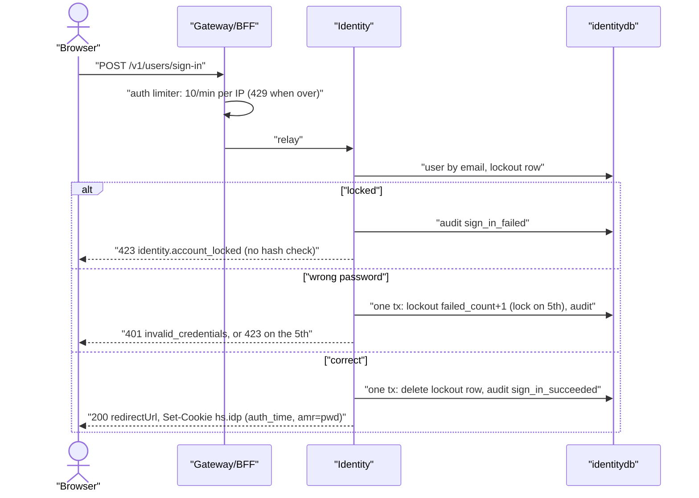
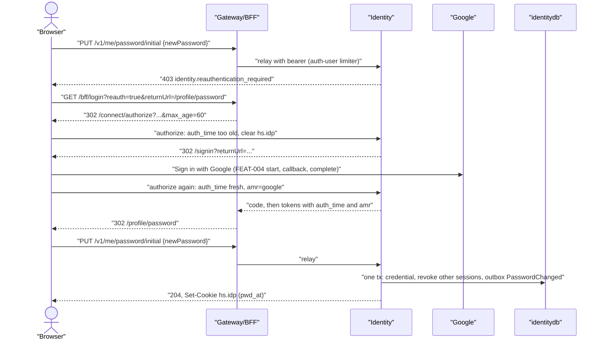

# Technical Design: FEAT-005 — Account hardening: lockout, set a password, rate limits, audit

> Feature from: docs/implementation-plan.md · Epic: E1 Identity & Access
> Implements: FR-AUTH-011, FR-AUTH-012, FR-AUTH-027; binding NFRs NFR-SEC-005, NFR-SEC-009 (sign-in part); the FR-AUTH-025 note (wrong current password counts toward lockout)
> Realizes: UC-002 (exception 2b), UC-026 (alternate 1a, and the lockout side of 2a) · Screens: SCR-STF-012, SCR-STF-018, and the Password card of SCR-STF-016 (designed by ui-design)
> Depends on: FEAT-001 (sign-in, `hs.idp`, OpenIddict, gateway `auth` limiter hook), FEAT-003 (`PUT /v1/me/password`, `pwd_at`, `ISessionRevoker`, `PasswordChanged`), FEAT-004 (Google sign-in, `external_logins`, exact `pwd_at` rule, Google-only accounts)
> Status: Verified (self-check clean); D-2, D-5 and D-7 confirmed by the user 2026-11-23 · Date: 2026-11-23
> Diagram: [design-flow.html](design-flow.html) (interactive flow diagram, html-flow-diagram)

## 1. Intent
Closes the Should-level security gaps the first four Identity slices left open on purpose. Five wrong passwords in 15 minutes lock an account for 15 minutes; the gateway enforces the NFR-SEC-005 request limits; sign-ins and lockouts are written to an audit log kept 90 days; and a user whose account has no password (Google-created, or whose password FEAT-004 removed) can set one after a recent Google sign-in. Every earlier feature design names this one as the place these land.

## 2. Codebase context
Surveyed on 2026-11-23 on branch `feat/004-google-sign-in` (FEAT-003 is merged; FEAT-004 has only its design, no code).

- **Prerequisite:** FEAT-004 is designed, not built. FR-AUTH-027 needs a Google-only account and the Google endpoints; the Google audit rows and the callback limit attach to FEAT-004's `complete` endpoint and gateway path. FEAT-005 is built **after FEAT-004 is merged** (§8). Everything below cites FEAT-004's design for those parts.
- **Identity Application:** handlers return `Result<T>`; `IUserRepository.SaveChangesAsync` commits everything, including outbox rows, in one transaction and maps the email unique index to `EmailInUseException`. `SignInHandler` runs a dummy hash check when there is no credential (FR-AUTH-010) and today writes nothing. `ChangeMyPasswordHandler` checks current password and policy together, then changes the credential, revokes other sessions (`ISessionRevoker`) and enqueues `PasswordChanged`. `IPasswordHasher` is argon2id.
- **Identity Api:** `POST /v1/users/sign-in` signs into cookie `hs.idp` via `UsersEndpoints.ToPrincipal(user, stamp)` (claims `sub, email, email_verified, name, lang, pwd_at, role`). `MeEndpoints` maps `/v1/me/*` under policy `me` (bearer only); `PUT /v1/me/password` reissues `hs.idp` with the new stamp. `ConnectEndpoints.AuthorizeAsync` accepts `hs.idp` only with a matching `pwd_at` (exact after FEAT-004) and `BuildPrincipal` puts the same claims in access and ID tokens; on refresh the claims are rebuilt from the database.
- **Errors:** envelope `{code, message, details[]}`; each code has one HTTP status in `contracts/errors/error-codes.yaml` and vi/en messages; `ApiException` → `ApiErrorResponder`. There is no rate-limit code yet.
- **Gateway:** `GatewayAuth.AddRateLimiter` registers a placeholder fixed-window policy `auth` (1000/min, one global partition, 429 with an empty body), attached to routes `users` and `users-root` (`/v1/users*`). `UseRateLimiter` runs after `UseAuthentication`, so `HttpContext.User` (the BFF cookie principal, with `sub`) is known. The `me` route covers all of `/v1/me/*`; `connect` covers `/connect/*`. There is **no forwarded-headers handling**, so behind Azure Container Apps ingress `RemoteIpAddress` is the ingress proxy, not the client. `/bff/login?returnUrl=` challenges the host's OIDC scheme; `OnRedirectToIdentityProvider` already rewrites the authorize address. The rate limiter is in memory and the gateway is pinned to one replica (risk R-5).
- **Schema:** last migration `20261120171033_AddUserProfile`, then FEAT-004's `AddExternalLogins`. Tables `users`, `role_grants`, `credentials` (PK `user_id`), `verification_tokens`, `external_logins`, outbox/inbox, OpenIddict.
- **Sweepers:** `OutboxCleanup<TContext>` in `libs/dotnet/HiveSpace.BuildingBlocks.Messaging` is the pattern for a periodic delete (`PeriodicTimer`, `ExecuteDeleteAsync`, runs on start, ADR-0012).
- **Web:** `SignInPage.vue` shows the server message for a 401 and a generic network error otherwise; `ChangePasswordPage.vue` (SCR-STF-018) shows the `password_not_set` info alert and sends a 401 to `/bff/login`. `GET /v1/me/profile` has no "has a password" field, so the profile card cannot tell set from change.
- **Divergences recorded** (reality wins):
  1. NFR-SEC-005 asks for the Google sign-in callback limit "per user". At the callback no user is known yet (it is anonymous until `complete`), so it is limited per IP (D-6).
  2. The plan lists only SCR-STF-012 and SCR-STF-018; the Password card on SCR-STF-016 also changes ("Set a password"), as FEAT-003's ui-design already announced (§8).
  3. NFR-SEC-009 also covers role grants. The only grant today is the Buyer role at registration; the first real grant (Seller) is FEAT-009, which adds its audit row (§8).

## 3. API contracts

Conventions inherited: JSON error envelope, codes from `error-codes.yaml` with vi/en messages, PUT for updates (dev-standards §6.7), user always from the bearer `sub`, no idempotency key (the calls are naturally guarded: a second set-password gets 409).

### 3.1 New error codes
| Code | `http` | When | Traces to |
| :-- | :-- | :-- | :-- |
| `identity.account_locked` | 423 | Sign-in or change-password on a locked account, and the attempt that causes the lock | FR-AUTH-011, FR-AUTH-012, UC-002 2b, D-7 |
| `identity.reauthentication_required` | 403 | Set-password with no Google sign-in in the last 10 minutes | FR-AUTH-027, UC-026 1a, D-5 |
| `identity.password_already_set` | 409 | Set-password on an account that has a credential | FR-AUTH-027 |
| `common.rate_limited` | 429 | Any request over a gateway limit | NFR-SEC-005 |

Messages (en; vi equivalents in `messages.vi.yaml`): locked — "Too many failed attempts. This account is locked for 15 minutes. Try again later, or sign in with Google."; reauth — "For your security, confirm it's you with Google first."; already set — "Your account already has a password. Use change password instead."; rate limited — "Too many requests. Please wait a minute and try again."

### 3.2 Changed: `POST /v1/users/sign-in` (`signIn`)
Request and 200 unchanged. Order of checks:
1. Find the user by normalized email.
2. **Locked** (a lockout with `locked_until > now`): `423 identity.account_locked`, **without verifying the password** (FR-AUTH-012). Written: one audit row `sign_in_failed`, reason `identity.account_locked`.
3. Verify (dummy hash when no user or no credential, FR-AUTH-010 / FR-AUTH-026).
4. **Failure, unknown email:** `401 identity.invalid_credentials`; audit `sign_in_failed` with no user id.
5. **Failure, existing account** (with or without a credential): record a failure on the account's lockout (§5.2). If this was the fifth in the window, the account locks and the answer is `423 identity.account_locked` (UC-002 2b) with audit rows `sign_in_failed` and `account_locked`; otherwise `401 identity.invalid_credentials` and `sign_in_failed`.
6. **Success:** the lockout row is removed (the count is "consecutive"), audit `sign_in_succeeded` (method `password`), and `hs.idp` gets two new claims, `auth_time` and `amr=pwd` (§3.6).

New responses: `423`, and `429 common.rate_limited` from the gateway. The 401 body is unchanged and still identical for every cause.

### 3.3 Changed: `PUT /v1/me/password` (`changeMyPassword`)
- Before evaluating anything: account locked → `423 identity.account_locked`, nothing evaluated.
- A wrong current password **counts as a failure on the same lockout** (FR-AUTH-025 note). If it causes the lock: `423 identity.account_locked` (audit `account_locked`, method `password_change`); otherwise the existing `400 common.validation_failed` with `identity.current_password_incorrect`.
- A correct current password clears the lockout (even if the new password then fails policy).
- New responses: `423`, `429` (gateway, per user). Everything else, including `409 identity.password_not_set`, unchanged.

### 3.4 New: `PUT /v1/me/password/initial` (`setMyPassword`) — FR-AUTH-027, UC-026 1a
- Auth: bearer (policy `me`). Body `PasswordSet {newPassword: string}`, required, `additionalProperties: false`.
- Checks in order:
  1. User not found → `401 common.unauthenticated`.
  2. Account has a credential → `409 identity.password_already_set` (nothing else evaluated).
  3. The access token's `amr` does not contain `google`, or its `auth_time` is more than **10 minutes** ago or missing → `403 identity.reauthentication_required` (D-5).
  4. `PasswordPolicy.Evaluate(newPassword, "newPassword")` violations → `400 common.validation_failed` listing each rule (FR-AUTH-003, NFR-SEC-003).
- Success `204`: one transaction creates the credential (argon2id), revokes every other session of the user (keeps the current authorization, like change password, NFR-SEC-015 by analogy), enqueues `PasswordChanged/v1` (FR-NOTIF-014, D-8), and writes nothing to the audit log. The response carries `Set-Cookie: hs.idp` reissued for the same user with the new `pwd_at` and the **same** `auth_time`/`amr`, when the request had a valid `hs.idp` for that user. Without it, the next `/connect/authorize` would find no `pwd_at` for an account that now has a credential and send the user to sign in (FEAT-004 exact rule).
- Two concurrent calls: the `credentials` primary key rejects the second insert → `409 identity.password_already_set`.
- Rate limited with change password: 10/min per user (§3.7).

### 3.5 Changed: `GET /v1/me/profile` — `Profile` gains `hasPassword: boolean` (required)
True when the account has a credential. Additive; drives the SCR-STF-016 card label and the SCR-STF-018 mode. `PUT /v1/me/profile` returns the same schema, so it also carries it.

### 3.6 Sessions and tokens: `auth_time`, `amr`, `max_age`
- **`hs.idp`** gains `auth_time` (Unix seconds of the interactive sign-in) and `amr` (`pwd` from `POST /v1/users/sign-in`, `google` from FEAT-004's `complete`). Reissues (change and set password) copy both unchanged.
- **Access and ID tokens** (`ConnectEndpoints.BuildPrincipal`) carry `auth_time` and `amr` copied from `hs.idp` at authorize, and from the refresh-token principal at refresh. A cookie issued before this feature has neither: treated as "not recent".
- **`/connect/authorize` honors `max_age`** (OIDC Core §3.1.2.1): when the request has `max_age` and `now − auth_time > max_age` (or no `auth_time`), Identity clears `hs.idp` and redirects to `/signin?returnUrl=…` exactly like a missing session. After the user signs in again, `auth_time` is fresh and the same request passes.
- **Gateway `GET /bff/login`** gains `reauth` (boolean, default false). When true, the challenge adds `max_age=60` to the authorize request; 60 s covers the round trip so a fresh sign-in is never asked twice. `contracts/openapi/gateway.yaml` documents the parameter.
- Re-authentication flow (UC-026 1a): SCR-STF-018 in set mode gets `403 identity.reauthentication_required` → the page navigates to `/bff/login?reauth=true&returnUrl=/profile/password` → authorize with `max_age=60` → `/signin` → Google (FEAT-004) → back through authorize → new BFF session whose token has `amr=google` and a fresh `auth_time` → `/profile/password`, where the user submits again.

### 3.7 Gateway rate limits (NFR-SEC-005)
| Policy | Key | Limit | Routes |
| :-- | :-- | :-- | :-- |
| `auth` (existing name, real numbers now) | client IP | 10 per minute, fixed window, no queue | `users`, `users-root` (`/v1/users*`: register, verify-email, resend, sign-in) |
| `auth-user` (new) | BFF `sub`, else client IP | 10 per minute | new routes `me-password` (`/v1/me/password`) and `me-password-rest` (`/v1/me/password/{**rest}`), both to Identity, authenticated |
| `auth` | client IP | 10 per minute | new route `connect-external-callback` (`/connect/external/{provider}/callback`), anonymous |

- Rejection: `/v1/*` → `429` envelope `common.rate_limited` with `Retry-After` (seconds until the window resets, from the lease metadata). `/connect/external/*` (a browser navigation) → `302 /signin?error=common.rate_limited`.
- Client IP: the gateway runs `UseForwardedHeaders` (`X-Forwarded-For`, `ForwardLimit = 1`, known networks cleared) **only when `Gateway:TrustForwardedFor` is true**, set in the Azure deployment where the Container Apps ingress appends the client address; locally it stays off and `RemoteIpAddress` is used (D-6).
- Numbers come from `RateLimits:PermitLimit` (default 10) and `RateLimits:Window` (default 1 minute). The defaults are the NFR; only the E2E and system-test stack overrides them (D-9).
- Verify-email falls under `auth` as part of `/v1/users/*`; NFR-SEC-005 does not name it, and 10 per minute per IP does not hinder a real user.

### 3.8 Contract files
- `contracts/errors/error-codes.yaml`, `messages.vi.yaml`, `messages.en.yaml`: the four codes.
- `contracts/openapi/identity.yaml`: `signIn` 423; `changeMyPassword` 423; new `setMyPassword`; `PasswordSet`; `Profile.hasPassword`; 429 on the three rate-limited operations (described as "from the gateway").
- `contracts/openapi/gateway.yaml`: `reauth` on `/bff/login`.
- `contracts/features/identity/lockout.feature` and `set-password.feature` (cucumber-js, ADR-0025); `change-password.feature` gains the locked scenario and the en-language scenario FEAT-003's acceptance report asked for (M-2).
- No new event schema: set-password reuses `PasswordChanged/v1` (D-8).

## 4. Schema changes

One Identity migration `AddLockoutAndAudit` after FEAT-004's `AddExternalLogins` (down drops both tables).

| Table | Columns and constraints | Entity |
| :-- | :-- | :-- |
| `sign_in_lockouts` (new) | `user_id uuid pk fk users(id) on delete cascade`, `failed_count int not null check (failed_count between 1 and 5)`, `window_started_at timestamptz not null`, `locked_until timestamptz null`; Postgres `xmin` mapped as the concurrency token | Lockout (Identity, architecture §5.2 "lockout") |
| `audit_entries` (new) | `id uuid pk` (UUID v7), `occurred_at timestamptz not null`, `type varchar(32) not null check (type in ('sign_in_succeeded','sign_in_failed','account_locked'))`, `method varchar(16) not null check (method in ('password','google','password_change'))`, `user_id uuid null` (no FK: an audit row outlives nothing and blocks nothing), `reason varchar(64) null` (an error code), `correlation_id varchar(64) null`; index `(occurred_at)` for the purge; index `(user_id, occurred_at)` | Audit log (Identity, architecture §5.2 and §8 "Audit") |

- A row in `sign_in_lockouts` exists only while there are recent failures; a success or a correct current password deletes it.
- Lockout lives in its own table, not on `users` or `credentials`: `credentials.updated_at` is the password stamp (FEAT-003 D-4) and must not move on a failed attempt; `users` changes would contend with profile saves; and FEAT-006's code sign-in will lock accounts that have no credential (FR-AUTH-035) (D-3).
- Audit rows store **no email, IP or user agent**: NFR-LEG-001 limits collected data to the listed fields, and an attempted unknown email is not ours to keep. The user id (when known), method, reason and correlation id (to join with traces) are enough to answer "who signed in when, and when was this account locked" (D-4).
- No change to `users`, `credentials`, `external_logins` or Notification tables.

Entities touched: Lockout, Audit log, Credential, User (all Identity, architecture §5.2 Identity row: "credentials, lockout, … audit log"). No new entity, no escalation.

## 5. Component design

### 5.1 Flows

### 5.2 Identity
- **Domain**
  - `LockoutPolicy` (static): `Threshold = 5`, `Window = 15 min`, `Duration = 15 min` (FR-AUTH-011; numbers are the OQ-21 proposals).
  - `SignInLockout {UserId, FailedCount, WindowStartedAt, LockedUntil}`:
    - `static Start(userId, now)` → count 1, window now.
    - `IsLocked(now)` → `LockedUntil > now`.
    - `RecordFailure(now)` → returns `true` when this call locked the account. If the window has expired (`WindowStartedAt + Window <= now`) or an earlier lock has ended, it restarts at 1 with window `now` and no lock; otherwise it adds one. Reaching `Threshold` sets `LockedUntil = now + Duration`.
  - `AuditEntry` with factories `SignInSucceeded(userId, method, now)`, `SignInFailed(userId?, method, reason, now)`, `AccountLocked(userId, method, now)`; `AuditMethod` (`password`, `google`, `password_change`). Correlation id is set by Infrastructure from `Activity.Current`/the request header, never by Domain.
  - `Credential.Create` is reused for set-password; no change.
- **Application**
  - Ports (`Abstractions/Ports.cs`): `ILockoutStore` — `FindAsync(userId)`, `Add(lockout)`, `Remove(lockout)`; `IAuditLog.Add(AuditEntry)`; both stage into the same unit of work committed by `IUserRepository.SaveChangesAsync`. `IUserRepository.AddCredential(credential)`. New exception `ConcurrencyConflictException`, raised by `SaveChangesAsync` for a lockout `xmin` conflict or a duplicate lockout insert; `CredentialExistsException` for a duplicate credential insert.
  - `Features/Lockout/LockoutRecorder` (shared by sign-in and change password): `RecordFailureAsync(userId, method)` loads or starts the lockout, applies `RecordFailure`, adds `account_locked` when it locks, and saves; on `ConcurrencyConflictException` it clears the tracked lockout, reloads and reapplies, **up to 3 attempts**, so parallel wrong passwords are all counted (AC-4). `ClearAsync(userId)` stages removal.
  - `SignInHandler`: the order of §3.2. Returns `SignInOutcome(User, RedirectUrl, PasswordStamp, AuthTime)`; the locked and failure paths save their audit/lockout rows before returning the failure.
  - `ChangeMyPasswordHandler`: locked check first; on `current_password_incorrect` calls the recorder (423 if it locks); on a correct current password stages lockout removal with the change.
  - `Features/Password/SetMyPasswordHandler`: `SetMyPasswordCommand(UserId, CurrentAuthorizationId, AuthTime?, Methods, NewPassword)` → checks of §3.4; then `Credential.Create`, `users.AddCredential`, `sessions.RevokeOtherSessionsAsync(userId, currentAuthorizationId)`, `outbox.Enqueue("PasswordChanged", 1, …)` with `PasswordChangedData`, one save; maps `CredentialExistsException` to `identity.password_already_set`. `ReauthWindow = 10 min`.
  - `ProfileView` gains `HasPassword`; `GetMyProfileHandler` and `UpdateMyProfileHandler` read the credential's existence.
  - **Google (FEAT-004 code):** `ExternalSignInHandler` adds `sign_in_succeeded` (method `google`) on success and `sign_in_failed` (method `google`, reason = the FEAT-004 error code, user id when known) on its own failures, in its existing save. Failures that happen before the handler runs (in the OIDC handler's `OnRemoteFailure`) go through a small `RecordSignInFailureHandler(method, reason)` that adds one row and saves. Google sign-in neither checks nor changes the lockout (D-2).
- **Infrastructure**
  - `IdentityDbContext`: `SignInLockout` (table `sign_in_lockouts`, `xmin` via `UseXminAsConcurrencyToken`/`IsRowVersion` per Npgsql), `AuditEntry` (table `audit_entries`, the two indexes and checks); migration `AddLockoutAndAudit`.
  - `EfUserRepository` implements the new ports and maps `DbUpdateConcurrencyException` and unique violations on `sign_in_lockouts`/`credentials` to the two exceptions.
  - `AuditRetentionSweeper` (`BackgroundService`, the `OutboxCleanup` pattern): on start and every 6 hours, `ExecuteDeleteAsync` on `audit_entries` older than **90 days** (NFR-SEC-009, architecture §8 "purged after 90 days"). `RunOnceAsync(now)` is public for tests.
- **Api**
  - `UsersEndpoints.ToPrincipal(user, passwordStamp, authTime, method)` adds `auth_time` and `amr`; `POST /v1/users/sign-in` passes `now` and `pwd`. FEAT-004's `complete` passes `google`.
  - `MeEndpoints`: `PUT /v1/me/password/initial` (`setMyPassword`), reading `auth_time` and `amr` from the bearer principal and `oi_au_id` for the kept authorization, then reissuing `hs.idp` like `changeMyPassword`. Both password endpoints reissue with the cookie's existing `auth_time`/`amr`.
  - `ConnectEndpoints`: `max_age` check in `AuthorizeAsync`; `BuildPrincipal(user, scopes, authTime, methods)` with destinations access and ID token; `ExchangeAsync` copies `auth_time`/`amr` from the refresh principal.
- **Logging:** one information line per lockout ("account locked", user id) and per set-password; never the email, password or tokens (NFR-SEC-008 spirit, FEAT-004 rule).

### 5.3 Gateway
- `GatewayAuth.AddRateLimiter`: policy `auth` partitioned by client IP (`PartitionedRateLimiter` with `RateLimitPartition.GetFixedWindowLimiter(ip, …)`), policy `auth-user` by `HttpContext.User` `sub` falling back to IP; options `RateLimits` bound from configuration. `OnRejected` writes the §3.7 response (envelope via `ApiErrorResponder` plus `Retry-After`, or the `/signin` redirect).
- `UseForwardedHeaders` before `UseGatewayAuth` when `Gateway:TrustForwardedFor` is true.
- `appsettings.json` routes `me-password`, `me-password-rest`, `connect-external-callback` (more specific than `me` and `connect`, so they win by YARP route precedence).
- `BffEndpoints` `/bff/login`: `reauth` puts an item in the challenge properties; the OIDC `OnRedirectToIdentityProvider` sets `ProtocolMessage.MaxAge = "60"` when it is present.
- Azure deployment config (`azure.yaml`/Container Apps env for the gateway) sets `Gateway__TrustForwardedFor=true`. The AppHost passes `RateLimits__PermitLimit` from an optional parameter (default unset → 10); `tests/e2e/playwright.config.ts`'s `webServer` and the `tests/system` fixture set it to 1000, because those suites sign in many users from one loopback IP (D-9).

### 5.4 Notification
- FEAT-004's `external_login_linked` templates: the `passwordRemoved` paragraph gains the link `{storefront}/profile/password` ("set a new password"), as FEAT-004 §8 asked. The storefront origin is the one the verification email already uses.
- `PasswordChanged` handling is unchanged; a set password sends the existing "password changed" email (D-8).

### 5.5 Web (storefront)
- `features/auth/SignInPage.vue` (SCR-STF-012): `423 identity.account_locked` → the server message in the error alert, password cleared, form usable (Google stays available, D-2); `429 common.rate_limited` → its message; `?error=common.rate_limited` joins the FEAT-004 `?error=` codes. When `?error=` is present without `returnUrl`, the page shows the alert and a "Try again" button that starts `/bff/login` instead of redirecting at once (the gateway's callback rejection cannot know the `returnUrl`).
- `features/profile/ChangePasswordPage.vue` (SCR-STF-018) reads `hasPassword` from the profile:
  - **set mode** (false): new and confirm fields only; submit → `setMyPassword` (`api.ts`, generated client). `403 reauthentication_required` → info alert with a "Continue with Google" button → `goTo('/bff/login?reauth=true&returnUrl=%2Fprofile%2Fpassword')`. `409 password_already_set` → reload the profile and switch to change mode. Success → `session.refresh()`, toast "Password set", switch to change mode.
  - **change mode** (true): as today, plus `423` → error alert, `429` → its message.
  - The `password_not_set` alert stays as a fallback if the profile was stale.
- `features/profile/ProfilePage.vue` (SCR-STF-016): the Password card reads "Set a password" when `hasPassword` is false.
- vi/en keys for every new message and label; key-parity check covers them. Screens are ui-design's; this is the wiring.

## 6. Acceptance criteria

| # | Criterion | Cites |
| :-- | :-- | :-- |
| AC-1 | Given an account with a password, four wrong sign-ins within 15 minutes each return `401 identity.invalid_credentials`; the fifth returns `423 identity.account_locked`, and `sign_in_lockouts.locked_until` is 15 minutes after it. | FR-AUTH-011, UC-002 2b |
| AC-2 | While locked, a sign-in with the **correct** password returns `423` and the hasher's `Verify` is not called (spy in a unit test; in the integration test the response is the locked one, not 200). After `locked_until` passes (fake clock), the correct password signs in and the lockout row is gone. | FR-AUTH-012, UC-002 2b |
| AC-3 | Failures do not chain across windows: four failures, then 15 minutes, then one failure gives count 1 (no lock). A successful sign-in after three failures resets the count. | FR-AUTH-011 ("consecutive … within 15 minutes") |
| AC-4 | Ten parallel wrong sign-ins for one account give a locked account with `failed_count` 5 and exactly one `account_locked` audit row; none of the requests returns 500. | FR-AUTH-011, D-3 |
| AC-5 | A wrong current password on `PUT /v1/me/password` counts toward the same lockout: three wrong sign-ins plus two wrong current passwords lock the account (the fifth call returns `423`); while locked, change password returns `423` without evaluating; a correct current password clears earlier failures. | FR-AUTH-025 note, FR-AUTH-011, FR-AUTH-012, UC-026 2a |
| AC-6 | An unknown email never creates a lockout row and always answers the unchanged `401` body; a Google-only account (no credential) is counted and locked like any account. | FR-AUTH-010, FR-AUTH-026, FR-AUTH-011 |
| AC-7 | While the account is password-locked, Google sign-in (FEAT-004 flow, fake IdP) still succeeds, and the lockout row is untouched. | D-2 |
| AC-8 | Audit: each password sign-in writes one row (`sign_in_succeeded` or `sign_in_failed`, method `password`, reason the error code, user id when the account exists, null otherwise); the locking attempt adds one `account_locked`; each Google sign-in success or failure writes one row with method `google`. No row contains an email, IP address, password or token. Rows are written in the same transaction as the lockout change. | NFR-SEC-009, NFR-LEG-001 |
| AC-9 | `AuditRetentionSweeper.RunOnceAsync(now)` deletes rows older than 90 days and keeps a row 89 days old. | NFR-SEC-009 |
| AC-10 | For a Google-only account whose token has `amr` google and `auth_time` within 10 minutes, `PUT /v1/me/password/initial` with a policy-compliant password returns `204`, creates a credential, revokes the user's other authorizations and tokens (the current one kept), writes one `PasswordChanged` outbox row valid against its schema, and reissues `hs.idp` with `pwd_at`; afterwards `POST /v1/users/sign-in` with that password succeeds, and `/connect/authorize` with the reissued cookie issues a code without asking to sign in. | FR-AUTH-027, UC-026 1a, FR-NOTIF-014 |
| AC-11 | `PUT /v1/me/password/initial` returns `403 identity.reauthentication_required` when `auth_time` is 11 minutes old, missing, or `amr` is `pwd`; `409 identity.password_already_set` when the account has a password (also for the loser of two parallel calls); `400 common.validation_failed` with each unmet rule on `newPassword`; `401` without a token. None of them writes anything. | FR-AUTH-027, FR-AUTH-003, OQ-33 |
| AC-12 | `/connect/authorize` with `max_age=60` and an `hs.idp` whose `auth_time` is older redirects to `/signin?returnUrl=…` and clears the cookie; with a fresh one it issues a code. Access and ID tokens carry `auth_time` and `amr`, also after a refresh. `/bff/login?reauth=true` sends `max_age=60`; without `reauth` no `max_age` is sent. | FR-AUTH-027, UC-026 1a |
| AC-13 | Gateway: the 11th request within a minute from one IP to `/v1/users/sign-in`, `/v1/users` or `/v1/users/verification-email` gets `429 common.rate_limited` with a `Retry-After` header and the envelope; another IP is not affected. The 11th `PUT /v1/me/password` (or `/initial`) from one user gets `429` while another user is not affected. The 11th Google callback from one IP is redirected to `/signin?error=common.rate_limited`. | NFR-SEC-005 |
| AC-14 | With `Gateway:TrustForwardedFor` true, two requests with different `X-Forwarded-For` client addresses use different partitions; with it false, the header is ignored. | NFR-SEC-005, D-6 |
| AC-15 | `GET /v1/me/profile` returns `hasPassword` true for a password account and false for a Google-only one. | FR-AUTH-027, UC-026 1a |
| AC-16 | Web: on SCR-STF-012 a `423` shows the locked message and keeps the form usable; `429` and `?error=common.rate_limited` show the rate-limit message; an `error` without `returnUrl` shows the alert and a "Try again" button instead of redirecting. On SCR-STF-018 with `hasPassword` false the page shows the set form; a `403` shows the "Continue with Google" action that navigates to `/bff/login?reauth=true&returnUrl=%2Fprofile%2Fpassword`; success shows the toast and switches to change mode; `423` on change mode shows the locked message. On SCR-STF-016 the card says "Set a password" for `hasPassword` false. vi and en strings exist for all of them. | FR-AUTH-012, FR-AUTH-027, FR-LOC-004 |
| AC-17 | `lockout.feature`, `set-password.feature` and the updated `change-password.feature` pass on the cucumber-js runner (lockout and locked responses, set-password 204/403/409/400, the en-language scenario). | dev-standards §9.1, ADR-0025 |
| AC-18 | Notification: the `external_login_linked` email with `passwordRemoved` true contains the `/profile/password` link in vi and en. | FR-NOTIF-015, FEAT-004 D-5 |
| AC-19 | Boundaries hold: Identity architecture tests (no EF or ASP.NET type in Domain/Application), Spectral 0 errors (no PATCH), vi/en key parity, Sheriff, and no password, token or email in the log output of the lockout and set-password integration runs. | dev-standards §5, NFR-SEC-007 |

## 7. Decisions
- **D-1 Lockout counts per account, in Identity; rate limits count per IP or user, in the gateway.** Driver: FR-AUTH-011 is per account and needs the database; NFR-SEC-005 and architecture §8 put request limits at the gateway. The two layers cover different attacks (one account guessed from many IPs; many accounts from one IP). Rejected: ASP.NET Core Identity's lockout (FEAT-001 did not adopt ASP.NET Core Identity's user store; bringing it in for one counter is out of proportion).
- **D-2 Google sign-in is not blocked by a password lockout.** *Confirmed by the user 2026-11-23.* Driver: the lock defends against password guessing; Google proves identity; blocking it would let anyone lock an owner out completely by typing five wrong passwords. FR-AUTH-035 extends the lock to code sign-in explicitly, Google is not named. Consequence: AC-7; Google failures do not count toward the lock.
- **D-3 Lockout state in its own table with optimistic concurrency.** Driver: `credentials.updated_at` is the `pwd_at` stamp and must not move on failures (FEAT-003 D-4); FEAT-006 locks accounts without credentials; parallel failures must all count. `xmin` conflict → reload and reapply, 3 tries. Rejected: columns on `users` (contention with profile saves, `UpdatedAt` semantics); a row lock held across the argon2 check (holds a connection for the hash time).
- **D-4 Audit rows carry no email or IP.** Driver: NFR-LEG-001 lists the only personal data the system collects; the user id and correlation id answer the NFR-SEC-009 questions ("who signed in, when, and when was the account locked"). Consequence: failures for unknown emails are counted but not attributable; an investigation uses the correlation id and the gateway logs. Teaches: audit design under data minimization.
- **D-5 Re-authentication before setting a first password = a Google sign-in within the last 10 minutes, enforced through `auth_time`/`amr` and OIDC `max_age`.** *Confirmed by the user 2026-11-23 (OQ-33 proposal).* Driver: UC-026 1a ("after Google re-authentication"); a stolen BFF session must not be enough to add a password to someone's account. The standard OIDC claims and `max_age` reuse the existing authorize → `/signin` path instead of a new endpoint. Rejected: a valid session only (does not meet 1a); a special Google start with a non-authorize `returnUrl` (leaves the BFF session and `hs.idp` pointing at different users when another Google account is chosen). Consequence: the SPA loses the typed password on the round trip; the user types it again.
- **D-6 Client IP from `X-Forwarded-For` only behind a trusted proxy; the Google callback limit is per IP.** Driver: in Container Apps the connection IP is the ingress; trusting the header everywhere lets a client pick its own partition. The callback has no user yet (divergence 1).
- **D-7 A locked account gets its own code (`423 identity.account_locked`), not the generic 401.** *Confirmed by the user 2026-11-23.* Driver: SCR-STF-012 lists a "locked out" state; registration already says "email in use" (FR-AUTH-002), so the lock reveals nothing new about existence. 423 instead of 401 so `ChangePasswordPage` does not treat it as signed out.
- **D-8 Setting a first password reuses `PasswordChanged/v1`.** Driver: FR-NOTIF-014 ("when a user's password is changed") covers it, and its email ("your password was changed; if this was not you…") is accurate for a newly set password. Rejected: a `PasswordSet` event (a new contract for the same email).
- **D-9 Limits are configurable; only the test stacks raise them.** Driver: E2E and system tests register and sign in many users from 127.0.0.1 and would hit 10 per minute. The defaults are the NFR, so a plain `dotnet run` enforces the real limits; gateway tests assert them with the defaults.
- **D-10 Set-password is a sub-resource `PUT /v1/me/password/initial`, not an optional `currentPassword` on `PUT /v1/me/password`.** Driver: dev-standards §6.7 (PUT sub-resource for a separate UI action); keeps FEAT-003's contract and tests unchanged; different preconditions (re-auth) and errors.

## 8. Escalations & open items
- **Prerequisite:** FEAT-004 must be implemented and merged first (today only its design exists). Tasks T3 (Google audit), T4 (`amr=google` from `complete`), T6 (callback route) and T9 (notice email link) touch FEAT-004 code.
- **No architecture escalation:** lockout and audit log are listed in Identity's responsibilities (architecture §5.2) and §8 "Audit"; rate limits at the gateway are architecture §8. The two tables are physical realizations of those concepts.
- **OQ-21 and OQ-33:** this design uses the proposals (5 failures / 15 minutes / 15 minutes; 10 per minute; recent Google sign-in = 10 minutes). D-5 is confirmed by the user; the numbers stay configurable constants. Requirements-engineering may close OQ-33 with "Google sign-in within 10 minutes".
- **Plan suggestions (implementation-planning owns them):** the FEAT-005 row should add SCR-STF-016 (Password card) and could list NFR-SEC-005 and NFR-SEC-009 in its trace, and name the endpoints `PUT /v1/me/password/initial` and the gateway limiter.
- **Deferred, named:**
  - Role-grant audit rows (NFR-SEC-009): with the first real grant, FEAT-009 (Seller).
  - Code sign-in lockout and its request/submit limits (FR-AUTH-031, FR-AUTH-035, NFR-SEC-005): FEAT-006 reuses `LockoutRecorder`, the `auth` policy and adds method `code` to the audit check constraint.
  - Natural-language search and image upload limits (NFR-SEC-005): the features that add those endpoints.
  - Order and payment status audit (NFR-SEC-009): their services.
  - A shared rate-limit store for more than one gateway replica: risk R-5 stays.
- **For ui-design:** design the states of SCR-STF-012 (locked, rate-limited, error without `returnUrl`), SCR-STF-018 (set mode, re-authentication prompt, locked), and the SCR-STF-016 card label, against §3 and §5.5.
- **Doc updates the implementation owes:** FEAT-003's design note on `hs.idp` claims (now also `auth_time`, `amr`); `docs/scaffold-notes.md` or the gateway README for `Gateway:TrustForwardedFor` and `RateLimits`.
