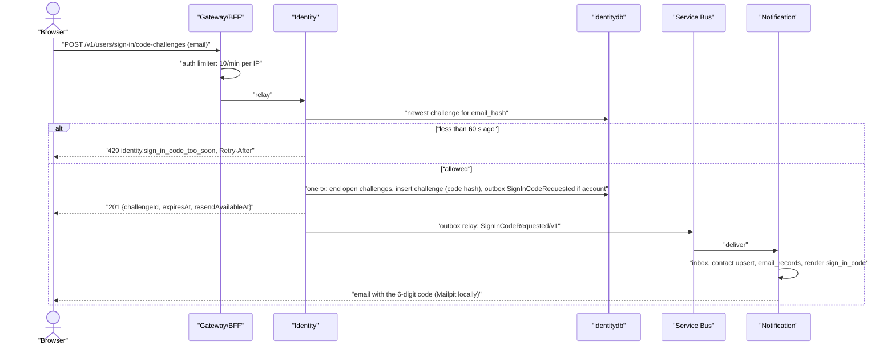
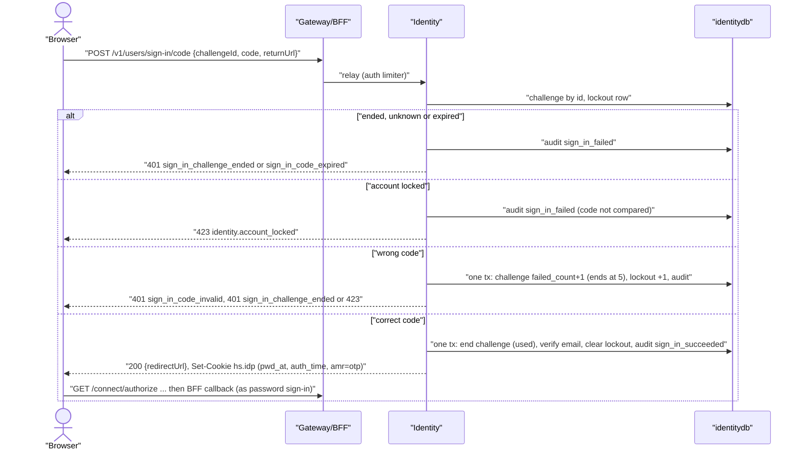

# Technical Design: FEAT-006 — Sign in with an email code

> Feature from: docs/implementation-plan.md · Epic: E1 Identity & Access
> Implements: FR-AUTH-028, FR-AUTH-029, FR-AUTH-030, FR-AUTH-031, FR-AUTH-032, FR-AUTH-033, FR-AUTH-034, FR-AUTH-035, FR-AUTH-036, FR-NOTIF-016; binding NFRs NFR-SEC-016, NFR-SEC-005 (code request and submit limits), NFR-SEC-009 (code sign-in audited)
> Realizes: UC-029 · Screens: SCR-STF-021, SCR-STF-022, SCR-STF-012 (the entry link) (designed by ui-design)
> Depends on: FEAT-001 (`hs.idp`, `/v1/users/*`, `SafeRedirect`, outbox → Notification), FEAT-004 (exact `pwd_at` rule at authorize), FEAT-005 (`LockoutRecorder`, `audit_entries`, gateway `auth` limiter, `Retry-After` on 429)
> Status: Verified (self-check clean) · Date: 2026-11-23
> Diagram: [design-flow.html](design-flow.html) (interactive flow diagram, html-flow-diagram)

## 1. Intent
A visitor who has an account can sign in without a password: they enter their email, get a 6-digit code by email, and type it in. It is the last Should slice of phase 5 and builds directly on FEAT-005's lockout, audit and rate limits, which every earlier design pointed at for the code path. The response never tells whether the email has an account.

## 2. Codebase context
Surveyed on 2026-11-23 on branch `feat/005-account-hardening` (FEAT-003, FEAT-004 and FEAT-005 are built and accepted there; `main` does not have them yet).

- **Prerequisite:** FEAT-005 is merged into `main` before FEAT-006 starts (§8). Everything below cites code that exists only on that branch today.
- **Identity Application:** handlers return `Result<T>`; `IUserRepository.SaveChangesAsync` commits everything, outbox rows included, in one transaction, and on a conflict drops what was staged and raises a typed exception (`EmailInUseException`, `CredentialExistsException`, `ConcurrencyConflictException`). `ResendVerificationEmailHandler` is the model for "same answer for any address": malformed email → 400, otherwise success whether or not the account exists, and the secret goes in an event (`VerificationEmailRequested`) while only its hash is stored (`Sha256TokenGenerator`, R-6). `VerificationToken` is the model for a single-use, hashed, expiring secret.
- **Lockout and audit (FEAT-005):** `LockoutRecorder.RecordFailureAsync`/`RecordSuccessAsync` each stage and save in their own retry loop (`Threshold + 1` attempts on `ConcurrencyConflictException`). `AuditEntry` has methods `password`, `google`, `password_change`; the `ck_audit_entries_method` check lists them. `SignInHandler` checks the lock before verifying (FR-AUTH-012).
- **Identity Api:** `POST /v1/users/sign-in` signs into `hs.idp` with `UsersEndpoints.ToPrincipal(user, passwordStamp, authTime, amr)` and returns `{redirectUrl}` (only a local `/connect/authorize…` is honored, `SignInHandler.SafeRedirect`). `ConnectEndpoints.AuthorizeAsync` accepts `hs.idp` only when its `pwd_at` equals the credential's stamp exactly, and **no** `pwd_at` for an account without a credential (FEAT-004 D-5). A code sign-in must therefore put the current stamp in the cookie when the account has a password.
- **Errors:** envelope `{code, message, details[]}`; one HTTP status per code in `contracts/errors/error-codes.yaml`; messages are static vi/en strings (no placeholders). `ApiException` has no way to carry a header, and `UseExceptionHandler` clears response headers before the responder runs, so an endpoint cannot set `Retry-After` itself and then throw.
- **Gateway:** routes `users` (`/v1/users/{**rest}`) and `users-root` use policy `auth`: one fixed window of 10 per minute **per client IP, shared by every `/v1/users*` endpoint** (FEAT-005 §3.7). New endpoints under `/v1/users/sign-in/…` are covered with no gateway change. Rejections are `429 common.rate_limited` with `Retry-After`.
- **Hosted sign-in:** Identity's `/signin` (storefront SPA, `SignInPage.vue`) is the sign-in screen for both hosts; the seller centre reaches it through the authorize redirect (ADR-0027). Offering the code there makes it available on the seller centre too (FR-AUTH-028 note) with no seller-centre code.
- **Notification:** `dispatch.py` validates a few payloads with pydantic models (`features/emails/events.py`), upserts contacts for `CONTACT_EVENTS`, and `emails.KINDS` maps event type → template, subjects and context. `prepare` writes one `email_records` row per (event, template) and `deliver` sends after commit; a send failure is recorded as `failed` with the exception type only (the body may hold a secret). There are no broker subscription filters to change.
- **Web:** `SignInPage.vue` handles `423` and `429` (with `failure.retryAfter` from `api.ts`) and uses `useCooldown` from `@hivespace/core`. A page opened without `returnUrl` starts `/bff/login` at once. FEAT-001's ui-design keeps the "Sign in with an email code" link hidden until this feature.
- **Schema:** last migration `20261123075254_AddLockoutAndAudit`.
- **Divergences recorded** (reality wins):
  1. UC-029 exception 2b says the system tells the user when email sending is unavailable. Identity hands the email to the outbox (ADR-0002), so it cannot know at request time whether Notification or the email provider is up. The code-entry screen therefore always offers "didn't get it? resend after the countdown, or use your password or Google" (NFR-REL-008 holds: the other methods keep working). See D-6 and §8.
  2. NFR-SEC-005 lists the code request and submit limits as 10 per minute per IP each; the existing `auth` policy shares one 10-per-minute window per IP across all `/v1/users*` calls (FEAT-005 §3.7). That is stricter, and a real user needs about 3 calls per minute for this flow. Kept as is.
  3. The UX inventory names the reference routes `/auth/otp` and `/auth/otp/code`; this storefront's auth routes live under `/signin`, so the screens are `/signin/code` and `/signin/code/enter` (§5.5).

## 3. API contracts

Conventions inherited: the error envelope and stable codes with vi/en messages, POST for actions (dev-standards §6.7 covers updates only), `Accept-Language` for messages, anonymous `security: []` like the other `/v1/users*` operations, CSRF header from the SPA's `api.ts`.

### 3.1 New error codes
| Code | `http` | When | Traces to |
| :-- | :-- | :-- | :-- |
| `identity.sign_in_code_invalid` | 401 | The code does not match an open challenge (fewer than five wrong codes so far) | FR-AUTH-031, UC-029 4a |
| `identity.sign_in_code_expired` | 401 | The challenge is still open but its code is past its 5-minute lifetime | FR-AUTH-031, UC-029 4a |
| `identity.sign_in_challenge_ended` | 401 | The challenge was used, replaced by a newer code, ended after five wrong codes, or does not exist | FR-AUTH-031, FR-AUTH-032, FR-AUTH-034, UC-029 4b |
| `identity.sign_in_code_too_soon` | 429 | A code was requested for the same address less than 60 seconds ago; `Retry-After` carries the seconds left | FR-AUTH-033, UC-029 1a |

Messages (en; vi equivalents in `messages.vi.yaml`): invalid — "That code is not right. Check the email and try again."; expired — "This code has expired. Request a new code."; ended — "This code can no longer be used. Request a new code."; too soon — "You just asked for a code. Wait a moment before asking again." (the SPA shows the seconds from `Retry-After`, which states the remaining wait, FR-AUTH-033).

Reused: `common.validation_failed` (400), `identity.account_locked` (423, FEAT-005), `common.rate_limited` (429, gateway).

### 3.2 New: `POST /v1/users/sign-in/code-challenges` (`requestSignInCode`) — FR-AUTH-028, FR-AUTH-029, FR-AUTH-033, FR-AUTH-034
- Auth: none. Rate limit: gateway `auth`, per IP (NFR-SEC-005).
- Request `SignInCodeRequest {email: string (maxLength 254)}`, required, `additionalProperties: false`.
- Checks in order:
  1. `Email.Create(email)` fails → `400 common.validation_failed`, details on `email` (as `resendVerificationEmail`).
  2. The newest challenge for this address (any state) was created less than **60 s** ago → `429 identity.sign_in_code_too_soon`, header `Retry-After: <ceil(seconds left)>`. Applies whether or not an account exists (FR-AUTH-033 note). Nothing is written.
- Success `201`, the same shape for any well-formed address (FR-AUTH-029):
  ```json
  { "challengeId": "<uuid v7>", "expiresAt": "<now + 5 min>", "resendAvailableAt": "<now + 60 s>" }
  ```
  Side effects in one transaction: every open challenge of the address is ended (reason `superseded`, FR-AUTH-034); a new challenge is stored with the **hash** of a fresh code (NFR-SEC-016); when an account exists, one `SignInCodeRequested/v1` outbox row carries the code to Notification (FR-NOTIF-016). For an unknown address the challenge is stored the same way but no event is written and no email is sent (UC-029 2a). A locked account still gets a code and an email (D-4).
- Two parallel requests for one address: the partial unique index on open challenges lets one insert win; the other gets `429 identity.sign_in_code_too_soon` with `Retry-After: 60`.
- Not idempotent by design: each accepted call issues a new code (UC-029 3a) and the 60 s rule limits repeats.

### 3.3 New: `POST /v1/users/sign-in/code` (`signInWithCode`) — FR-AUTH-030, FR-AUTH-031, FR-AUTH-032, FR-AUTH-035, FR-AUTH-036
- Auth: none. Rate limit: gateway `auth`, per IP (NFR-SEC-005).
- Request `SignInWithCodeRequest {challengeId: string, code: string, returnUrl?: string}`, `additionalProperties: false`.
- Checks in order (nothing about the code is evaluated before step 5):
  1. `code` is not exactly six ASCII digits (after trimming spaces) → `400 common.validation_failed`, detail `{field: "code", code: "identity.sign_in_code_invalid"}`. Not counted.
  2. `challengeId` is not a UUID, no such challenge, or the challenge has ended (used, superseded, five wrong codes) → `401 identity.sign_in_challenge_ended`. Audit `sign_in_failed`, method `code`, user id of the challenge when known.
  3. The challenge's code has expired → `401 identity.sign_in_code_expired`. Audit `sign_in_failed`. Not counted.
  4. The challenge belongs to an account that is locked → `423 identity.account_locked`, **without comparing the code** (FR-AUTH-035). Audit `sign_in_failed`, reason `identity.account_locked`.
  5. Compare the code with the stored hash in constant time (NFR-SEC-016).
     - **Wrong:** the challenge's wrong-code count goes up; at the fifth it ends (reason `attempts`, FR-AUTH-032). When the challenge has an account, the failure also counts on that account's lockout (FR-AUTH-031 note, FR-AUTH-011), all in one save. Answer, first that applies: the account is now locked → `423 identity.account_locked` (audit `sign_in_failed` + `account_locked`); the challenge has ended → `401 identity.sign_in_challenge_ended`; otherwise `401 identity.sign_in_code_invalid`.
     - **Correct:** in one save, the challenge ends (reason `used`, accepted at most once), an unverified email is marked verified (FR-AUTH-036), the lockout row is removed (the count is "consecutive", as a password success does), and audit `sign_in_succeeded`, method `code`.
- Success `200 {redirectUrl}` with `Set-Cookie: hs.idp` for the user: claims as a password sign-in, with `pwd_at` = the credential's stamp **when the account has a password** (otherwise none, so authorize accepts the cookie, FEAT-004 D-5), `auth_time` = now and `amr` = `otp` (RFC 8176). `redirectUrl` follows `SafeRedirect` (only `/connect/authorize…`, else `/`). The browser then goes through `/connect/authorize` and the BFF callback exactly as after a password sign-in, so the tokens are FR-AUTH-009's (FR-AUTH-030).
- Two parallel correct submissions: the challenge's row version lets one commit; the other reloads, finds it ended and gets `401 identity.sign_in_challenge_ended`.
- The 401 bodies for an unknown address and a real one are identical (FR-AUTH-031): both challenges exist, expire and end the same way.

### 3.4 New event `SignInCodeRequested/v1` (producer Identity, consumer Notification) — FR-NOTIF-016
`contracts/events/SignInCodeRequested/v1.schema.json`, `additionalProperties: false`, all required:

| Field | Type | Notes |
| :-- | :-- | :-- |
| `userId` | uuid | |
| `email` | string ≤ 254 | |
| `displayName` | string ≤ 80 | |
| `language` | `vi` \| `en` | FR-LOC-005 |
| `code` | string, pattern `^[0-9]{6}$` | Never logged (title says so, as `VerificationEmailRequested`, R-6) |
| `expiresAt` | date-time | The email states how long the code stays valid |

### 3.5 Library change: `Retry-After` on an `ApiException`
`libs/dotnet/HiveSpace.BuildingBlocks.Errors`: `ApiException` gains an optional `RetryAfterSeconds` (`int?`, init); `ApiErrorResponder.WriteAsync` sets the `Retry-After` header when it is present. The responder runs after the exception handler has cleared the response, so this is the one place that can add the header. Additive; existing callers are unchanged. Cross-cutting (error responses), so it belongs in `libs/` (AGENTS.md boundary rule).

### 3.6 Contract files
- `contracts/errors/error-codes.yaml`, `messages.vi.yaml`, `messages.en.yaml`: the four codes.
- `contracts/openapi/identity.yaml`: `requestSignInCode`, `signInWithCode`, schemas `SignInCodeRequest`, `SignInChallenge`, `SignInWithCodeRequest`; 423 and 429 (gateway) responses described; the `Retry-After` header on the 429 of `requestSignInCode`.
- `contracts/events/SignInCodeRequested/v1.schema.json`.
- `contracts/features/identity/code-sign-in.feature` (cucumber-js, ADR-0025).

## 4. Schema changes

One Identity migration `AddSignInCodeChallenges` after `20261123075254_AddLockoutAndAudit`. Down drops the table and restores the old check.

| Table | Columns and constraints | Entity |
| :-- | :-- | :-- |
| `sign_in_code_challenges` (new) | `id uuid pk` (UUID v7, returned as `challengeId`); `email_hash bytea not null` (SHA-256 of the normalized email, 32 bytes); `user_id uuid null fk users(id) on delete cascade` (null for an unknown address); `code_hash bytea not null` (SHA-256 of challenge id + code); `failed_count int not null default 0 check (failed_count between 0 and 5)`; `created_at timestamptz not null`; `expires_at timestamptz not null`; `ended_at timestamptz null`; `end_reason varchar(16) null check (end_reason in ('used','superseded','attempts'))`; check `(ended_at is null) = (end_reason is null)`; Postgres `xmin` as concurrency token | Sign-in code challenge (Identity; plan data "Code challenge (hash)") |
| | Indexes: `(email_hash, created_at desc)` for "newest for this address"; **unique** `(email_hash) where ended_at is null` (one open challenge per address, closes the request race); `(expires_at)` for the purge | |
| `audit_entries` (changed) | `ck_audit_entries_method` becomes `method in ('password','google','password_change','code')` | Audit log (FEAT-005) |

- **No plain email is stored for a challenge.** The hash lets the 60 s rule and the "invalidate earlier codes" rule work for any address, including unknown ones (FR-AUTH-029, FR-AUTH-033), and rows are deleted a day after they expire (D-3).
- **The code hash is salted with the challenge id** so the same code in two challenges never has the same hash; the lookup is by challenge id, then a constant-time compare (NFR-SEC-016).
- Per-address is per-account for a known address: the normalized email is unique in `users` and there is no email change in the MVP, so ending every open challenge of the address is FR-AUTH-034's "every earlier code for that account".
- No change to `users`, `credentials`, `sign_in_lockouts`, `verification_tokens` or Notification tables (Notification's `email_records.template` is `varchar(64)`, so a new template name needs no migration).

Entities touched: sign-in code challenge, User (email verified), Lockout, Audit log — all Identity. No new domain concept beyond the credential-like secret the plan names; see §8 for the architecture vocabulary note.

## 5. Component design

### 5.1 Flows





### 5.2 Identity
- **Domain**
  - `SignInCodePolicy` (static): `Lifetime = 5 min`, `ResendWait = 60 s`, `MaxWrongCodes = 5`, `Digits = 6` (FR-AUTH-028, FR-AUTH-032, FR-AUTH-033; OQ-35 proposals).
  - `SignInCodeChallenge {Id, EmailHash, UserId?, CodeHash, FailedCount, CreatedAt, ExpiresAt, EndedAt?, EndReason?}`:
    - `static Issue(Guid id, byte[] emailHash, Guid? userId, byte[] codeHash, DateTimeOffset now)` → open, expires `now + Lifetime`. The id is passed in because the code hash depends on it.
    - `IsEnded`, `IsExpired(now)` (`now >= ExpiresAt`), `ResendAvailableAt` (`CreatedAt + ResendWait`), `RetryAfter(now)` (time left until `ResendAvailableAt`, or zero).
    - `Supersede(now)`, `MarkUsed(now)` → end with the reason (no-op when already ended).
    - `RecordWrongCode(now)` → adds one; at `MaxWrongCodes` ends with `attempts`; returns true when this call ended it.
    - `ChallengeEndReason` enum: `Used`, `Superseded`, `Attempts`.
  - `AuditMethod` gains `Code` (stored `code`).
  - `User.VerifyEmail(now)` reused (no change).
- **Application**
  - Ports (`Abstractions/Ports.cs`):
    - `ISignInCodeGenerator`: `string NewCode()` (6 digits from a CSPRNG), `byte[] HashCode(Guid challengeId, string code)`, `bool Matches(Guid challengeId, string code, byte[] codeHash)` (constant-time), `byte[] HashEmail(string normalizedEmail)`.
    - `ISignInChallengeStore`: `FindAsync(Guid id)`, `FindNewestAsync(byte[] emailHash)`, `FindOpenAsync(byte[] emailHash)` (list), `Add(challenge)`; staged in the unit of work committed by `IUserRepository.SaveChangesAsync`.
    - New exception `SignInChallengeConflictException`, raised by `SaveChangesAsync` when the open-challenge unique index rejects an insert. A row-version conflict on a challenge raises the existing `ConcurrencyConflictException` (its message widens from "the lockout" to "a lockout or challenge").
  - `Features/Lockout/LockoutRecorder` gains staging-only methods `StageFailureAsync(userId, method, reason)` (returns true when the account is locked after it) and `StageSuccessAsync(userId, method)`; the existing `RecordFailureAsync`/`RecordSuccessAsync` become their retry loop around one save. Behavior of the password and change-password paths is unchanged (FEAT-005 tests stay green). This lets the code handler commit the challenge change and the lockout change in **one** save (D-5).
  - `Features/CodeSignIn/RequestSignInCodeHandler`: `RequestSignInCodeCommand(Email?)` → `Result<SignInCodeRequestOutcome>`, where the outcome is either `Issued(ChallengeId, ExpiresAt, ResendAvailableAt)` or `TooSoon(RetryAfterSeconds)`. Steps of §3.2: validate; `emailHash`; newest challenge too recent → `TooSoon`; find the user; `Supersede` each open challenge; `id = Guid.CreateVersion7(now)`; `code = NewCode()` **always** (the unknown-address path does the same work, FR-AUTH-029); `Issue`; when the user exists, `outbox.Enqueue("SignInCodeRequested", 1, userId, SignInCodeRequestedData(...))`; save; `SignInChallengeConflictException` → `TooSoon(60)`.
  - `Features/CodeSignIn/SignInWithCodeHandler`: `SignInWithCodeCommand(ChallengeId?, Code?, ReturnUrl?)` → `Result<SignInOutcome>` (the FEAT-005 record: user, redirect, password stamp, auth time). Owns one retry loop of at most `LockoutPolicy.Threshold + SignInCodePolicy.MaxWrongCodes + 1` attempts on `ConcurrencyConflictException` (each conflict means another failure or a success committed, and both counters are bounded). Each attempt reloads the challenge and runs §3.3 steps 2–5, staging challenge changes, `recorder.Stage*` and audit rows, then saves once. The `SignInOutcome.PasswordStamp` becomes `long?` (null when the account has no credential); the password path always sets it.
  - Audit rows for every failure and the success (method `code`); none for a code request (NFR-SEC-009 audits sign-ins and lockouts, not requests).
- **Infrastructure**
  - `IdentityDbContext`: `SignInCodeChallenge` (table, indexes, checks, `IsRowVersion()` on a shadow `Version` like `SignInLockout`); `EndReason` stored as lower-case text; `AuditMethod.Code` → `code`. Migration `AddSignInCodeChallenges`.
  - `EfUserRepository` implements `ISignInChallengeStore` and maps the unique violation on `ix_sign_in_code_challenges_open` to `SignInChallengeConflictException`, and a `DbUpdateConcurrencyException` on a challenge to `ConcurrencyConflictException`.
  - `Security/SignInCodeGenerator`: `RandomNumberGenerator.GetInt32(0, 1_000_000).ToString("D6")`; `HashCode` = SHA-256 over the 16 bytes of the id followed by the UTF-8 code; `Matches` = `CryptographicOperations.FixedTimeEquals`; `HashEmail` = SHA-256 of the UTF-8 normalized email.
  - `SignInChallengeSweeper` (`BackgroundService`, the `OutboxCleanup`/`AuditRetentionSweeper` pattern, ADR-0012): on start and every hour, `ExecuteDeleteAsync` on challenges with `expires_at` more than **1 day** ago. `RunOnceAsync(now)` is public for tests. The 60 s rule needs only the last minute; a day leaves room for investigation and stays small.
- **Api** (`UsersEndpoints`)
  - `POST /v1/users/sign-in/code-challenges` (`requestSignInCode`): `TooSoon` → `throw new ApiException("identity.sign_in_code_too_soon") { RetryAfterSeconds = … }`; `Issued` → `Results.Created(…, body)`. `Location` is not sent (there is no GET).
  - `POST /v1/users/sign-in/code` (`signInWithCode`): like `signIn`, then `http.SignInAsync(CookieScheme, ToPrincipal(user, stamp, authTime, "otp"))` and `Ok({redirectUrl})`.
  - `AmrClaim` doc comment lists `otp`.
- **Logging:** one information line per issued challenge ("sign-in code issued", challenge id, whether an account exists is **not** logged) and per code sign-in success; never the email, the code or its hash (NFR-SEC-016, R-6).

### 5.3 Gateway
No change: `/v1/users/sign-in/*` matches route `users` and its `auth` policy (§2). Gateway tests gain one case that the 11th code request from one IP gets `429 common.rate_limited`.

### 5.4 Notification
- `features/emails/events.py`: pydantic `SignInCodeRequested` (mirrors the schema, `extra="forbid"`, `code` pattern `^[0-9]{6}$`).
- `dispatch.py`: validate `SignInCodeRequested` before any write, like `PasswordChanged`.
- `features/contacts/repository.py`: add `SignInCodeRequested` to `CONTACT_EVENTS` (it carries the current name and language).
- `features/emails/service.py`: `SIGN_IN_CODE = "sign_in_code"`; `KINDS["SignInCodeRequested"]` with subjects vi "Mã đăng nhập HiveSpace của bạn" / en "Your HiveSpace sign-in code" and a context of `display_name`, `code`, `minutes` (5, from `expiresAt − now` rounded up, at least 1) and `expires_at` in Vietnam time (NFR-L10N-002).
- Templates `sign_in_code.{vi,en}.{txt,html}`: the code in large type, "valid for 5 minutes", "if you did not ask for it, ignore this email; nobody can sign in without the code". No link (a link would be a second way in to design).
- The rendered body stays in memory only; a send failure records the exception type only (existing `deliver`).

### 5.5 Web (storefront)
- `features/auth/api.ts`: `requestSignInCode(email)` and `signInWithCode({challengeId, code, returnUrl})` through the generated client (regenerated from `identity.yaml`), with the existing `run()` (so `retryAfter` comes along).
- `features/auth/codeChallenge.ts`: keeps `{challengeId, email, expiresAt, resendAvailableAt, returnUrl}` in `sessionStorage` (survives a reload of the code page; never the code).
- `features/auth/CodeRequestPage.vue` (SCR-STF-021, route `/signin/code`, fullscreen): email field (prefilled from the sign-in page's email when given), submit → `201` saves the challenge and goes to `/signin/code/enter` keeping `returnUrl`; `400` → field error; `429 identity.sign_in_code_too_soon` → message plus countdown from `retryAfter`; `429 common.rate_limited` → its message and countdown; network error → generic alert. A link back to password sign-in. Without `returnUrl` the page starts `/bff/login` first, like `SignInPage` (a code sign-in without the authorize round trip would create only `hs.idp`).
- `features/auth/CodeEntryPage.vue` (SCR-STF-022, route `/signin/code/enter`, fullscreen): six single-digit boxes with paste support, the email shown, a resend countdown to `resendAvailableAt`, "use password instead" link. Submit when six digits are entered → `200` `goTo(redirectUrl)`; `401 sign_in_code_invalid` → inline error, boxes cleared; `401 sign_in_code_expired` / `sign_in_challenge_ended` → message and a "Get a new code" action (no more submits for this challenge); `423` → locked message, link to password/Google sign-in; `429` → rate-limit message. Resend calls `requestSignInCode` again and replaces the stored challenge. No stored challenge → back to `/signin/code`. The page always says the email may take a minute and offers password and Google (divergence 1).
- `features/auth/SignInPage.vue` (SCR-STF-012): shows the "Sign in with an email code" link, to `/signin/code?returnUrl=…` (and the typed email), hidden until now per FEAT-001's ui-design.
- `app/router.ts`: the two routes; `features/auth/index.ts` exports the pages.
- vi/en keys for every new label and the four codes; the key-parity check covers them. Screens are ui-design's; this is the wiring.

## 6. Acceptance criteria

| # | Criterion | Cites |
| :-- | :-- | :-- |
| AC-1 | Given an account, `POST /v1/users/sign-in/code-challenges` returns `201` with `challengeId`, `expiresAt` = now + 5 min and `resendAvailableAt` = now + 60 s; one `SignInCodeRequested/v1` outbox row is written, valid against its schema, whose `code` is six digits; the stored `code_hash` equals SHA-256(id ‖ code) and no column holds the code or the plain email. | FR-AUTH-028, NFR-SEC-016 |
| AC-2 | For an unknown address the response has the same status and the same body fields as AC-1, a challenge row with null `user_id` is stored, and no outbox row is written. Submitting any code to that challenge gives the same `401` bodies as for a real account (invalid, then ended at the fifth). | FR-AUTH-029, FR-AUTH-031, UC-029 2a |
| AC-3 | A second request for the same address 59 s later (fake clock) returns `429 identity.sign_in_code_too_soon` with `Retry-After: 1` and writes nothing; at 60 s it returns `201`. Same for an unknown address. Two parallel requests for one address give one `201` and one `429`. | FR-AUTH-033, UC-029 1a |
| AC-4 | After a new code is issued, the earlier challenge reads `ended_at` set with `superseded`, and submitting its (correct) code returns `401 identity.sign_in_challenge_ended`. | FR-AUTH-034, UC-029 3a |
| AC-5 | Submitting the correct code within 5 minutes returns `200 {redirectUrl}` (`/connect/authorize…` kept, anything else → `/`) and sets `hs.idp` with `amr` `otp` and a fresh `auth_time`; the challenge ends `used`; following `redirectUrl` with that cookie, `/connect/authorize` issues a code for an account **with** a password and one **without** (Google-only). Submitting the same code again returns `401 identity.sign_in_challenge_ended`; of two parallel correct submissions exactly one gets `200`. | FR-AUTH-030, NFR-SEC-016, FEAT-004 D-5 |
| AC-6 | A wrong code returns `401 identity.sign_in_code_invalid` and adds one to the challenge and one to the account's lockout; the fifth wrong code for one challenge returns `401 identity.sign_in_challenge_ended` and the challenge ends `attempts`; a correct code after that is rejected the same way. | FR-AUTH-031, FR-AUTH-032, UC-029 4a, 4b |
| AC-7 | After the 5-minute lifetime (fake clock) the correct code returns `401 identity.sign_in_code_expired` and nothing is counted. | FR-AUTH-031, UC-029 4a |
| AC-8 | Code failures and password failures share the lockout: three wrong passwords plus two wrong codes lock the account (the fifth call returns `423`). While locked, the **correct** code returns `423 identity.account_locked` and the generator's `Matches` is not called (spy in a unit test); the challenge's count does not change. A correct code sign-in removes the lockout row. Ten parallel wrong codes on one challenge end with `failed_count` 5, the account locked with `failed_count` 5, and no `500`. | FR-AUTH-035, FR-AUTH-031 note, FR-AUTH-011, FR-AUTH-012, UC-029 4c |
| AC-9 | An unverified account that signs in with a correct code has `email_verified_at` set, and the token obtained through authorize carries `email_verified` true. | FR-AUTH-036 |
| AC-10 | Each code submission writes one audit row with method `code`: `sign_in_succeeded`, or `sign_in_failed` with the error code as reason (user id when the challenge has an account, null otherwise); the locking submission adds `account_locked`. A code request writes no audit row. No audit row, log line or outbox envelope log contains the code, its hash or the email. | NFR-SEC-009, NFR-SEC-016, NFR-LEG-001 |
| AC-11 | `400 common.validation_failed` for a malformed email on request, and for a code that is not six digits on submit (detail on `code`); neither writes anything or counts. An unknown or malformed `challengeId` returns `401 identity.sign_in_challenge_ended`. | FR-AUTH-031 |
| AC-12 | `SignInChallengeSweeper.RunOnceAsync(now)` deletes challenges that expired more than a day ago and keeps one that expired 23 hours ago. | design §5.2 (data minimization, NFR-LEG-001) |
| AC-13 | Notification: a `SignInCodeRequested` event produces one `sign_in_code` email to the event's address in its language (vi and en), containing the code and "5 minutes"; a redelivered event sends nothing more; a payload with extra keys or a non-6-digit code is rejected before any write; the contact is upserted. | FR-NOTIF-016, FR-LOC-005, NFR-REL-005 |
| AC-14 | System test (real stack): requesting a code for a registered user makes an email arrive in Mailpit with the code, and submitting it signs in (`200`). | FR-AUTH-028, FR-AUTH-030, FR-NOTIF-016 |
| AC-15 | Gateway: the 11th `/v1/users/sign-in/code-challenges` or `/v1/users/sign-in/code` call within a minute from one IP gets `429 common.rate_limited` with `Retry-After`. | NFR-SEC-005 |
| AC-16 | `ApiException` with `RetryAfterSeconds` produces the envelope and a `Retry-After` header; without it no header is written. | design §3.5 |
| AC-17 | Web: SCR-STF-012 shows the "Sign in with an email code" link carrying `returnUrl`; SCR-STF-021 handles 201 (navigates to the code page), 400, both 429s with a countdown, and starts `/bff/login` without `returnUrl`; SCR-STF-022 accepts a pasted 6-digit code, submits it, navigates to `redirectUrl` on 200, shows the inline error for `sign_in_code_invalid`, the "get a new code" state for expired and ended, the locked state for 423, the resend countdown, and goes back to SCR-STF-021 without a stored challenge. vi and en strings exist for all of them. | FR-AUTH-028..033, FR-AUTH-035, UC-029, FR-LOC-004 |
| AC-18 | `code-sign-in.feature` passes on the cucumber-js runner (request 201/429, unknown address, correct code 200 with cookie, wrong/expired/ended/locked, superseded code). | dev-standards §9.1, ADR-0025 |
| AC-19 | Boundaries hold: Identity architecture tests (no EF or ASP.NET type in Domain/Application), Spectral 0 errors, vi/en key parity, Sheriff, import-linter, and the FEAT-005 lockout, sign-in and change-password tests unchanged and green. | dev-standards §5, FEAT-005 |

## 7. Decisions
- **D-1 A challenge exists for every well-formed address, with a code that is never sent for an unknown one.** Driver: FR-AUTH-029 (same response, with a challenge) and FR-AUTH-031 (the rejection must not reveal existence). With a real, expiring, countable challenge for unknown addresses, every later response is identical by construction rather than by special cases. Rejected: a fake `challengeId` not stored (then a submit would answer "ended" at once, which differs from a real challenge's "invalid").
- **D-2 Two endpoints under `/v1/users/sign-in/`: `POST code-challenges` (request) and `POST code` (submit).** Driver: they sit next to `signIn` in the same anonymous family, so the gateway's `auth` route and limiter cover them unchanged (NFR-SEC-005); submit answers exactly like `signIn` (`{redirectUrl}` + `hs.idp`), so the SPA and the authorize round trip are reused. Rejected: a challenge sub-resource path with the id in the URL (the id is a bearer secret, kept out of URLs and access logs).
- **D-3 The address is stored only as a SHA-256 hash, and challenges are purged a day after expiry.** Driver: FR-AUTH-033 needs a per-address memory even for unknown addresses; NFR-LEG-001 limits the personal data we keep, and an attempted unknown address is not ours to keep in clear. Rejected: HMAC with a secret key (a secret to manage for rows that live a day; a plain hash of an email is guessable, which the one-day retention bounds); an in-memory cache (wrong with more than one Identity replica or after a restart). Teaches: rate limiting without keeping identifiers.
- **D-4 A locked account still gets a code; only the submit is refused.** Driver: FR-AUTH-035 is about code sign-in, and FR-AUTH-029 wants the request answered the same way for every address; refusing the request would make the request endpoint a lock oracle. The email lets the owner know someone asked. Consequence: the owner may type a code and see "locked", with the password/Google alternatives (D-2 of FEAT-005: Google is not blocked).
- **D-5 Challenge and lockout change in one save; `LockoutRecorder` gains staging methods.** Driver: a wrong code must count on both (FR-AUTH-031 note, FR-AUTH-032), and parallel wrong codes must all count on both (AC-8). Two saves could count one and lose the other on a crash or a conflict. Rejected: calling the existing `RecordFailureAsync` after saving the challenge (two transactions; a conflict in the second drops the count silently).
- **D-6 "Email sending unavailable" is not detected at request time.** Driver: ADR-0002 — Identity writes to the outbox and returns; Notification and the email provider are asynchronous. The code page always offers resend after 60 s and the password and Google alternatives, which keeps NFR-REL-008's promise. Rejected: a synchronous health probe of Notification (couples Identity to Notification's availability, against ADR-0002). See §8.
- **D-7 The code hash is SHA-256 salted with the challenge id, not argon2.** Driver: the code is guarded by a 5-minute lifetime, five tries per challenge, the account lockout and the gateway limit; a slow hash adds request latency without changing that (and the hash is never the only barrier). NFR-SEC-016 asks for hash-only storage, constant-time comparison and single use, which this meets. Rejected: argon2id per code (the cost of a password hash on every submit, under the same IP limit).
- **D-8 The code session carries `amr` `otp` and the credential's `pwd_at` when there is one.** Driver: FEAT-004's exact `pwd_at` rule at authorize would otherwise reject the cookie for accounts that have a password; `amr` keeps the audit-like record of how the session started and keeps FEAT-005's set-password re-authentication (`amr` google) meaning "Google", not "any recent sign-in".
- **D-9 Per-address rule in Identity, per-IP limit in the gateway.** Driver: as FEAT-005 D-1 — FR-AUTH-033 is per address and needs the database; NFR-SEC-005 is per IP at the gateway.

## 8. Escalations & open items
- **Prerequisite:** FEAT-005 (and with it FEAT-003 and FEAT-004) must be merged into `main` before FEAT-006 starts; it builds on `LockoutRecorder`, `audit_entries`, the gateway `auth` limiter and `Retry-After` handling that exist only on `feat/005-account-hardening` today.
- **No architecture escalation, one vocabulary note:** the sign-in code challenge is a short-lived, hashed sign-in secret in Identity, the same kind of thing as the verification token (which the architecture also does not list by name); it changes no boundary or ownership. Suggest (software-architecture owns it): add "sign-in code challenge" to Identity's responsibilities in architecture §5.2, and `SignInCodeRequested` to the §5.4 event table next to `VerificationEmailRequested` (it carries the code, the same accepted risk R-6).
- **Requirements note (requirements-engineering owns it):** UC-029 exception 2b ("system says so" when email sending is unavailable) cannot be met at request time under ADR-0002 (D-6). Proposed rewording: "2b. Email does not arrive: the code screen offers a new code after the wait, and password and Google sign-in still work."
- **OQ-35:** this design uses its proposals (6 digits, 5 minutes, 60 s, 5 wrong codes) as constants in `SignInCodePolicy`.
- **Plan suggestions (implementation-planning owns them):** the FEAT-006 row could list NFR-SEC-005 and NFR-SEC-009 in its trace and name the endpoints `POST /v1/users/sign-in/code-challenges`, `POST /v1/users/sign-in/code` and the event `SignInCodeRequested`.
- **E2E:** UC-029 is not one of the architecture's critical flows (§8.6), so there is no E2E task; the system test (AC-14) covers the real Identity → broker → Notification → Mailpit path.
- **For ui-design:** design SCR-STF-021 (default, sending, too-soon countdown, rate-limited, error) and SCR-STF-022 (entry, verifying, wrong code, expired, ended / too many attempts, locked, resend countdown, "email may take a minute" hint) and the SCR-STF-012 link placement, against §3 and §5.5.
- **Doc updates the implementation owes:** the FEAT-003/FEAT-005 note on `hs.idp` claims (`amr` can now be `otp`); `docs/scaffold-notes.md` is unaffected.
