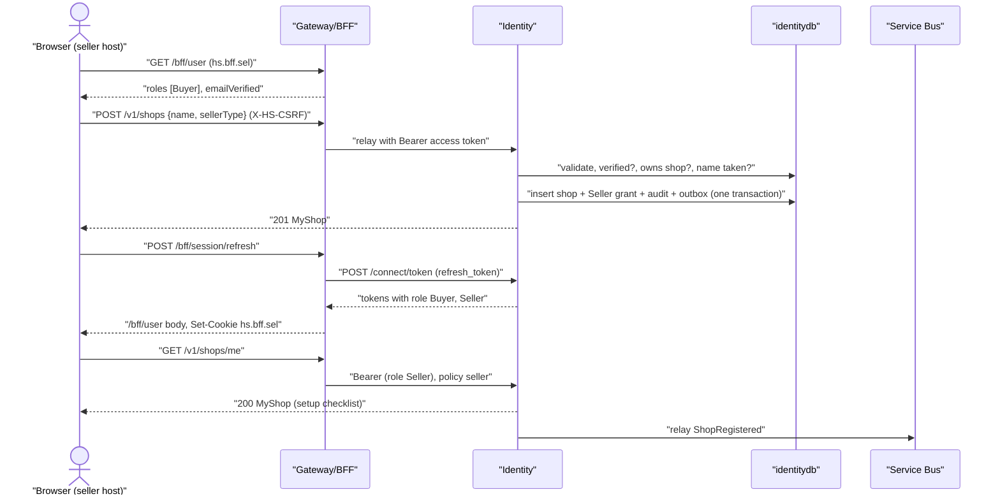

# Technical Design: FEAT-009 — Register a shop and become a seller

> Feature from: docs/implementation-plan.md · Epic: E2 Shop
> Implements: FR-SHOP-001, FR-SHOP-002, FR-SHOP-003, FR-SHOP-004, FR-ROLE-002, FR-ROLE-003; supports FR-SHOP-008 (field errors on the registration fields; FEAT-010 owns the rest), FR-ROLE-004 and NFR-SEC-006 (the shop is always the caller's), NFR-SEC-009 (role grants audited)
> Realizes: UC-003 · Screens: SCR-SEL-001, SCR-SEL-002 p (setup checklist only) (designed by ui-design)
> Depends on: FEAT-001 (users, verification, gateway BFF), FEAT-002 (bearer validation in Identity, `POST /bff/session/refresh`, profile language), ADR-0027 (seller host and `hivespace-seller` client, already in the gateway and Identity)
> Status: Draft · Date: 2026-11-24
> Diagram: [design-flow.html](design-flow.html) (interactive flow diagram, html-flow-diagram)

## 1. Intent
A signed-in buyer with a verified email opens the seller centre, enters a shop name and a seller type, and becomes a seller: the shop and the Seller role are created in one transaction, and the seller centre opens on the dashboard with a setup checklist. It is the first slice of phase 1 after identity, because every catalog, stock and order feature needs a shop owner. It is also the first time the seller centre has a real session (ADR-0027) and the first seller-only endpoint, so it sets the pattern for FR-ROLE-003.

## 2. Codebase context
Surveyed on 2026-11-24 on `main` at `d0498aa` (FEAT-001..006 merged). The design conforms to the following.

- **Identity domain:** `Role { Buyer, Seller }` already exists ("Seller arrives with FEAT-009"); `RoleGrant(UserId, Role, GrantedAt)` is owned by `User` through `_roles`. `User.IsEmailVerified` comes from `email_verified_at`. Value objects return `(value, Violation?)`. `AuditEntry` has types `sign_in_succeeded`, `sign_in_failed`, `account_locked` and a required `AuditMethod`.
- **Application:** handlers return `Result<T>`; `IUserRepository.SaveChangesAsync` commits entities, audit rows and outbox rows in one transaction and turns named unique-index violations into typed exceptions (`EmailInUseException`, `ExternalLoginConflictException`, …) in `Persistence/Adapters.cs`. Events are queued with `IEventOutbox.Enqueue(type, version, correlationId, data)`.
- **Api:** `MeEndpoints` maps `/v1/me/*` with policy `me` (OpenIddict validation scheme only, never the `hs.idp` cookie; FEAT-002 D-5). The user is always `sub` (`ClaimsPrincipal.GetUserId()`). There is no role-based policy yet. Tokens carry `role` claims, re-read from the database on every `/connect/token` exchange (`ConnectEndpoints.BuildPrincipal`), so a new role shows after the next refresh.
- **Schema:** last migration `20261124013009_AddSignInCodeChallenges`. `role_grants(user_id, role)` PK, check `ck_role_grants_role in ('Buyer','Seller')`. `audit_entries.method` is `NOT NULL` with check `ck_audit_entries_method`; `ck_audit_entries_type` lists the three types.
- **Gateway:** both hosts, both OIDC clients and per-host cookies (`hs.bff.stf`, `hs.bff.sel`) are already wired (ADR-0027); `/bff/login`, `/bff/user`, `/bff/session/refresh`, `/bff/logout` pick the client by host. Routes in `gateway/src/Gateway/appsettings.json`; `/v1/shops` is not routed. New routes default to `authenticated`; non-GET `/v1/*` needs `X-HS-CSRF: 1`.
- **Broker:** one topic `hivespace-events`; subscriptions exist only for `inventory` and `notification` (AppHost `Infrastructure.cs`). Catalog and Search-AI have none yet.
- **Web:** `seller-centre` is a shell: `SellerLayout.vue` with a stubbed account area and a browser-only `LanguageSwitcher`, one `DashboardPage.vue` placeholder ("setup checklist … arrive with FEAT-009"), no session, no API client use. The storefront has `features/auth` (session store, `fetchSession`, `refreshSessionUser`, `AccountMenu.vue`, `createAuthGuard`) and links to `VITE_SELLER_ORIGIN`. Apps never import each other (Sheriff).
- **Divergences recorded:** (1) the plan row lists `ShopRegistered` consumers Catalog, Search-AI and Notification; none of them needs the event in this slice, so the event is published now and consumed by the slices that need it (D-6). (2) ux-foundations names the reference page `/register-seller`; the route here is `/register-shop` (ui-design may rename it; no contract depends on it).

## 3. API contracts

Conventions inherited: JSON, camelCase, shared `Error` schema with `details[{field, code}]`, `Accept-Language` picks the message language, bearer security on protected operations, PUT for updates (dev-standards §6.7, none here), `X-HS-CSRF: 1` on non-GET calls through the gateway.

### 3.1 Identity REST (gateway routes `/v1/shops` and `/v1/shops/{**rest}` → identity, policy `authenticated`)

| Endpoint | Auth (Identity policy) | Request | Success | Errors |
| :-- | :-- | :-- | :-- | :-- |
| `POST /v1/shops` (`registerShop`) | bearer, `me` | `ShopRegistration` | `201 MyShop`, `Location: /v1/shops/me` | `400 common.validation_failed`, `401 common.unauthenticated`, `403 identity.email_not_verified`, `409 identity.shop_already_owned`, `409 identity.shop_name_taken` |
| `GET /v1/shops/me` (`getMyShop`) | bearer, `seller` | — | `200 MyShop` | `401 common.unauthenticated`, `403 common.forbidden` (no Seller role, FR-ROLE-003), `404 common.not_found` (Seller role without a shop; not reachable through the API) |

Schemas:
- `ShopRegistration`: `{name: string, sellerType: SellerType}`, both required, `additionalProperties: false`.
- `SellerType`: `individual | business` (FR-SHOP-001, FR-SHOP-004; recorded, never verified).
- `MyShop`: `{shopId: uuid, name, sellerType, createdAt: date-time, setup: {pickupAddress: boolean, payout: boolean}}`. `setup` feeds the SCR-SEL-002 checklist; both are `false` until FEAT-010 lets the owner add them (D-7). FEAT-010 extends `MyShop` additively.

Validation (every unmet rule listed together, one `details` entry per field):
- `name`: required → `identity.shop_name_required`; after trimming and collapsing inner whitespace to one space, 3 to 60 characters → `identity.shop_name_too_short`, `identity.shop_name_too_long`; control characters → `identity.shop_name_invalid` (D-4).
- `sellerType`: missing or not one of the two values → `identity.seller_type_invalid`.
- An unknown body key → `common.validation_failed` for that field (same reading as `PUT /v1/me/profile`).

Order of checks for `POST /v1/shops` (each stops the request, nothing is saved):
1. Field validation → `400`.
2. Email verified, read from the database, not the token claim (D-3) → `403 identity.email_not_verified` (UC-003 1a). The UI offers "resend verification" (`POST /v1/users/verification-email`, FEAT-001).
3. The user owns a shop → `409 identity.shop_already_owned` (FR-SHOP-002, UC-003 2a).
4. Another shop has the same normalized name → `409 identity.shop_name_taken` (FR-SHOP-003, UC-003 2a).
5. Create the shop, grant Seller (keeping Buyer), write the audit row and the `ShopRegistered` outbox row, commit once (FR-ROLE-002, D-1). A unique-index violation at commit (a parallel request won) maps to the same `409` codes as steps 3 and 4.

Behavior notes:
- The owner is always the token's `sub`; there is no user or shop id in the path, and `X-User-Id` or a body field never picks the user (FR-ROLE-004, NFR-SEC-006).
- No `Idempotency-Key`: a repeated `POST` after success gets `409 identity.shop_already_owned`, which the SPA treats as "already a seller" and moves on (D-5).
- After `201` (or that `409`) the SPA calls `POST /bff/session/refresh` on the seller host, so the access token carries `role: Seller` before the first seller-only call (D-2).

### 3.2 Gateway
Routes added to `appsettings.json`: `"shops-root": { "ClusterId": "identity", "Match": { "Path": "/v1/shops" } }` and `"shops": { "ClusterId": "identity", "Match": { "Path": "/v1/shops/{**rest}" } }`, both default `authenticated`. No BFF change: the seller host's `/bff/login`, `/bff/user`, `/bff/session/refresh` and `/bff/logout` already exist (ADR-0027). The gateway does not check roles; the service does (D-2).

### 3.3 OpenAPI and client
`contracts/openapi/identity.yaml` gains `registerShop`, `getMyShop`, schemas `ShopRegistration`, `MyShop`, `SellerType`, bearer security on both. Regenerate `web/packages/api-client`.

### 3.4 Event `ShopRegistered/v1`
`{shopId, ownerUserId, name, sellerType, registeredAt}`, `additionalProperties: false`, producer `identity`, correlation id = shop id. Written in the registration transaction (ADR-0002 outbox). No consumer in this slice (D-6); Notification's subscription receives it and must ignore it without error. `ShopChanged` arrives with FEAT-010.

### 3.5 Error codes (add to `error-codes.yaml`, with vi and en messages)
`identity.email_not_verified` 403 · `identity.shop_already_owned` 409 · `identity.shop_name_taken` 409 · `identity.shop_name_required` 400 · `identity.shop_name_too_short` 400 · `identity.shop_name_too_long` 400 · `identity.shop_name_invalid` 400 · `identity.seller_type_invalid` 400. The four name codes and the seller-type code appear as `details` codes under `common.validation_failed`.

## 4. Schema changes

**Identity database (`identitydb`), EF migration `AddShops`** (after `20261124013009_AddSignInCodeChallenges`):

| Change | Detail | Entity |
| :-- | :-- | :-- |
| create `shops` | `id uuid` PK (UUID v7, ADR-0009); `owner_user_id uuid not null` FK `users(id)` on delete cascade; `name varchar(60) not null`; `normalized_name varchar(60) not null`; `seller_type varchar(16) not null` with check `ck_shops_seller_type in ('individual','business')`; `created_at timestamptz not null`; `updated_at timestamptz not null` | Shop |
| index `ix_shops_owner_user_id` | unique on `owner_user_id` (FR-SHOP-002) | Shop |
| index `ix_shops_normalized_name` | unique on `normalized_name` (FR-SHOP-003) | Shop |
| alter `audit_entries.method` | drop `NOT NULL`: a role grant has no sign-in method (D-9) | Audit log |
| replace `ck_audit_entries_type` | add `'seller_role_granted'` | Audit log |

`role_grants` needs no change: its check already allows `Seller`. Profile, pickup address, bank details, logo and cover columns arrive with FEAT-010 and FEAT-035. Down: drop `shops`; delete `seller_role_granted` audit rows and `Seller` role grants, then restore the old type check and `NOT NULL` (stated in a migration comment: rolling back removes the seller state with the shops).

The architecture gives Identity the shop "(profile, pickup address, bank details, seller role)" (§5.2) and fixes that shop creation and the role grant commit together. Shop is an existing conceptual entity, so there is no escalation.

## 5. Component design

### 5.1 Flow

### 5.2 Identity
- **Domain:** `ShopName` value object (`Create(string?)` → trims, collapses whitespace, checks 3–60 and control characters; `Normalized` = NFC then `ToLowerInvariant()`), `SellerType` (`Individual`, `Business`; parse from the wire values), `Shop` (`Id`, `OwnerUserId`, `Name`, `NormalizedName`, `SellerType`, `CreatedAt`, `UpdatedAt`; `static Shop Register(Guid ownerUserId, ShopName name, SellerType type, DateTimeOffset now)`). `User.GrantRole(Role role, DateTimeOffset now)` adds the grant when missing and returns whether it did; Buyer is never removed. `AuditEntry.SellerRoleGranted(Guid userId, DateTimeOffset now)` with type `seller_role_granted` and `Method = null` (`AuditMethod?`).
- **Application:** ports `IShopStore { FindByOwnerAsync(Guid), NameExistsAsync(string normalized), Add(Shop) }` (staged, committed by `IUserRepository.SaveChangesAsync`); new exceptions `ShopAlreadyOwnedException`, `ShopNameTakenException`. `RegisterShopHandler` runs §3.1 steps 1–5, catches the two exceptions and returns the matching failure. `GetMyShopHandler` (`Guid userId` → `MyShopView`, `setup` both `false` for now). `ShopEvents` holds the `ShopRegistered` type name and data record.
- **Infrastructure:** `IdentityDbContext` maps `shops` and the audit changes; `ShopStore` adapter; `Adapters.SaveChangesAsync` maps `ix_shops_owner_user_id` and `ix_shops_normalized_name` violations to the two exceptions. Migration `AddShops`.
- **Api:** `ShopEndpoints` maps `POST /v1/shops` (policy `me`, body read as `JsonElement` to catch unknown keys, like `MeEndpoints.ToCommand`) and `GET /v1/shops/me` (policy `seller`). `Program.cs` adds policy `seller` = the `me` policy plus `RequireClaim("role", "Seller")` (D-2). The `Location` header is `/v1/shops/me`.

### 5.3 Gateway
Two routes (§3.2). Nothing else.

### 5.4 Notification
No feature code. Its subscription receives `ShopRegistered`; T7 confirms the dispatcher acknowledges an event type it has no handler for (inbox row, no error, no retry) and adds a test if none covers it.

### 5.5 Web
**Seller centre** (`web/apps/seller-centre`), first real session (D-8):
- `features/auth/`: `api.ts` (only file importing the gateway and identity clients; CSRF header and `Accept-Language` set there), `session.ts` (Pinia store with `load`, `refresh`, `markSignedOut`, same shape as the storefront's), `guards.ts` in `app/` with one guard for all routes:
  - anonymous → `location.assign('/bff/login?returnUrl=<path>')` (the seller client; SSO through `hs.idp` means a user already signed in on the storefront gets no password prompt, ADR-0027);
  - signed in without `Seller` → `/register-shop`;
  - `Seller` on `/register-shop` → `/`.
- `AccountMenu.vue` replaces the stub in `SellerLayout.vue`: display name, initials, "Go to storefront" (`VITE_STOREFRONT_ORIGIN`), "Sign out" (same-origin form `POST /bff/logout`).
- Language (the seller-centre part FEAT-002 §8 deferred here): the switcher calls `setLocale` at once, then, when signed in, `PUT /v1/me/profile/language` and `session.refresh()`; on session load the profile language wins (FEAT-002 D-7).
- `features/shop/`: `api.ts` (`registerShop`, `getMyShop`), `RegisterShopPage.vue` at `/register-shop` (SCR-SEL-001; layout and states from ui-design): name and seller type, field errors from `details`, `409` codes on the name field (`shop_name_taken`) or as a redirect (`shop_already_owned` → refresh session → `/`), unverified state with a resend button. When the session says `emailVerified: false` the page calls `session.refresh()` once on load, since the user may have verified after signing in (D-3).
- `features/dashboard/DashboardPage.vue` (SCR-SEL-002 partial): reads `GET /v1/shops/me` and shows the shop name and the setup checklist (pickup address, payout) as not done; the items link to `/settings` (built by FEAT-010). Order counts and low-stock stay out (FEAT-025, FEAT-013).

**Storefront:** no change. The existing header link "Seller centre" (`VITE_SELLER_ORIGIN`, design.md §3) is the entry for everyone; the seller-centre guard sends each user to the right place (D-10).

## 6. Acceptance criteria

| # | Criterion | Cites |
| :-- | :-- | :-- |
| AC-1 | Given a signed-in buyer with a verified email and no shop, `POST /v1/shops {name: "Tiệm Bánh An", sellerType: "individual"}` returns `201` with `MyShop` and `Location: /v1/shops/me`; the shop is owned by the caller and `role_grants` holds both Buyer and Seller for the user. | FR-SHOP-001, FR-ROLE-002, UC-003 1–3 |
| AC-2 | Both `individual` and `business` are accepted and returned exactly as submitted; nothing else about the seller is asked or checked. | FR-SHOP-004 |
| AC-3 | A body with an empty name, a 2-character name, a 61-character name (each separately) or a name with a control character, together with `sellerType: "x"`, returns `400 common.validation_failed` with one `details` entry for `name` and one for `sellerType` in one response; a missing `sellerType` and an unknown key are field errors too; nothing is saved. Names with leading, trailing or doubled spaces are stored trimmed and collapsed. | FR-SHOP-008 (registration fields), UC-003 2, D-4 |
| AC-4 | A signed-in user whose email is not verified gets `403 identity.email_not_verified` and no shop; SCR-SEL-001 shows the unverified state with a resend button that sends a new verification email. A user who verified after signing in can register without signing in again. | FR-SHOP-001, UC-003 1a, D-3 |
| AC-5 | A user who already owns a shop gets `409 identity.shop_already_owned`; two parallel registrations by one user create exactly one shop and the other request gets the same `409`. | FR-SHOP-002, UC-003 2a |
| AC-6 | With a shop named "Tiệm Bánh An", another user's registration of "tiệm  bánh an " returns `409 identity.shop_name_taken`; two parallel registrations of one name by different users create one shop. | FR-SHOP-003, UC-003 2a |
| AC-7 | The shop, the Seller grant, the audit row and the `ShopRegistered` outbox row are committed together: when the commit fails on a name conflict, none of them exists. | FR-ROLE-002, architecture §5.2, D-1 |
| AC-8 | Each registration writes exactly one `ShopRegistered/v1` outbox row that validates against its schema; Notification receives it and acknowledges it without error or retry. | ADR-0002, NFR-REL-005, D-6 |
| AC-9 | Each registration writes one `seller_role_granted` audit row with the user id, no email, and a correlation id. | NFR-SEC-009, D-9 |
| AC-10 | `GET /v1/shops/me` with a Buyer-only token returns `403 common.forbidden`; with a Seller token it returns the caller's own shop with `setup.pickupAddress` and `setup.payout` both `false`; with no session it is `401` at the gateway; called directly with no, tampered or wrong-audience token Identity returns `401`; a spoofed `X-User-Id` never changes which shop is read or whose shop is created. | FR-ROLE-003, FR-ROLE-004, NFR-SEC-006, FR-AUTH-015 |
| AC-11 | After `201` and `POST /bff/session/refresh` on the seller host, `/bff/user` lists roles Buyer and Seller and `GET /v1/shops/me` returns `200`, without signing in again. | FR-ROLE-002, UC-003 4, D-2 |
| AC-12 | In the seller centre: a visitor is sent to sign in and comes back to the page asked for; a user signed in on the storefront reaches the seller centre without entering a password; a buyer without a shop lands on SCR-SEL-001; after registering, the dashboard (SCR-SEL-002) shows the shop name and the checklist with pickup address and payout not done; a seller opening `/register-shop` lands on the dashboard; sign out returns to the seller host's `/`. | UC-003 4, ADR-0027, SCR-SEL-001, SCR-SEL-002 |
| AC-13 | The storefront header's "Seller centre" link opens the seller host, where a visitor is sent to sign in, a buyer without a shop lands on SCR-SEL-001 and a seller on the dashboard. | UC-003, D-10 |
| AC-14 | In the seller centre, picking a language while signed in saves it to the profile; after reload and on the storefront after its next session load, the UI uses it. | FR-LOC-002 (FEAT-002 §8 deferral) |
| AC-15 | Every code in §3.5 has vi and en messages and comes back in the request's language. | FR-LOC-004, NFR-L10N-004 |
| AC-16 | `contracts/features/identity/register-shop.feature` covers `registerShop` and `getMyShop` (success and each designed error) and passes in `tests/contract`. | dev-standards §9.1, ADR-0025 |
| AC-17 | A Playwright journey registers a buyer, verifies the email, opens the seller centre (no password asked), registers a shop and sees the dashboard checklist. | UC-003 main flow, ADR-0026 |

## 7. Decisions
- **D-1 One transaction for shop, role, audit and event.** Driver: architecture §5.2 ("granting the Seller role and creating the shop must commit together", FR-ROLE-002). `Shop` is its own aggregate, but the handler stages it with the `User` role change through the one `SaveChangesAsync`. Rejected: shop first and the role from an event (a window where the shop exists and the owner is not a seller).
- **D-2 Seller-only functions check the `role` claim of the validated access token, in the service.** Driver: FR-ROLE-003, dev-standards §6.5 (the gateway forwards identity and roles; services authorize). Identity policy `seller`; later services reuse the same claim. The token is stale for at most one access-token lifetime (15 minutes), and roles are only ever added in the MVP, so staleness can only delay access, never extend it. The SPA refreshes the session right after registering, so the delay does not show. Rejected: a role check in the gateway (it would need route-level role metadata for every seller route) and a database read per request.
- **D-3 Email verification is read from the database.** Driver: UC-003 1a. The `email_verified` claim may be older than the verification. The page also refreshes the session once when the claim says unverified, so its state matches the server.
- **D-4 Shop name: trimmed, inner whitespace collapsed, 3–60 characters, no control characters; uniqueness on NFC + lower-case invariant.** Driver: FR-SHOP-003 (case-insensitive) and FR-SHOP-008 (invalid fields are rejected), which state no length. 60 is enough for Vietnamese names with diacritics and fits result cards (FR-SRCH-010). Accent-sensitive: "Tiệm" and "Tiem" are different names. Rejected: accent-insensitive matching (would block legitimate distinct names), a citext column (Postgres lower-casing does not do NFC).
- **D-5 No `Idempotency-Key` on `POST /v1/shops`.** Driver: the one-shop rule (FR-SHOP-002) already makes a retry harmless: it returns `409 identity.shop_already_owned`, which the SPA handles as success. Idempotency keys stay for checkout and payment (ADR-0004, ADR-0006).
- **D-6 `ShopRegistered` is published now; consumers come with the slices that read it.** Driver: no FR in this slice needs Catalog, Search-AI or Notification to know the shop; the Catalog shop snapshot is needed by FEAT-012 (products) and FEAT-011 (shop page), Notification's shop-owner contact by order emails (FEAT-032). Consequence: the broker keeps no messages for a subscription that does not exist yet, so see §8.
- **D-7 `GET /v1/shops/me` exists now, with a `setup` object.** Driver: SCR-SEL-002's checklist (plan: "SCR-SEL-002 p") and the seller centre's need to read its own shop. FEAT-010 extends `MyShop` additively and adds `PUT` sub-resources (dev-standards §6.7).
- **D-8 The seller centre gets its own small `features/auth`.** Driver: Sheriff forbids importing the storefront; the store and probe are about 100 lines. Rejected for now: moving the session client into a shared package (would make `@hivespace/core` depend on the generated client). Revisit if a third consumer appears.
- **D-9 Role grants go to the existing audit log with no method.** Driver: NFR-SEC-009 lists role grants. `audit_entries.method` becomes nullable instead of inventing a fake method.
- **D-10 One storefront entry: the existing header link, not a role-aware menu item** (user decision 2026-11-24, ui-design U-6). Driver: each host has its own session (ADR-0027), so a storefront label chosen from the storefront's token would lag up to 15 minutes after registering on the seller host; the header link "Seller centre" (design.md §3) needs no role, and the seller-centre guard routes from its own fresh session. Rejected: an account-menu item "Register a shop" / "Seller centre" (ux-foundations Part C), which duplicated the header link; a forced storefront refresh on every page load. Accepted gap: between `md` and `lg` the header link is hidden.

## 8. Escalations & open items
- **Plan correction suggested (implementation-planning owns it):** the FEAT-009 row says `event ShopRegistered → Catalog, Search-AI, Notification`. In this slice the event has no consumer; the consumers belong to FEAT-012 or FEAT-011 (Catalog snapshot), FEAT-018 (Search-AI shop name on results) and FEAT-032 (Notification shop-owner contact) (D-6).
- **Open item, before the first shared environment holds real shops:** Service Bus delivers only to subscriptions that existed when the message was published. A shop registered before Catalog or Search-AI subscribe is never projected there. Locally and in CI the data is recreated, so nothing breaks now; the slice that adds the first consumer (FEAT-012 or FEAT-011) must either create its subscription before shops exist in the demo environment or provide a backfill (re-publish `ShopRegistered` for existing shops). Recorded so it is not lost.
- **Wording change suggested to ux-foundations (it owns it):** Part C "Buyer to seller" describes a storefront account-menu item; D-10 keeps the header link instead.
- **Choice for the user to confirm at review:** the 3–60 character shop name rule (D-4) has no requirement behind it; change it here before implementation if another limit is wanted.
- **Deferred, named:** shop profile, pickup address, payout and `ShopChanged` (FEAT-010); public shop page and the Catalog snapshot (FEAT-011); the "publish needs address and payout" rule (FR-SHOP-011, FEAT-010/FEAT-013); order counts and low stock on the dashboard (FEAT-025, FEAT-013); single logout across the two hosts (ADR-0027 follow-up).
- **No architecture escalation:** Shop and the Seller role are existing entities owned by Identity (architecture §5.2).
