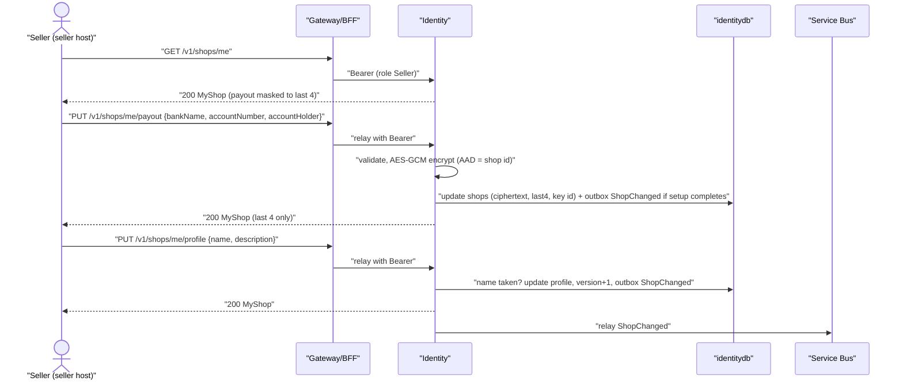

# Technical Design: FEAT-010 — Shop settings: profile, pickup address, payout

> Feature from: docs/implementation-plan.md · Epic: E2 Shop
> Implements: FR-SHOP-005, FR-SHOP-006, FR-SHOP-007, FR-SHOP-008, FR-SHOP-010 (logo and cover deferred, D-8), NFR-SEC-008; supports FR-ROLE-003, FR-ROLE-004 and NFR-SEC-006 (the shop is always the caller's), FR-SHOP-009 (private fields never leave Identity), FR-SHOP-011 (readiness flag for FEAT-012, D-6)
> Realizes: UC-004 (main flow 1–3, exception 3a) · Screens: SCR-SEL-007, SCR-SEL-008 (designed by ui-design); SCR-SEL-002 checklist becomes live
> Depends on: FEAT-009 (shop, `seller` policy, `GET /v1/shops/me`, seller-centre session and dashboard), FEAT-002 (PUT sub-resource pattern, `PhoneNumber`)
> Status: Draft · Date: 2026-11-24
> Diagram: [design-flow.html](design-flow.html) (interactive flow diagram, html-flow-diagram)

## 1. Intent
A seller fills in what a shop needs before it can sell: a profile (name, description), a pickup address and the payout bank details. The bank account number is encrypted at rest and only its last four digits are ever shown. It is next in phase 1 because FEAT-012 (create a product) needs a shop that is ready to sell (FR-SHOP-011), and because FEAT-009's dashboard checklist links to these settings and still reads "not done" for everyone.

## 2. Codebase context
Surveyed on 2026-11-24 on `main` at `78bf35c` (FEAT-001..006 and FEAT-009 merged). The design conforms to the following.

- **Domain:** `Identity.Domain/Shops/Shop.cs` has `Id`, `OwnerUserId`, `Name`, `NormalizedName`, `SellerType` (string), `CreatedAt`, `UpdatedAt` and only the `Register` factory; no mutation method and no row version. `ShopName.Create` (trim, collapse, NFC, 3–60, control characters, codes on field `name`) and `SellerType` are reused. Value objects return `(value?, Violation?)`. `Identity.Domain/Users/PhoneNumber.cs` accepts `0` or `+84` followed by `[235789]` and 8 digits after removing spaces, dots and hyphens, stores E.164 (max 16) and always reports field `phone`.
- **Application:** `Features/Shops/RegisterShopHandler` collects every violation and returns `Result.Fail(common.validation_failed, violations)`; `GetMyShopHandler` returns `MyShopView`, whose `From()` hard-codes `ShopSetupView(false, false)` "until FEAT-010". `IShopStore` (`FindByOwnerAsync`, `NameExistsAsync`, `Add`) is implemented in `Infrastructure/Persistence/EfUserRepository.Shops.cs` and committed by `IUserRepository.SaveChangesAsync`, which maps a `23505` on `ix_shops_normalized_name` to `ShopNameTakenException` and `DbUpdateConcurrencyException` to `ConcurrencyConflictException`. FEAT-002's `UpdateMyProfileHandler` queues an event only when something changed.
- **Concurrency:** the existing pattern is a shadow `uint Version` mapped with `IsRowVersion()` (Npgsql `xmin`) plus a bounded retry in the handler (`SignInLockout`, `ChangeMyPasswordHandler`). There is no HTTP `ETag`/`If-Match` anywhere.
- **Api:** `ShopEndpoints` (`SellerPolicy = "seller"`: OpenIddict validation scheme plus `role: Seller`) reads bodies as `JsonElement`, collects unknown keys against `KnownKeys`, takes the user from `sub` only and ends with `.OrThrow()`. FEAT-002 `PUT /v1/me/profile` (full representation, nullable keys must be present) and `PUT /v1/me/profile/language` (sub-resource) are the PUT patterns (dev-standards §6.7: never PATCH).
- **Schema:** last migration `20261124102658_AddShops`. `shops` has the columns above, `ck_shops_seller_type`, unique `ix_shops_owner_user_id` and `ix_shops_normalized_name`, FK to `users` on delete cascade.
- **Secrets:** Identity's local secrets come from `apphost/HiveSpace.AppHost/Resources/DevSecrets.cs` (`.local/dev-secrets`, generated once, gitignored) and are passed as `Identity__*` environment variables in `DotnetServices.cs`. Deployed values come from a vault (FEAT-037). There is no encryption code in Identity or `libs/dotnet` yet.
- **Contracts:** `identity.yaml` has `registerShop` and `getMyShop` with `MyShop {shopId, name, sellerType, createdAt, setup}`; `.spectral.yaml` has one custom rule, `hs-no-patch`; dev-standards §11 asks for "Spectral rule + unit test" for NFR-SEC-008, which does not exist yet. Event schemas live in `contracts/events/<Type>/v1.schema.json` (JSON Schema 2020-12); `ShopRegistered/v1` is the model.
- **Gateway:** `/v1/shops` and `/v1/shops/{**rest}` already route to Identity with the default `authenticated` policy and the CSRF header on writes. No change.
- **Seller centre:** routes `/`, `/register-shop`, catch-all 404; `SellerLayout.vue` already has a "Settings" link to `/settings`; `features/dashboard/DashboardPage.vue` (own `api.ts` and `MyShop` type) renders the checklist from `setup.*` with buttons to `/settings`; `features/shop/api.ts` has the `Outcome`/`Failure`/`FieldProblem` wrapper. Storefront `features/profile/ProfilePage.vue` is the form and field-error pattern (`errors` by field, focus the first, summary alert at three or more).
- **Divergences recorded:** (1) architecture §8 says secrets are "Aspire parameters locally"; Identity's local keys actually come from `DevSecrets`, which this design follows (§5.3). (2) FR-SHOP-010 shows logo and cover images; they are FEAT-035/036's (D-8). (3) FR-SHOP-006 lists a district; Vietnam's 2025 administrative reform removed that level. The FR is followed as written (D-2, user decision) and an SRS note is suggested (§8).

## 3. API contracts

Conventions inherited: JSON, camelCase, shared `Error` schema with `details[{field, code}]`, `Accept-Language` picks the message language, bearer security, PUT for updates with sub-resources for parts the UI saves on its own (dev-standards §6.7), `X-HS-CSRF: 1` on non-GET calls through the gateway, user from `sub` only.

### 3.1 Identity REST (all on policy `seller`; gateway routes exist)

| Endpoint | Request | Success | Errors |
| :-- | :-- | :-- | :-- |
| `GET /v1/shops/me` (`getMyShop`, extended) | — | `200 MyShop` | as FEAT-009: `401`, `403 common.forbidden`, `404 common.not_found` |
| `PUT /v1/shops/me/profile` (`updateMyShopProfile`) | `ShopProfileUpdate` | `200 MyShop` | `400 common.validation_failed`, `401`, `403 common.forbidden`, `404 common.not_found`, `409 identity.shop_name_taken` |
| `PUT /v1/shops/me/pickup-address` (`setMyShopPickupAddress`) | `PickupAddressUpdate` | `200 MyShop` | `400`, `401`, `403`, `404` |
| `PUT /v1/shops/me/payout` (`setMyShopPayout`) | `PayoutUpdate` | `200 MyShop` | `400`, `401`, `403`, `404` |

Each `PUT` returns the whole `MyShop`, so the SPA refreshes the checklist and every section from one response.

Schemas (all request bodies `additionalProperties: false`, every key required; nullable keys must still be present, like `ProfileUpdate`):
- `ShopProfileUpdate`: `{name: string, description: string|null}`.
- `PickupAddressUpdate`: `{contactName, phone, province, district, ward, street}`, all `string`.
- `PayoutUpdate`: `{bankName, accountNumber, accountHolder}`, all `string`. `accountNumber` is write-only: no response schema carries it (§3.3).
- `MyShop` (additive; FEAT-009 fields unchanged): `{shopId, name, sellerType, createdAt, updatedAt: date-time, description: string|null, pickupAddress: PickupAddress|null, payout: Payout|null, setup: {pickupAddress: boolean, payout: boolean}}`.
  - `PickupAddress`: `{contactName, phone (E.164), province, district, ward, street}`.
  - `Payout`: `{bankName, accountNumberLast4: string (exactly 4 digits), accountHolder}`.
  - `setup.pickupAddress` = `pickupAddress != null`; `setup.payout` = `payout != null` (replaces FEAT-009's hard-coded `false`).

Validation (every unmet rule listed in one `400`, one `details` entry per field, nothing saved; FR-SHOP-008, UC-004 3a). Text is trimmed first; "collapsed" means inner whitespace runs become one space.

| Field (details `field`) | Rule | Code |
| :-- | :-- | :-- |
| `name` | `ShopName` rules unchanged (required, 3–60, no control characters) | `identity.shop_name_required` / `_too_short` / `_too_long` / `_invalid` |
| `description` | optional: `null`, empty or whitespace-only stores `null`; at most 1000 characters after trimming; no control characters other than `\n` (`\r\n` normalized to `\n`) | `identity.shop_description_too_long`, `identity.shop_description_invalid` |
| `contactName` | required, collapsed, 1–80, no control characters | `identity.address_field_required`, `identity.address_field_too_long`, `identity.address_field_invalid` |
| `phone` | required; `PhoneNumber` rule (Vietnamese number), stored E.164 | `identity.address_field_required`, `identity.phone_invalid` |
| `province`, `district`, `ward` | required, collapsed, 1–60 each, no control characters | `identity.address_field_*` as above |
| `street` | required, collapsed, 1–200, no control characters | `identity.address_field_*` as above |
| `bankName` | required, collapsed, 2–80, no control characters | `identity.bank_name_required`, `identity.bank_name_too_long`, `identity.bank_name_invalid` |
| `accountNumber` | required; after removing spaces and hyphens, 6–19 ASCII digits | `identity.bank_account_number_required`, `identity.bank_account_number_invalid` |
| `accountHolder` | required, collapsed, 2–80, no control characters | `identity.bank_account_holder_required`, `identity.bank_account_holder_too_long`, `identity.bank_account_holder_invalid` |
| an unknown key, or a value of the wrong JSON type | — | `common.validation_failed` on that key |

Short values (1 character for `bankName`/`accountHolder`) use the `_required` code's sibling `_invalid`; the generic `address_field_*` codes are shared with the buyer address book (FEAT-008).

Behavior per endpoint (order of checks; each stop saves nothing):
- **profile:** (1) validation → `400`; (2) shop of `sub` → `404` if none; (3) if the normalized name differs from the current one and `NameExistsAsync` → `409 identity.shop_name_taken` (FR-SHOP-003 kept on rename); saving the shop's own name, in any case or spacing, is not a conflict; (4) `Shop.UpdateProfile`; if anything changed, bump `profile_version` and queue `ShopChanged`; (5) commit; a unique-index violation at commit maps to the same `409`.
- **pickup-address:** validation → shop → `Shop.SetPickupAddress` → if `setupComplete` flipped, queue `ShopChanged` → commit.
- **payout:** validation → shop → encrypt the digits (D-1) → `Shop.SetPayout` → if `setupComplete` flipped, queue `ShopChanged` → commit. No payout, transfer or verification is started (FR-SHOP-007).
- All three are naturally idempotent (a repeated PUT with the same body leaves the same state and queues nothing new), so no `Idempotency-Key` (FEAT-009 D-5 reasoning). A concurrent write on the same shop is retried on `ConcurrencyConflictException` up to 3 times (the `ChangeMyPasswordHandler` bound); after that the exception surfaces as `500`, and no new error code is added. Two simultaneous edits by one seller are last-write-wins per section; the row version only keeps `profile_version` and the `setupComplete` transition exact (D-9).
- The owner is always `sub`; no shop id in the path; `X-User-Id` or a body field never selects the shop (FR-ROLE-004, NFR-SEC-006).

### 3.2 Event `ShopChanged/v1`
`{shopId, ownerUserId, name, description: string|null, sellerType, setupComplete: boolean, version: integer ≥ 2, changedAt: date-time}`, `additionalProperties: false`, producer `identity`, correlation id = shop id, written in the same transaction through the outbox (ADR-0002).
- Sent when the public profile changes (name or description) or when `setupComplete` (= pickup address and payout both present) flips. Saving an address or payout that does not change readiness sends nothing: those fields are private and have no consumer (D-6).
- `version` is `shops.profile_version` after the change; `ShopRegistered` is version 1. Consumers drop an event whose version is not higher than the one they hold (ADR-0003).
- Never carries the pickup address, phone or any bank field (FR-SHOP-009, NFR-LEG-001).
- No consumer in this slice. Catalog (FEAT-011/012) and Search-AI (FEAT-018) subscribe later; Notification's subscription receives it and acknowledges it without a handler, as FEAT-009 T7 proved for `ShopRegistered`.

### 3.3 OpenAPI, Spectral and client
- `contracts/openapi/identity.yaml`: the three operations, `ShopProfileUpdate`, `PickupAddressUpdate`, `PayoutUpdate`, `PickupAddress`, `Payout`, the `MyShop` additions; bearer security on all.
- `contracts/.spectral.yaml`: new rule `hs-no-bank-number-in-responses` (error): no schema reachable from a response may declare a property named `accountNumber`. It is the "Spectral rule" dev-standards §11 asks for NFR-SEC-008.
- Regenerate `web/packages/api-client`.

### 3.4 Error codes (add to `error-codes.yaml` with vi and en messages; all `400`, all used as `details` codes)
`identity.shop_description_too_long` · `identity.shop_description_invalid` · `identity.address_field_required` · `identity.address_field_too_long` · `identity.address_field_invalid` · `identity.bank_name_required` · `identity.bank_name_too_long` · `identity.bank_name_invalid` · `identity.bank_account_number_required` · `identity.bank_account_number_invalid` · `identity.bank_account_holder_required` · `identity.bank_account_holder_too_long` · `identity.bank_account_holder_invalid`. Reused: `identity.phone_invalid`, the four `identity.shop_name_*` codes, `identity.shop_name_taken`.

## 4. Schema changes

**Identity database (`identitydb`), EF migration `AddShopSettings`** (after `20261124102658_AddShops`), all on `shops`:

| Change | Detail |
| :-- | :-- |
| add `description` | `varchar(1000) null` |
| add `profile_version` | `integer not null default 1` |
| add pickup columns | `pickup_contact_name varchar(80)`, `pickup_phone varchar(16)`, `pickup_province varchar(60)`, `pickup_district varchar(60)`, `pickup_ward varchar(60)`, `pickup_street varchar(200)`, all `null` |
| check `ck_shops_pickup_all_or_none` | the six pickup columns are all null or all not null |
| add payout columns | `payout_bank_name varchar(80)`, `payout_account_holder varchar(80)`, `payout_account_ciphertext bytea`, `payout_account_last4 char(4)`, `payout_key_id varchar(32)`, all `null` |
| check `ck_shops_payout_all_or_none` | the five payout columns are all null or all not null |
| row version | shadow `Version` mapped to `xmin` (`IsRowVersion()`), no column added |

Down: drop the added columns and checks (stated in a migration comment: rolling back loses settings). Existing shops get `profile_version = 1` and nulls, which reads as "not set up", the same as today's hard-coded `false`.

Mapping: `PickupAddress` and `PayoutDetails` are EF owned types (`OwnsOne`, table splitting into `shops`). No new table, no new entity: the architecture gives Identity the shop "(profile, pickup address, bank details, seller role)" (§5.2), and these are its attributes. No escalation.

## 5. Component design

### 5.1 Flow

### 5.2 Identity
- **Domain** (`Identity.Domain/Shops/`):
  - `ShopDescription.Create(string?)` → `(ShopDescription?, Violation?)`; `null` for empty.
  - `AddressText` helper (trim, collapse, max length, control characters) used by `PickupAddress.Create(contactName, phone, province, district, ward, street)`, which returns `(PickupAddress?, IReadOnlyList<Violation>)` with field names `contactName`, `phone`, `province`, `district`, `ward`, `street`. `PhoneNumber.Create` gains an optional `field` argument (default `"phone"`, so FEAT-002 is unchanged).
  - `BankName`, `AccountHolder`, `BankAccountNumber` (digits only; `Last4`). `BankAccountNumber.ToString()` returns the masked form `••••1234` so a stray log or interpolation cannot print the number.
  - `EncryptedValue(string KeyId, byte[] Bytes)` and `PayoutDetails(BankName, AccountHolder, EncryptedValue AccountNumber, string Last4)`. The Domain never sees a key.
  - `Shop` gains `Description`, `ProfileVersion`, `PickupAddress?`, `Payout?`, `bool SetupComplete => PickupAddress is not null && Payout is not null`, and:
    - `bool UpdateProfile(ShopName name, ShopDescription? description, DateTimeOffset now)`: changes and bumps `ProfileVersion` only when name or description differ.
    - `bool SetPickupAddress(PickupAddress address, DateTimeOffset now)` and `bool SetPayout(PayoutDetails payout, DateTimeOffset now)`: return whether `SetupComplete` flipped; when it flips they also bump `ProfileVersion` (the event carries it).
- **Application** (`Features/Shops/`):
  - Port `Abstractions/Security/IBankAccountProtector { EncryptedValue Protect(BankAccountNumber number, Guid shopId); BankAccountNumber Unprotect(EncryptedValue value, Guid shopId); }`. `Unprotect` is used by the round-trip and wrong-shop tests and by a future key rotation; no endpoint calls it.
  - `IShopStore` gains `FindByOwnerForUpdateAsync(Guid)` (tracked) — or `FindByOwnerAsync` becomes tracked; the implementer picks the smaller change.
  - `UpdateShopProfileHandler`, `SetPickupAddressHandler`, `SetPayoutHandler` per §3.1, each a bounded retry (3) on `ConcurrencyConflictException`, mapping `ShopNameTakenException` to `409`.
  - `ShopEvents` gains `ShopChanged` and `ShopChangedData`.
  - `MyShopView` gains the fields of §3.1; `setup` is computed; the payout view takes `Last4` only.
- **Infrastructure:**
  - `Security/AesGcmBankAccountProtector`: AES-256-GCM, 12-byte random nonce, 16-byte tag; stored bytes `0x01 | nonce | tag | ciphertext`; associated data = the shop id's 16 bytes, so a ciphertext copied to another shop fails to decrypt. Options `BankEncryptionOptions { ActiveKeyId, Keys: {id → base64 of 32 bytes} }` bound from `Identity:BankEncryption`, validated on start (`ValidateOnStart`: active key present and 32 bytes). Decryption picks the key by the stored `payout_key_id`, so adding a new active key does not break old rows (D-1).
  - EF: `OwnsOne` mappings, checks, `xmin` version, migration `AddShopSettings`.
- **Api:** `ShopEndpoints` maps the three `PUT`s under policy `seller`, each with its own `KnownKeys` and the FEAT-002 rule for wrong JSON types. Log lines: one information line per save with shop id and section; never the body. A unit test pushes a payout through the handler with a capturing logger and asserts the digits appear nowhere (dev-standards §5, NFR-SEC-008).

### 5.3 AppHost and configuration
- `DevSecrets.LoadIdentitySecrets` gains `bank-encryption-key-v1.txt` (base64 of 32 random bytes) in `.local/dev-secrets`; `DotnetServices.cs` passes `Identity__BankEncryption__ActiveKeyId=v1` and `Identity__BankEncryption__Keys__v1`.
- Test hosts (`Identity.IntegrationTests`, `tests/contract`, `tests/system`) set a fixed test key.
- Deployed environments get the key from the vault with the other Identity secrets (FEAT-037).

### 5.4 Notification
No change. A test that delivers a `ShopChanged` envelope and expects acknowledgement without a handler is added only if FEAT-009's unhandled-type test is not generic over the type.

### 5.5 Web (seller centre; layouts and states belong to ui-design)
- `features/settings/`: `api.ts` (only importer of the identity client here; `getMyShop`, `updateMyShopProfile`, `setMyShopPickupAddress`, `setMyShopPayout`; CSRF and `Accept-Language` headers; the `Outcome`/`Failure` shape of `features/shop/api.ts`).
  - `ShopProfilePage.vue` (SCR-SEL-007): name and description; field errors from `details`; `shop_name_taken` on the name field. Logo and cover arrive with FEAT-036.
  - `PickupPayoutPage.vue` (SCR-SEL-008): two independently saved sections. The address form pre-fills from `MyShop`. Payout shows bank name, holder and `•••• 1234`; "Change" opens the form with bank name and holder pre-filled and an empty account-number field (D-4). Saved and error states per ui-design.
- Routes: `/settings` → redirect to `/settings/profile`; `/settings/profile`; `/settings/pickup-payout`. The existing guard applies (Seller only).
- `features/dashboard/DashboardPage.vue`: both checklist buttons go to `/settings/pickup-payout`; its `MyShop` type gains the new optional fields it does not use (or is narrowed to `setup` + name); the "all done" state from FEAT-009 ui-design becomes reachable.

## 6. Acceptance criteria

| # | Criterion | Cites |
| :-- | :-- | :-- |
| AC-1 | `PUT /v1/shops/me/profile {name: "Tiệm Bánh An 2", description: "Bánh mì nóng\nmỗi sáng"}` by the owner returns `200 MyShop` with both values; `GET /v1/shops/me` returns them; `description: null` clears it. | FR-SHOP-005, UC-004 2–3 |
| AC-2 | Renaming to another shop's name in another case or spacing returns `409 identity.shop_name_taken` and changes nothing; saving the shop's own name with different case is accepted. | FR-SHOP-005, FR-SHOP-003 |
| AC-3 | `PUT /v1/shops/me/pickup-address` with all six fields returns `200`; the phone `0912 345 678` is returned as `+84912345678`; every field is stored trimmed and collapsed; `setup.pickupAddress` is `true`. | FR-SHOP-006 |
| AC-4 | `PUT /v1/shops/me/payout {bankName: "Vietcombank", accountNumber: "0071 0012 34567", accountHolder: "NGUYEN VAN AN"}` returns `200` with `payout.accountNumberLast4 = "4567"` and no `accountNumber` anywhere in the body; no payout, transfer or other record is created; `setup.payout` is `true`. | FR-SHOP-007, FR-SHOP-010, NFR-SEC-008 |
| AC-5 | In the database, `payout_account_ciphertext` does not contain the digits as ASCII or UTF-8; decrypting it with the shop id returns `0071001234567`; the same bytes copied to another shop's row fail to decrypt; a row written with key `v1` still decrypts after a key `v2` becomes active. | NFR-SEC-008, D-1 |
| AC-6 | One request per endpoint with every field invalid (empty, too long, control character, phone `12345`, account number `12ab` and 5 and 20 digits, an unknown key) returns one `400 common.validation_failed` listing one `details` entry per invalid field with the codes of §3.1; nothing changes and no outbox row is written. | FR-SHOP-008, UC-004 3a |
| AC-7 | `GET /v1/shops/me` after all three saves returns the profile, the pickup address and the payout with only the last four digits; before any save it returns `description`, `pickupAddress` and `payout` as `null` and both `setup` flags `false`. | FR-SHOP-010, UC-004 1 |
| AC-8 | A Buyer-only token gets `403 common.forbidden` on all three `PUT`s; no session gets `401` at the gateway; a missing CSRF header gets `403` at the gateway; a spoofed `X-User-Id` or a `shopId` in the body never changes which shop is written. | FR-ROLE-003, FR-ROLE-004, NFR-SEC-006 |
| AC-9 | A profile change writes exactly one `ShopChanged/v1` outbox row with `version` one higher than before; an identical repeat writes none; saving the address and then the payout writes one row only when the second save makes `setupComplete` true; every row validates against its schema and has no address, phone or bank property. | ADR-0002, ADR-0003, FR-SHOP-009, D-6 |
| AC-10 | Two concurrent profile updates of one shop both return `200` and leave `profile_version` raised by exactly two with two outbox rows. | D-9 |
| AC-11 | No log line written while handling a payout save contains the account number digits; Spectral's `hs-no-bank-number-in-responses` passes on `identity.yaml` and fails on a fixture that returns `accountNumber`. | NFR-SEC-008, dev-standards §5, §11 |
| AC-12 | Every code in §3.4 has vi and en messages and comes back in the request's language. | FR-LOC-004, NFR-L10N-004 |
| AC-13 | `contracts/features/identity/shop-settings.feature` covers the three operations and the extended `getMyShop` (success and each designed error) and passes in `tests/contract`. | dev-standards §9.1, ADR-0025 |
| AC-14 | In the seller centre: the dashboard's checklist buttons open `/settings/pickup-payout`; the sidebar "Settings" opens the profile; each page saves its section, shows field errors next to their fields, shows the account number as `•••• 4567` after saving and asks for the full number to change it; after both sections are saved the dashboard shows the checklist complete. | UC-004 1–3, SCR-SEL-007, SCR-SEL-008, SCR-SEL-002 |
| AC-15 | A Playwright journey: a seller registers a shop, opens settings from the dashboard, saves the profile, the pickup address and the payout, sees the masked number, and the dashboard shows the checklist complete. | UC-004 main flow, ADR-0026 |

## 7. Decisions
- **D-1 AES-256-GCM in Identity with a versioned key from configuration** (user decision 2026-11-24). Driver: NFR-SEC-008, architecture §8 "Bank numbers encrypted at rest". The stored key id allows rotation without a data migration; the shop id as associated data stops a ciphertext from being moved between shops. The last four digits are kept in clear for display (FR-SHOP-010) so the number is never decrypted to render a page. Rejected: ASP.NET Data Protection (meant for short-lived payloads; losing the blob key ring loses every number), Key Vault envelope encryption (no local emulator, adds cost against NFR-COST-001). Teaches authenticated encryption, nonces, associated data and key rotation.
- **D-2 Free-text pickup address with the district kept** (user decision 2026-11-24). Driver: FR-SHOP-006 as written. Rejected: reference pick-lists (a dataset, an endpoint and more UI than this slice), optional district (an SRS change). The 2025 reform is raised in §8.
- **D-3 Three PUT sub-resources, not one PUT of the whole shop.** Driver: dev-standards §6.7 and the screens, which save the profile, the address and the payout separately; a whole-shop PUT would have to resend the masked account number.
- **D-4 The payout PUT always carries the full account number.** Driver: the response only has the last four digits, so a masked value cannot be sent back; changing the bank name alone means re-entering the number, which also guards against a stale session changing payout silently. Rejected: an optional `accountNumber` meaning "keep" (two meanings for one PUT).
- **D-5 Address and payout are owned types on `shops`.** Driver: they are one-per-shop attributes with no identity of their own (architecture §5.2). Rejected: separate tables (joins and lifecycle for no gain).
- **D-6 `ShopChanged` carries the public profile, `setupComplete` and `version`, and is sent only when they change.** Driver: FR-SHOP-009 (private fields stay in Identity), ADR-0003 (versions for stale-event filtering) and FR-SHOP-011, which FEAT-012 can then enforce from Catalog's own shop snapshot without a synchronous call to Identity. Rejected: a gRPC "is the shop ready" call from Catalog (couples product publishing to Identity's availability).
- **D-7 Limits without an FR behind them:** description 1000, address parts 80/60/200, bank name and holder 2–80, account number 6–19 digits (Vietnamese bank accounts are commonly 8–15 digits; the range leaves room). Confirm at review.
- **D-8 Logo and cover image are not in this slice.** Driver: the plan gives them to FEAT-035/036 (Media pipeline). FR-SHOP-010 is implemented for everything else; its Design ref is appended now, and FEAT-036 appends its own.
- **D-9 Row version plus bounded retry, no `If-Match`.** Driver: the codebase's existing concurrency pattern; one seller edits one shop, so last-write-wins per section is acceptable, and the row version only protects `profile_version` and the readiness transition. Rejected: ETag/If-Match (a new convention for one rare case).

## 8. Escalations & open items
- **No architecture escalation:** pickup address and bank details are attributes of Shop, which Identity owns (architecture §5.2).
- **SRS note suggested (requirements-engineering owns it):** since Vietnam's 2025 administrative reform, addresses have no district level. FR-SHOP-006 and FR-ADDR-001 could make the district optional; this design keeps it required as written (D-2).
- **Plan note:** the FEAT-010 row's `ShopChanged` has no consumer yet; Catalog (FEAT-011/012) and Search-AI (FEAT-018) subscribe later. The FEAT-009 open item applies here too: a subscription created after shops exist misses earlier events, so the first consumer needs its subscription before demo data exists, or a backfill that re-publishes `ShopRegistered` and the latest `ShopChanged` per shop.
- **For FEAT-012:** FR-SHOP-011 can read `setupComplete` from the Catalog snapshot built from `ShopRegistered` (treated as `false`) and `ShopChanged` (D-6).
- **Decided at review (2026-11-25):** the limits in D-7 are accepted as written. The district stays required in this slice but is to become optional: requirements-engineering amends FR-SHOP-006 and FR-ADDR-001 (plan P-12), then a follow-up drops the `*` and the client check and the domain accepts an empty district. The "shop is ready" toast has no "Go to dashboard" link (see ui-design); a `Toast` action slot is not added for one message.
- **Environment note:** `Parameters__postgres-password` must be set for `tests/system` and `tests/e2e` (plan P-11, scaffold-notes §7).
- **Deferred, named:** logo and cover (FEAT-035/036); the public shop page (FEAT-011); key rotation tooling (re-encrypting old rows) — not needed until a key is retired.
