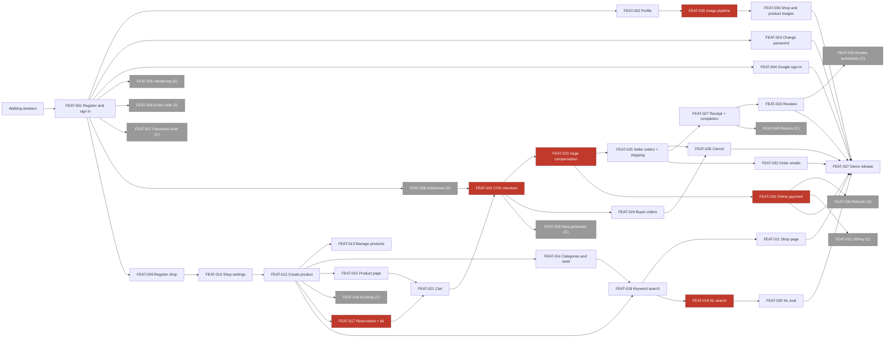

# Implementation Plan: HiveSpace (MVP)

> Status: Draft · Last updated: 2026-11-17
> Inputs: [srs.md](srs.md) v0.16 · [use-cases.md](use-cases.md) · [architecture.md](architecture.md) (with `adr/0001..0021`) · [ux-foundations.md](ux-foundations.md) — all four found. Also read: [dev-standards.md](dev-standards.md), [repo-structure.md](repo-structure.md), [rtm.md](rtm.md).

## 1. Overview

HiveSpace is a multi-seller marketplace (gateway/BFF, 9 services, 1 Azure Function, 2 Vue SPAs) built by one person in about 390 hours (CON-1). This plan cuts it into **38 vertical slices (FEAT-001..038)** across 12 epics, after a walking skeleton.

**What ordered the work** (user decision, 2026-11-17):
1. **Unblock downstream first.** Identity, shop and catalog come right after the skeleton, because nearly every other slice needs a signed-in user, a shop and products with stock. The risky core (atomic reservation, checkout saga, idempotent payment) follows straight after, still in the first half.
2. **Must first, Should after.** All slices that carry Must requirements are sequenced before Should-only and Could slices. One exception, where dependency wins: the buyer address book (FEAT-008, Should) comes before checkout, because FR-CHK-002 (Must) needs an address.

**Cut line.** The Must scope already exceeds the PRD's 390-hour budget (SRS §1.2, CR-1). If the schedule slips, cut in the architecture's R-1 order: Media + image Function (FEAT-035/036 fall back to direct upload through Identity and Catalog) → Notification as a module of Order → Cart as a module of Order. **Never cut** the reservation, the saga or payment idempotency (CON-7). Should and Could phases (5 and 6) are cuttable as a whole.

This is a living order, not a contract. Phases 1–2 are firm; later phases get re-sequenced as earlier slices land.

## 2. Walking Skeleton

The thinnest path that touches every stack, the broker, gRPC and the deploy path, and gives the UI a shell to land in.

**What is real**
- **Repo and templates**: monorepo per [repo-structure.md](repo-structure.md); Copier templates for a rich .NET, a lean .NET, a Go and a Python service (ADR-0020).
- **Aspire AppHost**: `dotnet run --project apphost` starts Postgres (one DB per service), MongoDB, the Service Bus emulator, Azurite and Mailpit (ADR-0015, NFR-PORT-001).
- **Gateway/BFF** (YARP): serves both SPAs from one origin, routes `/v1/*`, rejects unauthenticated calls to protected routes and relays identity (FR-AUTH-015, FR-AUTH-016). In the skeleton the session is a stub: a dev-only fixed test user, no OpenIddict yet.
- **Web shell**: `web/apps/storefront` and `web/apps/seller-centre` with the theme from `tokens.json` (Tailwind v4, light and dark, ADR-0021), header/sidebar navigation, vi/en switcher, and the error pages **SCR-STF-019** and **SCR-SEL-009**. `web/packages/ui` and `web/packages/core` (Money, date and i18n helpers) exist.
- **One trivial end-to-end operation**: `GET /v1/categories` → gateway → Catalog (.NET) → Postgres → back, rendered in the storefront header.
- **One gRPC call**: Catalog → Inventory (Go) `GetAvailability` returning a stub value, with a deadline, through `contracts/proto/` and `buf` (ADR-0019).
- **One event path**: Catalog writes a `Ping` event to its outbox → relay → Service Bus emulator → inbox in Inventory (Go) and Notification (Python), deduplicated by `eventId` (ADR-0002).
- **One trace**: the request above shows as one OpenTelemetry trace in the Aspire dashboard across gateway, Catalog, Inventory and the broker hop (ADR-0013).
- **CI**: build, lint and test for all three stacks plus the web workspace; secret scan; vi/en key-parity check (NFR-MNT-001, NFR-SEC-007, NFR-L10N-004).
- **Deploy path**: `azd` provisions the demo environment and deploys gateway + Catalog to Container Apps once, then tears down (ADR-0005, cost lever R-2).

**What is stubbed**: all business logic, sign-in, every screen except the shell and error pages, all external providers (fakes behind their interfaces), the other six services (empty templates with `/health` and `/ready` only).

**Done when**: a fresh clone starts with one command; the category request and the Ping event each show one trace; CI is green on `main`; one deploy to Azure succeeded through the pipeline and the shell loaded over TLS.

## 3. Epic & Feature Breakdown

Priority shows the highest SRS priority the slice carries. "p" after an ID means the slice delivers that requirement only in part. Data lists the main entities written.

### E1 Identity & Access — Identity, Gateway/BFF, Notification (first email)

| ID | Feature | Pri | FRs | UCs | Screens | Blocks / endpoints | Data |
| :- | :------ | :-- | :-- | :-- | :------ | :----------------- | :--- |
| FEAT-001 | Register, verify email, password sign-in and sign-out | Must | FR-AUTH-001..010, FR-AUTH-013, FR-AUTH-014, FR-ROLE-001, FR-NOTIF-002, FR-NOTIF-001 p, FR-LOC-005 p | UC-001, UC-002 | SCR-STF-012, SCR-STF-013, SCR-STF-014 | Identity (OpenIddict), BFF `/bff/login`, `/bff/callback`, `/bff/logout`, `/bff/user`; event `UserRegistered`; Notification | User, credential, verification token (hash), refresh token, email record |
| FEAT-002 | Profile and preferred language | Must | FR-PROF-001..004, FR-PROF-006, FR-LOC-002 | UC-027 | SCR-STF-016 | Identity `GET/PATCH /v1/me/profile`; event `UserProfileChanged` | User profile |
| FEAT-003 | Change password | Must | FR-AUTH-003 p, FR-AUTH-024, FR-AUTH-025, FR-NOTIF-014 | UC-026 | SCR-STF-018 | Identity `POST /v1/me/password`; event `PasswordChanged` | Credential, refresh tokens |
| FEAT-004 | Google sign-in with auto-link | Must | FR-AUTH-020..023, FR-AUTH-026, FR-NOTIF-015 | UC-025 | SCR-STF-012 | Identity `IExternalLoginProvider` (Google OIDC); event `ExternalLoginLinked` | External login |
| FEAT-005 | Account hardening: lockout, set password for Google-only accounts, rate limits, audit | Should | FR-AUTH-011, FR-AUTH-012, FR-AUTH-027 | UC-002, UC-026 | SCR-STF-012, SCR-STF-018 | Identity, gateway rate limiter | Lockout state, audit log |
| FEAT-006 | Sign in with an email code | Should | FR-AUTH-028..036, FR-NOTIF-016 | UC-029 | SCR-STF-021, SCR-STF-022, SCR-STF-012 | Identity code challenge endpoints; Notification | Code challenge (hash) |
| FEAT-007 | Password reset | Could | FR-AUTH-017..019, FR-NOTIF-013 | UC-022 | SCR-STF-015 | Identity reset endpoints; Notification | Reset token (hash) |
| FEAT-008 | Buyer address book | Should | FR-ADDR-001..004 | — | SCR-STF-017 | Identity `/v1/me/addresses` | Address |

### E2 Shop — Identity (shop lives with the Seller role, architecture §5.2)

| ID | Feature | Pri | FRs | UCs | Screens | Blocks / endpoints | Data |
| :- | :------ | :-- | :-- | :-- | :------ | :----------------- | :--- |
| FEAT-009 | Register a shop and become a seller | Must | FR-SHOP-001..004, FR-ROLE-002, FR-ROLE-003 | UC-003 | SCR-SEL-001, SCR-SEL-002 p (setup checklist) | Identity `POST /v1/shops`; event `ShopRegistered` → Catalog, Search-AI, Notification | Shop, role grant |
| FEAT-010 | Shop settings: profile, pickup address, payout | Must | FR-SHOP-005..008, FR-SHOP-010 | UC-004 | SCR-SEL-007, SCR-SEL-008 | Identity `/v1/shops/me`; event `ShopChanged` | Shop, pickup address, bank details (encrypted) |
| FEAT-011 | Public shop page | Must | FR-SHOP-009 | — | SCR-STF-004 | Catalog shop snapshot + Search-AI product list by shop | read only |

### E3 Catalog — Catalog, Inventory (stock rows)

| ID | Feature | Pri | FRs | UCs | Screens | Blocks / endpoints | Data |
| :- | :------ | :-- | :-- | :-- | :------ | :----------------- | :--- |
| FEAT-012 | Create a product with variants and stock | Must | FR-CAT-001, FR-CAT-002, FR-CAT-004, FR-CAT-005, FR-SHOP-011, FR-INV-001, FR-CUR-003 p | UC-005 | SCR-SEL-004 | Catalog `POST /v1/seller/products`; events `ProductChanged`, `VariantCreated` → Inventory | Product, variant, attribute values, stock row |
| FEAT-013 | Manage products and stock | Must | FR-CAT-006..010, FR-INV-010, FR-INV-011 | UC-006 | SCR-SEL-003, SCR-SEL-004 | Catalog seller endpoints; gRPC Catalog → Inventory `SetOnHand` | Product, variant, stock movement |
| FEAT-014 | Category tree and catalog seed | Must | FR-CAT-003, FR-CAT-016, FR-CAT-017, FR-LOC-007 p | UC-020 | — (operator) | Catalog seed command, `GET /v1/categories`; event `CategoryTreeChanged` | Category (vi/en), seeded shops, products, stock |
| FEAT-015 | Product detail page | Must | FR-CAT-012..015 | UC-009 | SCR-STF-003 | Catalog `GET /v1/products/{id}`; gRPC Catalog → Inventory availability | read only |
| FEAT-016 | AI listing draft | Could | FR-LAS-001..003 | UC-023 | SCR-SEL-004 | Search-AI `ILlmProvider` | — |

### E4 Inventory — Inventory (Go)

| ID | Feature | Pri | FRs | UCs | Screens | Blocks / endpoints | Data |
| :- | :------ | :-- | :-- | :-- | :------ | :----------------- | :--- |
| FEAT-017 | Atomic reservation, release, expiry and the oversell proof | Must | FR-INV-002..005, FR-INV-007, FR-INV-008, FR-INV-012 | UC-019 | — (system; k6 report) | gRPC `Reserve`, `Release` (batch, per checkout); lazy expiry + sweeper (ADR-0007, ADR-0012) | Reservation, stock movement |

### E5 Search-AI — Search-AI (Python)

| ID | Feature | Pri | FRs | UCs | Screens | Blocks / endpoints | Data |
| :- | :------ | :-- | :-- | :-- | :------ | :----------------- | :--- |
| FEAT-018 | Keyword search, category browse and home | Must | FR-SRCH-001..011, FR-CAT-018 | UC-007 | SCR-STF-001, SCR-STF-002 | Search-AI `GET /v1/search`; consumes `ProductChanged`, `ShopChanged`, `CategoryTreeChanged` | Product read model, FTS index |
| FEAT-019 | Natural-language Vietnamese search | Must | FR-NLS-001..009 | UC-008 | SCR-STF-002 | Search-AI `GET /v1/search/nl`; `ILlmProvider`, `IEmbeddingProvider` (ADR-0014) | Embeddings (pgvector) |
| FEAT-020 | NL search evaluation | Must | FR-NLS-010..012 | UC-021 | — (operator) | Eval script, eval set, results file | Eval results |

### E6 Cart — Cart (Go, MongoDB)

| ID | Feature | Pri | FRs | UCs | Screens | Blocks / endpoints | Data |
| :- | :------ | :-- | :-- | :-- | :------ | :----------------- | :--- |
| FEAT-021 | Multi-seller cart | Must | FR-CART-001..010 | UC-010 | SCR-STF-005, SCR-STF-003 (add to cart) | Cart `/v1/cart`; gRPC Cart → Catalog, Cart → Inventory | Cart document |

### E7 Checkout & Orders — Order

| ID | Feature | Pri | FRs | UCs | Screens | Blocks / endpoints | Data |
| :- | :------ | :-- | :-- | :-- | :------ | :----------------- | :--- |
| FEAT-022 | COD checkout split by seller | Must | FR-CHK-001..004, FR-CHK-009..013, FR-AUTH-008, FR-CUR-004, FR-SHIP-001, FR-PAY-001, FR-ORD-001, FR-ORD-016 | UC-011 | SCR-STF-006, SCR-STF-008 | Order `POST /v1/checkouts` (Idempotency-Key); gRPC to Cart, Catalog, Inventory, Identity; events `CheckoutCompleted`, `OrderPlaced` | Checkout, order, order line, pricing |
| FEAT-023 | Saga compensation, timeouts, idempotency and failure injection | Must | FR-CHK-005..008, FR-INV-006 p | UC-011 | SCR-STF-006 (stock failure state) | Order saga state machine, sweeper (ADR-0006, ADR-0012) | Checkout state |
| FEAT-024 | Buyer order list and detail with timeline | Must | FR-ORD-004, FR-ORD-013, FR-ORD-015, FR-PAY-015 | UC-013 | SCR-STF-009, SCR-STF-010 | Order `GET /v1/orders` | read only |
| FEAT-025 | Seller order processing and mock shipping | Must | FR-ORD-002, FR-ORD-003, FR-ORD-005..007, FR-ORD-014, FR-SHIP-002, FR-SHIP-003, FR-INV-009 | UC-014 | SCR-SEL-005, SCR-SEL-006, SCR-SEL-002 p (order counts) | Order seller endpoints; `IShippingProvider`; events `OrderShipped`, `OrderDelivered` | Order status history, shipment |
| FEAT-026 | Cancel an order (buyer and seller) | Must | FR-ORD-010..012, FR-INV-006 | UC-015 | SCR-STF-010, SCR-SEL-006 | Order cancel endpoints; event `OrderCancelled` → Inventory, Payment | Order status history |
| FEAT-027 | Confirm receipt, auto-complete and payment release | Must | FR-ORD-008, FR-ORD-009, FR-PAY-002, FR-PAY-013 | UC-016 | SCR-STF-010 | Order endpoint + sweeper; event `OrderCompleted` → Payment, Catalog | Order, payment ledger state |
| FEAT-028 | Return request | Could | FR-RTN-001..003 | UC-024 | SCR-STF-020, SCR-STF-010 | Order, Payment refund | Return request |

### E8 Payment — Payment

| ID | Feature | Pri | FRs | UCs | Screens | Blocks / endpoints | Data |
| :- | :------ | :-- | :-- | :-- | :------ | :----------------- | :--- |
| FEAT-029 | Online mock payment with idempotent callbacks | Must | FR-PAY-003..010, FR-PAY-014, FR-CUR-005 | UC-012 | SCR-STF-007, SCR-STF-008 | gRPC Order → Payment; `POST /v1/payments/callbacks/mock` (anonymous, signed); mock controls; events `PaymentSucceeded`, `PaymentFailed` (ADR-0004) | Payment, provider event, status history |
| FEAT-030 | Refunds for late success and paid cancellations | Should | FR-PAY-011, FR-PAY-012 | UC-012, UC-015 | SCR-STF-010 | Payment; event `PaymentRefunded` | Refund |
| FEAT-031 | VNPay sandbox provider | Could | FR-PAY-016 | UC-012 | SCR-STF-008 | `IPaymentProvider` second implementation | — |

### E9 Notification — Notification (Python)

| ID | Feature | Pri | FRs | UCs | Screens | Blocks / endpoints | Data |
| :- | :------ | :-- | :-- | :-- | :------ | :----------------- | :--- |
| FEAT-032 | Order emails with retries and dedupe | Must | FR-NOTIF-001, FR-NOTIF-003..012, FR-LOC-005 | UC-018 | — (email) | consumes `OrderPlaced`, `OrderShipped`, `OrderCancelled`, `ShopRegistered`; `IEmailSender` (Mailpit / Resend) | Email record, contact projection |

### E10 Reviews — Catalog

| ID | Feature | Pri | FRs | UCs | Screens | Blocks / endpoints | Data |
| :- | :------ | :-- | :-- | :-- | :------ | :----------------- | :--- |
| FEAT-033 | Verified-purchase reviews and ratings | Must | FR-REV-001..007, FR-PROF-005 | UC-017 | SCR-STF-011, SCR-STF-003 | Catalog `/v1/products/{id}/reviews`; consumes `OrderCompleted`; event `ReviewChanged` → Search-AI | Review, rating aggregate, purchased-items projection |
| FEAT-034 | AI review summaries | Could | FR-REV-008..010 | — | SCR-STF-003 | Batch job; `ILlmProvider` | Review summary |

### E11 Media — Media, Image processor Function (first cut candidate, R-1)

| ID | Feature | Pri | FRs | UCs | Screens | Blocks / endpoints | Data |
| :- | :------ | :-- | :-- | :-- | :------ | :----------------- | :--- |
| FEAT-035 | Image upload pipeline and avatar | Must | FR-MEDIA-001, FR-MEDIA-004..008 | UC-028 | SCR-STF-016 | Media upload intent + SAS; Function; events `MediaUploaded`, `MediaProcessed`, `MediaRejected`; gRPC Identity → Media (ADR-0011) | Media record, blobs |
| FEAT-036 | Shop and product images | Must | FR-MEDIA-002, FR-MEDIA-003, FR-CAT-011 | UC-028, UC-004, UC-005 | SCR-SEL-004, SCR-SEL-007, SCR-STF-003, SCR-STF-004 | gRPC Catalog → Media; event `MediaDetached` | Image references |

### E12 Release & Operations

| ID | Feature | Pri | FRs | UCs | Screens | Blocks / endpoints | Data |
| :- | :------ | :-- | :-- | :-- | :------ | :----------------- | :--- |
| FEAT-037 | Demo release: deployed hero flow, perf runs, demo video | Must | (NFRs only: NFR-DEM-001..003, NFR-USE-001, NFR-PORT-002, NFR-MNT-004, NFR-COST-001, NFR-PERF-006, NFR-SCAL-002) | hero flow UCs | all hero-flow screens | IaC, `azd`, budget alert | seed in Neon |
| FEAT-038 | Large-scale data generator | Could | FR-GEN-001..003 | — | — (operator) | Python tool, local only | Synthetic data |

**Non-functional requirements carried by slices** (the rest are in §6): NFR-SEC-002..004 → FEAT-001; NFR-SEC-015 → FEAT-003; NFR-SEC-014 → FEAT-004; NFR-SEC-005, NFR-SEC-009 → FEAT-005; NFR-SEC-016 → FEAT-006; NFR-SEC-008 → FEAT-010; NFR-LEG-002 → FEAT-014; NFR-PERF-001 → FEAT-015; NFR-SCAL-001, NFR-REL-001, NFR-PERF-005, NFR-OBS-003 → FEAT-017; NFR-PERF-002 → FEAT-018; NFR-SEC-010, NFR-COST-002, NFR-PERF-003 → FEAT-019; NFR-PERF-004, NFR-OBS-001, NFR-MNT-007 → FEAT-022; NFR-REL-002 → FEAT-023; NFR-REL-003, NFR-SEC-011 → FEAT-029; NFR-REL-004, NFR-COST-004 p → FEAT-032; NFR-SEC-013, NFR-MNT-010, NFR-PERF-007 → FEAT-035; NFR-SCAL-003 → FEAT-038.

## 4. Build Sequence

**Reasoning.** Dependency sets the order inside "unblock downstream": everything needs a user (FEAT-001), sellers need a shop (FEAT-009, FEAT-010 for FR-SHOP-011), buyers need products and stock (FEAT-012..015) and a way to find them (FEAT-018). Risk then pulls the hardest proofs forward as soon as their inputs exist: the reservation (FEAT-017) is built and load-tested before the cart and checkout that call it, and the saga's failure injection (FEAT-023) follows COD checkout directly, before any more order features build on it. Must before Should before Could breaks remaining ties. FEAT-001 deliberately includes the first real cross-stack event (Identity → broker → Python Notification → Mailpit), so the event pattern is proven in phase 1.

| Phase | Increment (demoable) | Slices in order |
| :-- | :-- | :-- |
| 0 | Skeleton runs locally, in CI and once on Azure | Walking skeleton + §6 foundations |
| 1 | A seller registers, sets up a shop and lists products; a visitor finds and views them | FEAT-001, FEAT-002, FEAT-009, FEAT-010, FEAT-012, FEAT-013, FEAT-014, FEAT-015, FEAT-018, FEAT-011 |
| 2 | A buyer checks out COD from several shops; oversell and failure-injection proofs committed | FEAT-017, FEAT-021, FEAT-008, FEAT-022, FEAT-023, FEAT-024 |
| 3 | Full order lifecycle with online payment and emails | FEAT-025, FEAT-026, FEAT-027, FEAT-029, FEAT-032 |
| 4 | All Musts: reviews, profile security, images, Google, NL search; demo released | FEAT-033, FEAT-003, FEAT-035, FEAT-036, FEAT-004, FEAT-019, FEAT-020, FEAT-037 |
| 5 | Should extras | FEAT-030, FEAT-005, FEAT-006 |
| 6 | Could, in the PRD's cut order (last first) | FEAT-034, FEAT-016, FEAT-028, FEAT-038, FEAT-031, FEAT-007 |

Notes: FEAT-008 (Should) sits in phase 2 because FR-CHK-002 needs an address. FEAT-019 sits late because OQ-4 (AI runtime) is due before week 10; its provider interface and the price parser can start earlier if OQ-4 closes sooner. If phase 4 runs short, cut FEAT-035/036 first (R-1).

Red: high risk or high uncertainty (ADR-0006, ADR-0007, ADR-0004, ADR-0014, ADR-0011 / R-9). Grey: Should (S) or Could (C).

## 5. First Vertical Slice — FEAT-001 Register, verify email, password sign-in and sign-out

**Flow.** F3 in ux-foundations: a visitor registers with email, display name and password → sees "check your email" → opens the verification link from Mailpit → signs in with the password → is returned to the page they came from → signs out. Realizes UC-001 and UC-002.

**Why first.** Every other slice needs a signed-in user with roles, so it unblocks the most work. It also proves the riskiest plumbing early, on a small feature: OpenIddict as the authorization server and the gateway as a confidential BFF with an encrypted cookie (ADR-0008, risk R-11); the 15-minute access token with silent refresh (NFR-SEC-004); and the first real cross-stack event (Identity outbox → Service Bus → Python Notification inbox → Mailpit), including a vi/en email template and the verification-token-in-event rule (R-6).

**Acceptance criteria**
1. Valid registration creates an unverified account holding the Buyer role (FR-AUTH-001, FR-ROLE-001) and stores the password only as an argon2id or bcrypt hash (NFR-SEC-002).
2. A taken email, a policy-failing password (≥8 chars, a letter and a digit, NFR-SEC-003) and malformed fields are each rejected with stable error codes, listing every unmet rule or field, in the request language (FR-AUTH-002..004, FR-LOC-004).
3. Registration publishes `UserRegistered`; Notification sends exactly one verification email in the language used at registration, even if the event is delivered twice (FR-NOTIF-002, FR-LOC-005, NFR-REL-005).
4. A valid link verifies the email; an expired (24 h), used or invalid link is rejected with an offer to resend; resending invalidates earlier links (FR-AUTH-005..007).
5. Correct credentials sign the user in (verified or not); the browser holds only the HttpOnly encrypted cookie, never a token (FR-AUTH-009, ADR-0008).
6. Wrong credentials give one message that does not reveal whether the email exists (FR-AUTH-010).
7. After 15 minutes the session keeps working through refresh; sign-out revokes the refresh token so a replayed cookie fails to refresh (FR-AUTH-013, FR-AUTH-014, NFR-SEC-004).
8. A protected route without a valid session returns 401 at the gateway; with one, the service receives the user ID and roles (FR-AUTH-015, FR-AUTH-016).
9. An unverified user can browse; the "cannot place orders" rule is recorded for FEAT-022 to enforce (FR-AUTH-008 p).
10. Gherkin contract features for register, verify, resend and sign-in pass; one Playwright test runs register → verify → sign in on the storefront.

**→ Input to ui-design** (screens, storefront): **SCR-STF-013** Register (with the check-your-email notice), **SCR-STF-014** Verify email (verified, expired, already verified, resend), **SCR-STF-012** Sign in (password only in this slice; the Google button and the email-code link stay hidden until FEAT-004 and FEAT-006). Plus the header account menu in signed-in and signed-out states.

**→ Input to detailed-design** (contracts and data)
- REST through the gateway: `POST /v1/users` (register), `POST /v1/users/verify-email`, `POST /v1/users/verification-email` (resend), `GET /bff/user`, `/bff/login`, `/bff/callback`, `/bff/logout`; OpenIddict `/connect/authorize`, `/connect/token`, `/connect/revoke`; hosted login page in Identity.
- Event: `UserRegistered` JSON schema in `contracts/events/` (user ID, email, display name, language, verification token; redaction rule per R-6).
- Identity data: user (UUID v7, ADR-0009), email-verified flag, password hash, verification token (hash, expiry, used), OpenIddict applications/tokens, outbox.
- Notification data: contact projection, email record (status per recipient and event), inbox; vi/en verification template.
- Gateway: data-protection keys in Azurite, cookie settings, token refresh, auth rate limit hook (rules arrive in FEAT-005).
- Error codes for each rejection, with vi/en messages in the shared catalog.

## 6. Engineering Foundations

Stand these up with the skeleton or in the slice that first needs them. Requirement IDs here are owned by the foundations in the RTM.

- [ ] **Repo and templates**: layout per repo-structure; Copier templates for rich/lean .NET, Go, Python (ADR-0020); Conventional Commits and PR checklist (dev-standards §4).
- [ ] **Local stack**: Aspire AppHost with Postgres per service, MongoDB, Service Bus emulator, Azurite, Mailpit; migrations run on start (NFR-PORT-001, NFR-REL-007, ADR-0015).
- [ ] **Contracts**: OpenAPI per service with a generated web client; `contracts/proto/` with `buf` lint and breaking checks; event JSON schemas; shared `.feature` files run by Reqnroll, godog and pytest-bdd (dev-standards §6, §9.1).
- [ ] **Messaging**: `IEventBus`, event envelope, outbox relay and inbox dedupe in each stack (ADR-0002, NFR-REL-005, EIR-COM-003).
- [ ] **Gateway**: single origin, routing, BFF cookie, rate-limit middleware, correlation ID (EIR-COM-001, FR-AUTH-015, FR-AUTH-016).
- [ ] **Authorization**: JWT validation and ownership checks in every service; the shared cross-user authorization test suite, extended by each slice (FR-ROLE-004, FR-ROLE-005, NFR-SEC-006).
- [ ] **Money and currency**: `Money` type in .NET, Go, Python and TS; currency table with VND only; locale formatting (FR-CUR-001..003, NFR-MNT-008, NFR-MNT-009, NFR-L10N-001, ADR-0010).
- [ ] **Localization**: vi/en catalogs for UI and error messages, stable error codes, browser-language default, vi fallback, date/number formatting in Asia/Ho_Chi_Minh, CI key-parity check (FR-LOC-001, FR-LOC-003, FR-LOC-004, FR-LOC-006..008, NFR-L10N-002..004, EIR-UI-004).
- [ ] **Provider interfaces with fakes, timeouts and fallbacks**: payment, email, shipping, LLM, embeddings, Google, object storage (NFR-MNT-006, NFR-REL-008, EIR-COM-005).
- [ ] **Observability**: OpenTelemetry in all stacks, trace context through the broker, structured JSON logs with correlation ID, `/health` and `/ready` (NFR-OBS-002, EIR-COM-004, ADR-0013).
- [ ] **CI**: build, lint, test per stack on every push; secret scan; dependency vulnerability gate; `main` stays green (NFR-MNT-001, NFR-SEC-007, NFR-SEC-012).
- [ ] **Test strategy**: xUnit + Testcontainers, `go test -race`, pytest, Vitest, Playwright for the hero flow only; risk tests runnable from the repo with documented commands (NFR-MNT-005, architecture §8.6).
- [ ] **Design system**: tokens.json → Tailwind v4 theme, light and dark; `web/packages/ui` components per design.md; loading/empty/error states for every list (NFR-USE-002); WCAG 2.1 AA as the bar, audited on hero-flow screens first (NFR-USE-003, UXQ-5); 360 px to desktop (EIR-UI-003); browser matrix (NFR-COMPAT-001). Recolour the logo (UXQ-1).
- [ ] **Docs trail**: README with run steps, architecture diagram, ADRs kept current (NFR-MNT-002, NFR-MNT-003).
- [ ] **Security baseline**: TLS on the demo ingress (NFR-SEC-001); secrets via Aspire parameters locally and Container Apps secrets in Azure; minimal personal data and a "no real transactions" notice (NFR-LEG-001).
- [ ] **Cost guardrails**: heavy jobs (embeddings batch, k6, generator) local only; budget alert created with the first Azure deploy (NFR-COST-003, NFR-COST-001).

`EIR-HW-001` (no hardware interfaces) needs no work and is marked Foundations in the RTM.

## 7. Risks & Assumptions

**Coverage.** Every non-tombstoned Must FR (and every FR) is assigned to a slice or the foundations; every screen SCR-STF-001..022 and SCR-SEL-001..009 is touched by a slice or the skeleton (SCR-STF-019 and SCR-SEL-009, the error pages). The SRS and UX foundations contain no tombstoned items. **No open coverage gaps.**

| # | Risk or assumption | Effect on the plan | Trigger to re-order |
| :-- | :-- | :-- | :-- |
| P-1 | Must scope exceeds 390 hours (CON-1, R-1) | Phases 5–6 are likely cut; phase 4 may lose FEAT-035/036 | After phase 2, compare hours spent with the budget and apply the R-1 cut order |
| P-2 | **OQ-1** seed data source and **NFR-LEG-002** licence are open | Blocks FEAT-014 | Not decided by the start of phase 1 → seed with a small hand-made set and finish FEAT-014 later |
| P-3 | **OQ-4** AI runtime and **OQ-15** "hit" definition are open | Blocks FEAT-019 and FEAT-020 | Close before week 10, or move FEAT-019 later and demo keyword search |
| P-4 | **OQ-32** Google Cloud project and **OQ-29** Resend domain/limits | Block FEAT-004 and real email in FEAT-037 | Mailpit covers local work; set these up before phase 4 |
| P-5 | **OQ-13** timeouts (24 h link, 15 min hold and payment window, 10 s step) are taken as proposed | FEAT-001, FEAT-017, FEAT-022, FEAT-029 use them as config | Values change → config only (FR-INV-012) |
| P-6 | **OQ-19** assumed answered as "address book" (FEAT-008) | Pulled into phase 2 | If an address entered at checkout is enough, shrink FEAT-008 into FEAT-022 |
| P-7 | **OQ-7 / UXQ-3** reference pages taken from the ux-foundations columns | ui-design ports those pages | Confirm at each slice's ui-design step |
| P-8 | Service Bus cost while provisioned (R-2) and undecided MongoDB host (R-13) | Skeleton deploy and FEAT-037 | Decide in the initial-deployment step; tear down between demo windows |
| P-9 | Aspire support for the Function and gRPC over Container Apps internal ingress (R-9, R-14) | Verified in the skeleton | Fails → worker process for images; HTTP/2 config fix |
| P-10 | Cold-start stacking (R-4) may miss NFR-PERF-007 and NFR-PERF-006 | Measured in FEAT-035 and FEAT-037 | Record results honestly; warm before demos |

Phases beyond the near term are a living order, re-sequenced as slices land.
