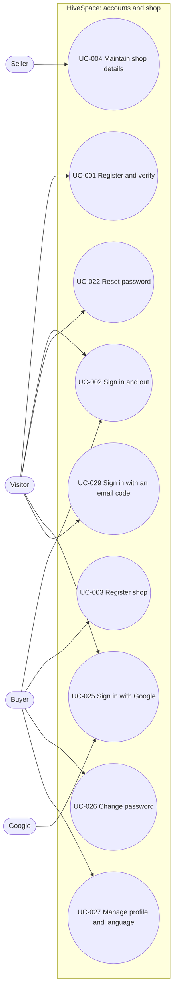
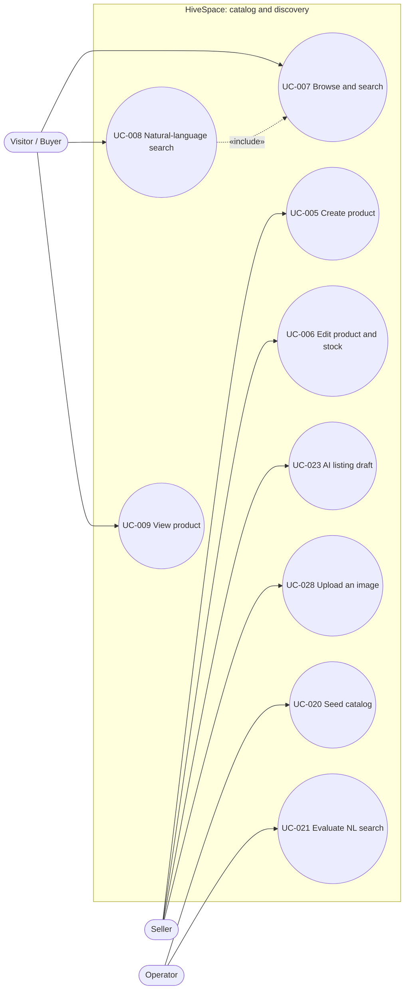
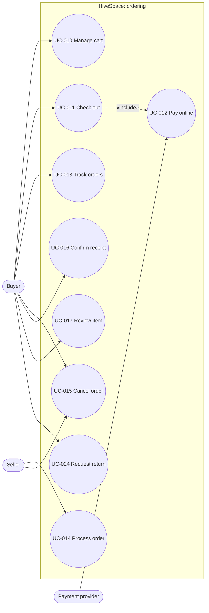

# Use Cases: HiveSpace (MVP)

> Source: `docs/srs.md` v0.16 · Last updated: 2026-11-16
> Priority follows the SRS: UC-001..021 trace to Must/Should requirements; UC-022..024 are Could (PRD P1).

## Actors

| Actor | Role |
| :-- | :-- |
| Visitor | Unauthenticated person |
| Buyer | Registered user (every user) |
| Seller | Buyer who owns a shop |
| Operator | Builder running scripts and mock controls |
| Payment provider | Mock (VNPay sandbox is Could) |
| Email provider | Mailpit or free tier |
| LLM provider | Query interpretation (and Could features) |
| System timer | Time-based triggers (timeouts, auto-completion) |

## Diagrams

### Accounts and shop

### Catalog and discovery

### Ordering

## Specifications

### UC-001: Register and verify an account

- **ID:** UC-001
- **Actors:** Visitor (primary), Email provider
- **Description:** A visitor creates an account and confirms their email.
- **Preconditions:** The visitor is not signed in.
- **Postconditions (success):** A verified account with the Buyer role exists.
- **Traces to:** FR-AUTH-001, FR-AUTH-002, FR-AUTH-003, FR-AUTH-004, FR-AUTH-005, FR-AUTH-006, FR-AUTH-007, FR-AUTH-008, FR-ROLE-001, FR-NOTIF-001, FR-NOTIF-002, FR-NOTIF-008, FR-LOC-005

**Main success scenario**
1. Visitor submits email, display name and password.
2. System validates the fields, email uniqueness and password policy.
3. System creates an unverified account with the Buyer role.
4. System emails a verification link.
5. Visitor opens the link.
6. System marks the email verified.

**Alternate flows**
- 2a. Email already registered: system says so and offers sign-in.
- 2b. Password or fields invalid: system lists the errors.
- 5a. Visitor requests a new link: system issues one and invalidates the old one.

**Exception flows**
- 4a. Email provider unavailable: system retries without blocking registration (FR-NOTIF-009).
- 5b. Link expired or used: system rejects it and offers a new link.

### UC-002: Sign in and out

- **ID:** UC-002
- **Actors:** Visitor / Buyer / Seller (primary)
- **Description:** A user authenticates to use protected functions and ends the session.
- **Preconditions:** An account exists.
- **Postconditions (success):** The user holds valid tokens; after sign-out the refresh token is revoked.
- **Traces to:** FR-AUTH-009, FR-AUTH-010, FR-AUTH-011, FR-AUTH-012, FR-AUTH-013, FR-AUTH-014, FR-AUTH-015, FR-AUTH-016, FR-ROLE-005, FR-AUTH-026

**Main success scenario**
1. User submits email and password.
2. System verifies the credentials and issues access and refresh tokens.
3. User calls protected functions; the gateway accepts the token.
4. User signs out; system revokes the refresh token.

**Alternate flows**
- 3a. Access token expires: client presents the refresh token and gets a new access token.

**Exception flows**
- 2a. Wrong credentials: system rejects with a generic message.
- 2b. Fifth failure in 15 minutes: system locks the account for 15 minutes; further attempts are rejected unevaluated.
- 3b. Access token missing, malformed, expired or invalid: gateway rejects the request. A revoked refresh token cannot obtain a new access token.

### UC-003: Register a shop (become a seller)

- **ID:** UC-003
- **Actors:** Buyer (primary)
- **Description:** A verified buyer opens a shop and gains the Seller role.
- **Preconditions:** The buyer is signed in with a verified email and owns no shop.
- **Postconditions (success):** A shop exists; the user holds Buyer and Seller roles.
- **Traces to:** FR-SHOP-001, FR-SHOP-002, FR-SHOP-003, FR-SHOP-004, FR-SHOP-008, FR-ROLE-002, FR-ROLE-003

**Main success scenario**
1. Buyer submits shop name and seller type (individual or business).
2. System validates and creates the shop; seller type is recorded unverified.
3. System grants the Seller role while keeping Buyer.
4. Seller pages become accessible.

**Alternate flows**
- 2a. Shop name taken or user already owns a shop: system rejects.

**Exception flows**
- 1a. Email not verified: system rejects and offers to resend verification.

### UC-004: Maintain shop details

- **ID:** UC-004
- **Actors:** Seller (primary)
- **Description:** A seller edits the profile, pickup address and payout bank details.
- **Preconditions:** The user owns a shop.
- **Postconditions (success):** The details are saved; no payout occurs.
- **Traces to:** FR-SHOP-005, FR-SHOP-006, FR-SHOP-007, FR-SHOP-008, FR-SHOP-009, FR-SHOP-010, FR-SHOP-011, FR-ROLE-004, NFR-SEC-008, FR-MEDIA-002, FR-MEDIA-004, FR-MEDIA-005

**Main success scenario**
1. Seller opens shop settings; bank number appears masked.
2. Seller edits profile, pickup address and bank fields and saves.
3. System validates and saves.
4. Public shop page shows profile only.

**Exception flows**
- 3a. Invalid or missing fields: system lists the errors.
- 2a. Seller tries to publish a product before address and bank details exist: system rejects (UC-005).

### UC-005: Create a product

- **ID:** UC-005
- **Actors:** Seller (primary)
- **Description:** A seller lists a product with variants, attributes, images and stock.
- **Preconditions:** The user is a seller with pickup address and bank details saved.
- **Postconditions (success):** The product is active and visible in browse and search within 60 s.
- **Traces to:** FR-CAT-001, FR-CAT-002, FR-CAT-003, FR-CAT-004, FR-CAT-005, FR-CAT-007, FR-CAT-020, FR-CAT-022, FR-CAT-023, FR-CAT-011, FR-CAT-018, FR-SHOP-011, FR-NLS-007, FR-ROLE-003, FR-MEDIA-003, FR-MEDIA-004, FR-CUR-001, FR-CUR-002, FR-CUR-003, FR-LOC-007

**Main success scenario**
1. Seller picks a leaf category.
2. Seller enters title, description, required attributes and images.
3. Seller adds one or more variants with option values, price and stock.
4. System validates and creates the product.
5. System indexes the product and refreshes its embedding.

**Alternate flows**
- 2a. Seller uses an AI draft (UC-023).

**Exception flows**
- 4a. Invalid data (price ≤ 0, duplicate variant combination, negative stock, a value outside the product limits of FR-CAT-005): system rejects with field errors.
- 4b. Shop setup incomplete: system rejects and states what is missing.

### UC-006: Edit a product and its stock

- **ID:** UC-006
- **Actors:** Seller (primary)
- **Description:** A seller changes product data, adjusts stock, or deactivates and reactivates a product.
- **Preconditions:** The seller owns the product.
- **Postconditions (success):** Changes are saved and reflected in search within 60 s.
- **Traces to:** FR-CAT-006, FR-CAT-007, FR-CAT-008, FR-CAT-009, FR-CAT-010, FR-CAT-018, FR-INV-010, FR-NLS-007, FR-ROLE-004, FR-MEDIA-003, FR-MEDIA-005

**Main success scenario**
1. Seller opens own product list and selects a product.
2. Seller edits fields, variant prices or on-hand stock, and saves.
3. System validates and saves; search and embedding are refreshed.

**Alternate flows**
- 2a. Seller deactivates the product: it disappears from browse and search; existing orders are unaffected.

**Exception flows**
- 3a. On-hand set below reserved quantity: system rejects and states the reserved quantity.
- 1a. Product belongs to another seller: system rejects.

### UC-007: Browse and search by keyword

- **ID:** UC-007
- **Actors:** Visitor / Buyer (primary)
- **Description:** A user finds products by category, keyword, filters and sort order.
- **Preconditions:** None.
- **Postconditions (success):** A paged list of matching active products is shown.
- **Traces to:** FR-SRCH-001, FR-SRCH-002, FR-SRCH-003, FR-SRCH-004, FR-SRCH-005, FR-SRCH-006, FR-SRCH-007, FR-SRCH-008, FR-SRCH-009, FR-SRCH-010, FR-SRCH-011, FR-LOC-007, FR-CAT-021

**Main success scenario**
1. User enters a keyword or opens a category.
2. System returns matching products in pages of 20 with the total count.
3. User applies category and price filters and chooses a sort order.
4. System returns the refined, ordered results.

**Alternate flows**
- 1a. Query has no diacritics: system still matches diacritic text.

**Exception flows**
- 2a. No results: system says so and suggests broadening (FR-SRCH-009).

### UC-008: Search in natural Vietnamese

- **ID:** UC-008
- **Actors:** Visitor / Buyer (primary), LLM provider
- **Description:** A user describes what they want in free Vietnamese and receives relevant products.
- **Preconditions:** Products have embeddings.
- **Postconditions (success):** Results satisfy interpreted hard constraints, ranked by semantic similarity; interpretation shown.
- **Traces to:** FR-NLS-001, FR-NLS-002, FR-NLS-003, FR-NLS-004, FR-NLS-005, FR-NLS-006, FR-NLS-009, FR-SRCH-011, NFR-SEC-010, NFR-REL-008

**Main success scenario**
1. User enters "áo khoác mỏng đi mưa dưới 300k".
2. System sends the query to the LLM and receives constraints (category, max price 300000, attributes) and residual text.
3. System filters by the hard constraints and ranks by embedding similarity.
4. System shows results and the interpreted constraints.

**Alternate flows**
- 3a. Constraints match nothing: system shows the closest products and says there was no exact match.

**Exception flows**
- 2a. LLM fails, times out or returns invalid structure: system falls back to keyword search.
- 1a. Rate limit exceeded: system rejects with a retry-after message and offers keyword search.

### UC-009: View a product

- **ID:** UC-009
- **Actors:** Visitor / Buyer (primary)
- **Description:** A user inspects a product, selects a variant and reads reviews.
- **Preconditions:** The product is active.
- **Postconditions (success):** The user sees price, availability, seller type, return window and reviews for the chosen variant.
- **Traces to:** FR-CAT-012, FR-CAT-013, FR-CAT-014, FR-CAT-015, FR-SHOP-009, FR-REV-005, FR-REV-006, FR-REV-008, FR-REV-009, FR-REV-010, FR-CUR-002, FR-PROF-005

**Main success scenario**
1. User opens the product page.
2. System shows details, images, attributes, shop, seller type, return window and rating summary.
3. User selects a variant; system shows its price and availability.
4. User reads the reviews.

**Alternate flows**
- 2a. An AI review summary exists (Could): system shows it labelled AI-generated.

**Exception flows**
- 3a. Variant sold out: system shows sold out and disables add-to-cart.

### UC-010: Manage the cart

- **ID:** UC-010
- **Actors:** Buyer (primary)
- **Description:** A buyer adds, changes and removes cart lines grouped by shop.
- **Preconditions:** The buyer is signed in.
- **Postconditions (success):** The cart reflects the changes and persists.
- **Traces to:** FR-CART-001, FR-CART-002, FR-CART-003, FR-CART-004, FR-CART-005, FR-CART-006, FR-CART-007, FR-CART-008, FR-CART-009, FR-CART-010

**Main success scenario**
1. Buyer adds a variant with a quantity.
2. System adds the line.
3. Buyer views the cart grouped by shop with subtotals and total.
4. Buyer changes a quantity or removes a line.

**Exception flows**
- 1a. Quantity exceeds available stock: system rejects and states the available quantity.
- 1b. Variant sold out or deactivated: system rejects.
- 1c. Visitor not signed in: system prompts sign-in and keeps the item.
- 1d. Seller adds own product: system rejects.
- 3a. A line became unavailable or changed price: system flags it and blocks checkout until resolved.

### UC-011: Check out (split by seller)

- **ID:** UC-011
- **Actors:** Buyer (primary), Payment provider, Email provider
- **Description:** A buyer turns selected cart lines into one order per seller with stock reserved and compensation on failure.
- **Preconditions:** The buyer is signed in, verified, and has a valid cart and a delivery address.
- **Postconditions (success):** One order per seller exists, stock is reserved, cart lines are removed. **(failure):** no orders, no held stock, no charge.
- **Traces to:** FR-CHK-001, FR-CHK-002, FR-CHK-003, FR-CHK-004, FR-CHK-005, FR-CHK-006, FR-CHK-007, FR-CHK-008, FR-CHK-009, FR-CHK-010, FR-CHK-011, FR-CHK-012, FR-CHK-013, FR-AUTH-008, FR-INV-002, FR-INV-003, FR-INV-004, FR-INV-005, FR-INV-006, FR-INV-007, FR-INV-008, FR-INV-012, FR-PAY-001, FR-PAY-003, FR-ORD-001, FR-ORD-016, FR-ORD-015, FR-SHIP-001, FR-NOTIF-003, FR-NOTIF-004, FR-ADDR-001, FR-ADDR-002, FR-ADDR-003, FR-ADDR-004, NFR-REL-002, NFR-OBS-001, FR-CUR-002, FR-CUR-003, FR-CUR-004

**Main success scenario**
1. Buyer starts checkout; system shows the per-seller summary with shipping fees and total.
2. Buyer picks a delivery address and a payment method (COD or online) and confirms.
3. System reserves stock for every line.
4. System creates one order per seller under one checkout identifier, recording price snapshots.
5. For COD, orders are placed; for online payment, orders await payment (UC-012).
6. System removes the purchased lines from the cart and shows the orders.
7. System emails buyer and sellers when each order is placed.

**Alternate flows**
- 1a. Price changed since confirmation view: system shows the updated summary and asks again.
- 2a. Buyer submits the same request twice: system returns the original outcome.

**Exception flows**
- 2b. Missing address or payment method: system rejects and names it.
- 2c. Account unverified: system rejects and offers to resend verification.
- 3a. Any line cannot be reserved: system releases earlier reservations, creates no orders, charges nothing, and names the insufficient items.
- 4a. Any step fails or times out: system compensates all completed steps, leaving no orphan orders or held stock.
- 7a. Email fails: system retries; checkout is not affected.

### UC-012: Pay online and handle the payment callback

- **ID:** UC-012
- **Actors:** Buyer (primary), Payment provider, System timer
- **Description:** A buyer pays through the provider; the system applies the result idempotently.
- **Preconditions:** A checkout with online payment created orders awaiting payment.
- **Postconditions (success):** Payment is paid once; orders are placed.
- **Traces to:** FR-PAY-003, FR-PAY-004, FR-PAY-005, FR-PAY-006, FR-PAY-007, FR-PAY-008, FR-PAY-009, FR-PAY-010, FR-PAY-011, FR-PAY-014, FR-PAY-015, FR-PAY-016, FR-ORD-001, FR-INV-007, NFR-REL-003, NFR-REL-005, NFR-SEC-011, FR-CUR-005

**Main success scenario**
1. Buyer is sent to the payment step and pays.
2. Provider sends a success callback.
3. System verifies the callback, marks the payment paid and moves the orders to placed.
4. Buyer sees the updated payment status.

**Alternate flows**
- 2a. Same callback arrives again: system acknowledges and applies nothing further.
- 2b. Failure callback: payment marked failed; buyer may retry within the window.

**Exception flows**
- 2c. Callback signature invalid: rejected, no change.
- 2d. Callback for unknown payment: rejected and logged.
- 1a. Payment window expires: system cancels the orders and releases reservations.
- 2e. Success callback after expiry: orders stay cancelled; system refunds the payment.

### UC-013: Track orders

- **ID:** UC-013
- **Actors:** Buyer (primary)
- **Description:** A buyer follows each order's status and payment.
- **Preconditions:** The buyer has orders.
- **Postconditions (success):** The buyer sees status, timeline and payment status.
- **Traces to:** FR-ORD-004, FR-ORD-013, FR-ORD-015, FR-ORD-016, FR-PAY-015, FR-SHIP-002, FR-ROLE-004, FR-NOTIF-005

**Main success scenario**
1. Buyer opens the order list, newest first, optionally filtered by status.
2. Buyer opens an order and sees items, amounts, address, payment status and timeline.
3. Orders from one checkout appear grouped.
4. Buyer receives an email when an order ships.

**Exception flows**
- 2a. Order belongs to another user: system rejects.

### UC-014: Process an order (seller)

- **ID:** UC-014
- **Actors:** Seller (primary), System timer, Email provider
- **Description:** A seller confirms, ships or cancels orders and sees them progress.
- **Preconditions:** The seller's shop has orders.
- **Postconditions (success):** Order status advances along allowed transitions with a timeline entry.
- **Traces to:** FR-ORD-002, FR-ORD-003, FR-ORD-004, FR-ORD-005, FR-ORD-006, FR-ORD-007, FR-ORD-011, FR-ORD-012, FR-ORD-014, FR-SHIP-002, FR-SHIP-003, FR-INV-009, FR-PAY-002, FR-NOTIF-005, FR-NOTIF-006, FR-ROLE-003, FR-ROLE-004

**Main success scenario**
1. Seller opens the order list filtered by status and views an order with the buyer's delivery details.
2. Seller confirms a placed order.
3. Seller ships the confirmed order; system records a mocked tracking number and emails the buyer.
4. Mock shipping reports delivery; system sets delivered (COD payment recorded as collected).

**Alternate flows**
- 2a. Seller cancels a placed or confirmed order with a reason: system cancels and releases stock; buyer is emailed.

**Exception flows**
- 2b. Illegal transition or cancel after shipment: system rejects and leaves the order unchanged.
- 1a. Order belongs to another shop: system rejects.

### UC-015: Cancel an order

- **ID:** UC-015
- **Actors:** Buyer (primary), Seller, Payment provider
- **Description:** A buyer cancels an unshipped order.
- **Preconditions:** The order is placed or confirmed (or awaiting payment).
- **Postconditions (success):** The order is cancelled, stock released, paid online amount refunded.
- **Traces to:** FR-ORD-010, FR-ORD-011, FR-ORD-012, FR-INV-006, FR-INV-008, FR-PAY-012, FR-NOTIF-006, FR-NOTIF-007

**Main success scenario**
1. Buyer cancels the order.
2. System sets cancelled and releases the reservations.
3. For a paid online order, system refunds through the provider interface.
4. System emails the buyer and the seller.

**Exception flows**
- 1a. Order is shipped, delivered or completed: system rejects.

### UC-016: Confirm receipt

- **ID:** UC-016
- **Actors:** Buyer (primary), System timer
- **Description:** A buyer confirms delivery, or the order completes automatically, releasing payment to the seller.
- **Preconditions:** The order is delivered.
- **Postconditions (success):** The order is completed and payment is marked released.
- **Traces to:** FR-ORD-008, FR-ORD-009, FR-PAY-013, FR-ORD-004

**Main success scenario**
1. Buyer confirms receipt.
2. System sets completed and marks payment released to the seller.

**Alternate flows**
- 1a. Buyer does nothing: after the auto-completion period the system completes the order.

**Exception flows**
- 1b. Order not in delivered status: system rejects.

### UC-017: Review a purchased item

- **ID:** UC-017
- **Actors:** Buyer (primary)
- **Description:** A buyer rates and reviews an item from a completed order.
- **Preconditions:** The order is completed and the item is not yet reviewed.
- **Postconditions (success):** The review is stored and ratings updated.
- **Traces to:** FR-REV-001, FR-REV-002, FR-REV-003, FR-REV-004, FR-REV-005, FR-REV-006, FR-REV-007

**Main success scenario**
1. Buyer opens a completed order and chooses an item.
2. Buyer submits a rating (1 to 5) and optional text.
3. System stores the review and updates the average rating within a minute.

**Exception flows**
- 2a. Item not in the buyer's completed order: system rejects.
- 2b. Item already reviewed: system rejects.
- 2c. Rating missing or out of range, or text too long: system rejects.

### UC-018: Send a transactional email

- **ID:** UC-018
- **Actors:** System (primary), Email provider
- **Description:** The Notification capability turns domain events into emails.
- **Preconditions:** A registration or order event occurred.
- **Postconditions (success):** Each recipient receives exactly one email per event.
- **Traces to:** FR-NOTIF-001, FR-NOTIF-008, FR-NOTIF-009, FR-NOTIF-010, FR-NOTIF-011, FR-NOTIF-012, NFR-REL-004, NFR-REL-005, FR-NOTIF-014, FR-NOTIF-015, FR-LOC-005, NFR-COST-004

**Main success scenario**
1. System receives an event and creates an email per recipient from a template.
2. System sends it through the email provider and records it as sent.

**Alternate flows**
- 1a. Same event delivered twice: system sends one email.

**Exception flows**
- 2a. Provider down: system retries with backoff up to the limit; originating operations are not blocked.
- 2b. Retries exhausted: system marks the email failed and logs it.

### UC-019: Release expired reservations

- **ID:** UC-019
- **Actors:** System timer (primary)
- **Description:** The system frees stock held by reservations that were never converted to an order or payment.
- **Preconditions:** A reservation exceeded the hold time.
- **Postconditions (success):** Units return to available stock exactly once.
- **Traces to:** FR-INV-001, FR-INV-007, FR-INV-008, FR-INV-011, FR-PAY-010

**Main success scenario**
1. Timer finds an expired reservation.
2. System releases it and records the movement.

**Alternate flows**
- 1a. Release is requested twice: units are returned once.

### UC-020: Seed the catalog

- **ID:** UC-020
- **Actors:** Operator (primary)
- **Description:** The operator loads the starting dataset with one command.
- **Preconditions:** Environment is running.
- **Postconditions (success):** At least 200 products with sellers, variants, stock and embeddings exist.
- **Traces to:** FR-CAT-016, FR-CAT-017, FR-CAT-019, FR-CAT-022, FR-CAT-023, FR-NLS-008, NFR-LEG-002, NFR-REL-007

**Main success scenario**
1. Operator runs the seed command.
2. System loads categories, sellers, products, variants and stock.
3. System generates embeddings.

**Alternate flows**
- 1a. Command re-run: no duplicates are created.

### UC-021: Evaluate natural-language search

- **ID:** UC-021
- **Actors:** Operator (primary)
- **Description:** The operator measures NL search against the keyword baseline.
- **Preconditions:** Seed data and embeddings are loaded; the evaluation set exists.
- **Postconditions (success):** Hit rates are printed and recorded in the repository.
- **Traces to:** FR-NLS-010, FR-NLS-011, FR-NLS-012

**Main success scenario**
1. Operator runs the evaluation script.
2. System runs each query through NL search and keyword search.
3. System prints both hit rates and writes the results file.

### UC-022: Reset a password (Could)

- **ID:** UC-022
- **Actors:** Visitor (primary), Email provider
- **Description:** A user who forgot their password sets a new one.
- **Preconditions:** None.
- **Postconditions (success):** Password updated and refresh tokens revoked.
- **Traces to:** FR-AUTH-017, FR-AUTH-018, FR-AUTH-019, FR-NOTIF-013

**Main success scenario**
1. User requests a reset for an email address; system responds identically whether or not it exists.
2. If the account exists, system emails a reset link.
3. User opens the link and submits a compliant new password.
4. System updates the password and revokes refresh tokens.

**Exception flows**
- 3a. Link expired, used or invalid: system rejects and offers a new link.

### UC-023: Draft a listing with AI (Could)

- **ID:** UC-023
- **Actors:** Seller (primary), LLM provider
- **Description:** A seller gets a drafted title and description from short input.
- **Preconditions:** The seller is creating or editing a product.
- **Postconditions (success):** The seller has editable draft text; nothing is saved until they save.
- **Traces to:** FR-LAS-001, FR-LAS-002, FR-LAS-003

**Main success scenario**
1. Seller enters keywords and attributes and requests a draft.
2. System returns a Vietnamese title and description.
3. Seller edits and saves the product.

**Exception flows**
- 2a. Generation fails or times out: system informs the seller; manual entry stays available.

### UC-024: Request a return (Could)

- **ID:** UC-024
- **Actors:** Buyer (primary), Seller
- **Description:** A buyer asks to return a delivered order within the return window (happy path only).
- **Preconditions:** The order is delivered and within the return window.
- **Postconditions (success):** The order is marked returned and the buyer refunded.
- **Traces to:** FR-RTN-001, FR-RTN-002, FR-RTN-003

**Main success scenario**
1. Buyer submits a return request with a reason.
2. Seller approves it.
3. System marks the order returned and refunds the buyer.

**Exception flows**
- 1a. Order not delivered or window passed: system rejects.

### UC-025: Sign in with Google

- **ID:** UC-025
- **Actors:** Visitor (primary), Google
- **Description:** A visitor signs in, or creates an account, with their Google identity.
- **Preconditions:** The visitor is not signed in.
- **Postconditions (success):** The user is signed in; a verified account exists, linked to the Google identity.
- **Traces to:** FR-AUTH-020, FR-AUTH-021, FR-AUTH-022, FR-AUTH-023, FR-NOTIF-015, NFR-SEC-014, EIR-SW-006

**Main success scenario**
1. Visitor chooses Sign in with Google and consents.
2. System validates Google's response and reads the verified email.
3. No account exists for the email: system creates a verified Buyer account.
4. System signs the user in.

**Alternate flows**
- 3a. An account with that email exists: system links the Google identity, signs in, and emails the owner a notice.

**Exception flows**
- 2a. Consent denied, response invalid, or email unverified: system rejects and keeps the visitor signed out.
- 1a. Google unavailable: system says so and email-and-password sign-in still works.

### UC-026: Change password

- **ID:** UC-026
- **Actors:** Buyer (primary), Email provider
- **Description:** A signed-in user changes their password, or sets one on a Google-created account.
- **Preconditions:** The user is signed in.
- **Postconditions (success):** The password is updated and other refresh tokens are revoked.
- **Traces to:** FR-AUTH-003, FR-AUTH-024, FR-AUTH-025, FR-AUTH-027, FR-NOTIF-014, NFR-SEC-015

**Main success scenario**
1. User submits the current password and a new password.
2. System checks the current password and the password policy.
3. System updates the password and revokes other refresh tokens.
4. System emails a password-changed notice.

**Alternate flows**
- 1a. Account has no password (Google-created): after Google re-authentication the user sets one without a current password.

**Exception flows**
- 2a. Current password wrong: system rejects.
- 2b. New password breaks the policy: system lists the unmet rules.

### UC-027: Manage profile and language

- **ID:** UC-027
- **Actors:** Buyer / Seller (primary)
- **Description:** A user views and edits their profile and chooses the language.
- **Preconditions:** The user is signed in.
- **Postconditions (success):** Profile changes and language choice are saved.
- **Traces to:** FR-PROF-001, FR-PROF-002, FR-PROF-003, FR-PROF-004, FR-PROF-006, FR-LOC-001, FR-LOC-002, FR-LOC-003, FR-LOC-004, FR-LOC-006, FR-LOC-008, FR-MEDIA-001

**Main success scenario**
1. User opens the profile and sees display name, read-only email, phone, gender, date of birth, avatar and language.
2. User edits fields and may upload an avatar (UC-028).
3. User selects Vietnamese or English; the UI switches at once.
4. System saves the changes.

**Alternate flows**
- 3a. A visitor selects a language: the choice is kept in the browser.

**Exception flows**
- 4a. Invalid field (date of birth in the future, bad phone): system rejects and names the field.

### UC-028: Upload an image

- **ID:** UC-028
- **Actors:** Buyer / Seller (primary)
- **Description:** A user uploads an avatar, a shop logo or cover, or product images.
- **Preconditions:** The user owns the profile, shop or product being changed.
- **Postconditions (success):** The image is stored and shown; any replaced image is no longer accessible.
- **Traces to:** FR-MEDIA-001, FR-MEDIA-002, FR-MEDIA-003, FR-MEDIA-004, FR-MEDIA-005, FR-MEDIA-006, FR-MEDIA-007, FR-MEDIA-008, FR-ROLE-004, NFR-SEC-013, NFR-PERF-007, NFR-MNT-010

**Main success scenario**
1. User selects an image for the avatar, shop logo or cover, or a product.
2. System validates type, size and content.
3. System strips metadata, stores the image and shows it.

**Alternate flows**
- 1a. User replaces or removes an image: the old file becomes inaccessible.

**Exception flows**
- 2a. Wrong type, too large or not a real image: system rejects and states the limits.
- 3a. Storage unavailable: system rejects, keeps the existing image, asks the user to retry.
- 1b. Target belongs to another user: system rejects.

### UC-029: Sign in with an email code

- **ID:** UC-029
- **Actors:** Visitor (primary), Email provider
- **Description:** A visitor signs in to an existing account with a one-time code sent to their email, without a password.
- **Preconditions:** The visitor is not signed in.
- **Postconditions (success):** The user is signed in; the code is used up; an unverified account is now verified.
- **Traces to:** FR-AUTH-028, FR-AUTH-029, FR-AUTH-030, FR-AUTH-031, FR-AUTH-032, FR-AUTH-033, FR-AUTH-034, FR-AUTH-035, FR-AUTH-036, FR-NOTIF-016, NFR-SEC-005, NFR-SEC-016

**Main success scenario**
1. Visitor chooses Sign in with an email code and enters their email.
2. System issues a 6-digit code, invalidates earlier codes, emails the code and shows the code entry with a resend countdown.
3. Visitor enters the code before it expires.
4. System checks the code, ends the challenge and signs the user in (marking an unverified email as verified).
5. System returns the user to the page they came from.

**Alternate flows**
- 2a. No account has that email: system shows the same code entry but sends no email.
- 3a. Visitor asks for a new code after the 60-second wait: system issues a new code and the old one stops working.

**Exception flows**
- 1a. Visitor asks for a code again within 60 seconds: system rejects and shows the remaining wait.
- 4a. Code wrong or expired: system rejects without revealing whether the email exists.
- 4b. Fifth wrong code for the challenge: system ends the challenge and asks for a new code.
- 4c. Account locked: system rejects without checking the code.
- 2b. Email sending unavailable: system says so; password and Google sign-in still work.

### Requirements without a use case
Requirements marked "—" in the RTM are system-wide qualities (NFRs, interface requirements), and the Could data-generator tooling (FR-GEN-001..003), which is operator tooling with no actor goal worth a use case.
