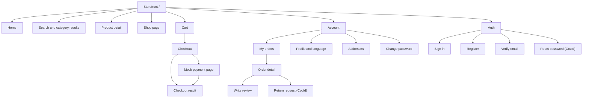
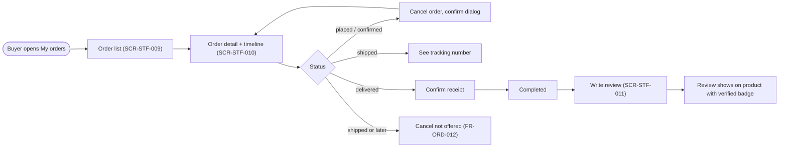
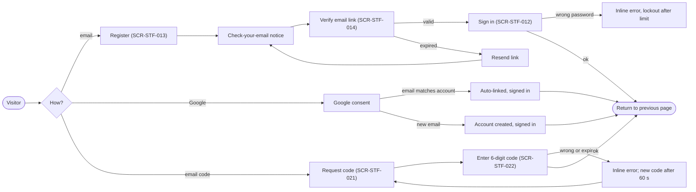
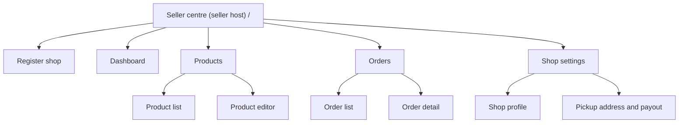
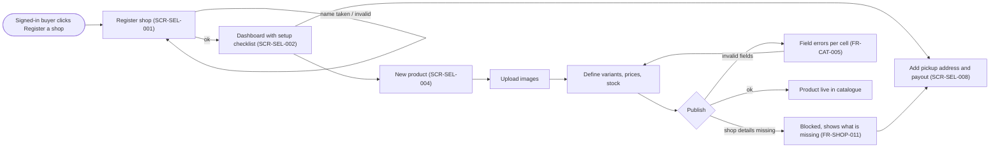
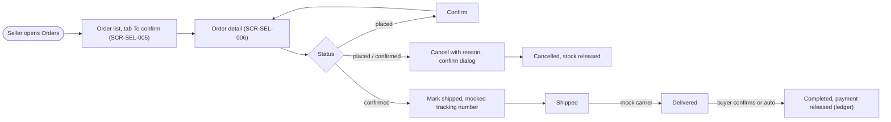
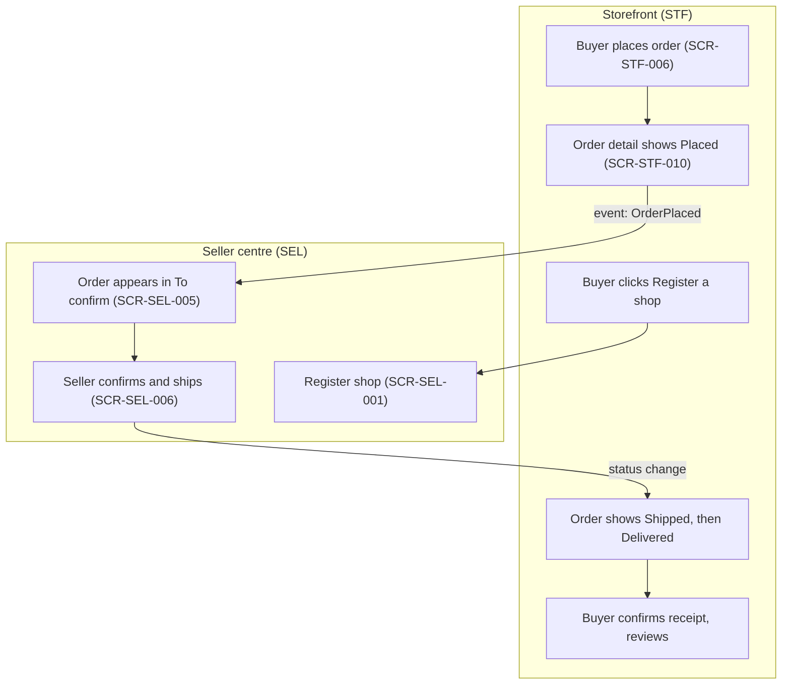

# UX Foundations: HiveSpace

> Status: Draft · Last updated: 2026-11-16 (CR-7: email-code sign-in, SCR-STF-021..022)
> Sources: [srs.md](srs.md) · [architecture.md](architecture.md) · [use-cases.md](use-cases.md)
> Design system: **[design.md](design.md) + [tokens.json](tokens.json)** are the single source of truth for every design value. This document references them and never restates them.

## 1. Overview

HiveSpace is a multi-seller marketplace for Vietnamese shoppers. Its hero flow is register → search (including natural-language Vietnamese) → cart → split checkout → pay → track → review, and it has a seller side for listing products and fulfilling orders (SRS §1.2). Two web UI surfaces exist. Both are Vue 3 + TypeScript SPAs served by the gateway/BFF, each on its own host (architecture §5, container "Web"; ADR-0027):

| Surface | Code | Route | For |
| :-- | :-- | :-- | :-- |
| Storefront | `STF` | `/` | Visitors and buyers: browse, search, buy, track, review, manage account (EIR-UI-001) |
| Seller centre | `SEL` | `seller.hivespace.vn` (local `seller.localhost:5080`) | Sellers: shop setup, products and stock, order processing (EIR-UI-002) |

There is no admin console (SRS §1.2 exclusions, architecture §11). Operator tasks (seed, eval, load test, mock-provider controls) run as scripts, except the mock payment page, which is part of STF.

**Design-source mode:** existing-codebase extraction from `references/hivespace.web` (Vue 3 + Tailwind v4). Provenance and adjustments are in [design.md §9](design.md#9-provenance-and-known-gaps).

---

## Part A — Shared core (summary; authority lives in design.md)

### A1. Brand and visual direction

Clean, trustworthy and quick. White cards on a pale canvas, a single indigo brand colour for every action, and red kept for prices and errors. Light and dark themes are both supported. The look continues `hivespace.web` (TailAdmin lineage) but drops its mix of three primaries and its Shopee-style accents, as the user decided on 2026-11-16. See [design.md §1](design.md#1-visual-theme-and-atmosphere).

### A2. Voice and tone

Clear, warm and honest. Vietnamese is the default, in a polite natural register; English is the secondary locale. Errors say what happened and what to do next. The storefront is friendly; the seller centre is direct and task-focused. Full rules are in [design.md §6](design.md#6-voice-and-microcopy).

### A3. Design language summary

A neutral gray palette with one indigo brand scale and four feedback hues; a single sans family (Inter, Vietnamese subset); a 4 px spacing grid; soft radii (8 px controls, 12 px cards) and light elevation. The storefront is comfortable (16 px body). The seller centre is denser (14 px body, compact table controls on desktop). Tokens are in [design.md §2](design.md#2-design-tokens) and [tokens.json](tokens.json); components and states are in [design.md §4](design.md#4-components).

### A4. Accessibility standard

**WCAG 2.1 AA.** It is required for the buyer hero-flow screens by **NFR-USE-003** and adopted here for every screen on both surfaces. Every list and async action has defined loading, empty and error states (**NFR-USE-002**). Both surfaces must work at 360 px width and on desktop (**EIR-UI-003**), in Vietnamese and English (**EIR-UI-004**, **FR-LOC-001**). The mechanical rules are in [design.md §5](design.md#5-accessibility-rules-non-negotiable).

### A5. Cross-surface principles

1. **Destructive actions confirm.** Cancelling an order, deleting an address and removing a product open a ConfirmModal that names the object. The confirm button uses the danger variant.
2. **Money-moving actions are idempotent and visibly pending.**
   - "Place order" and "Pay" disable themselves and show a spinner on the first click.
   - A repeat submit returns the original outcome (FR-CHK-008), so the UI never shows a duplicate order.
   - There are no optimistic updates for checkout, stock or payment. The UI waits for the confirmed state (CON-7).
3. **Optimistic updates only where safe.** Cart quantity changes and filter changes may update at once, then reconcile with the server and roll back with an inline error if rejected (FR-CART-002).
4. **Errors are recoverable.**
   - Every error message comes from a stable error code in the request's language (FR-LOC-004) and offers a next step (retry, adjust, sign in).
   - Partial failures keep the rest of the page usable.
5. **State is always visible.** Order status is a Badge plus a timeline on both surfaces (FR-ORD-004), with the same status names and colours.
6. **One vocabulary.** The same terms on both surfaces. vi/en pairs:

   | Tiếng Việt | English |
   | :-- | :-- |
   | Đơn hàng | Order |
   | Giỏ hàng | Cart |
   | Cửa hàng | Shop |
   | Người bán | Seller |
   | Phân loại | Variant |
   | Tồn kho | Stock |
   | Thanh toán khi nhận hàng | Cash on delivery |

7. **Language and theme follow the user.** Both are switchable from the header on both surfaces. Language persists to the profile when signed in (FR-LOC-002). Theme persists in the browser.
8. **Seller content is shown as entered.** Product titles, descriptions and shop names are never translated (SRS §1.2, CR-1).

---

## Part B — Surfaces

### B1. Storefront — surface code `STF`

#### Users and primary jobs

| SRS §2.3 class | Context | Top jobs |
| :-- | :-- | :-- |
| Visitor | Arrives from a link or search, often on mobile; not signed in | Browse and search (FR-SRCH-011), view products and shops, register |
| Buyer | Vietnamese-speaking shopper, mobile-first, price-aware | Find a product without knowing its name (natural-language search); pick variants; check out from several shops at once; pay COD or online; track orders; confirm receipt; review |
| Seller (as buyer) | Every seller is also a buyer (FR-ROLE-002) | Everything a buyer does, plus a link into the seller centre and "Register a shop" |

#### Information architecture and navigation

**Navigation model.** A sticky top header holds the logo, a prominent search field and a cart button with count. A top utility bar holds the seller-centre link, language, theme and account menu. Below `md`, the utility items move into a menu drawer and search becomes an expanding icon. Cart and checkout use a reduced header without search, to keep focus. Account pages use a left sub-nav (top tabs on mobile). Search is the primary way in, because the hero AI feature is search.

#### Key user flows

**F1. Find and buy across shops (hero flow)** [UC-007, UC-008, UC-009, UC-010, UC-011, UC-012]

```mermaid
flowchart LR
    s(["Buyer has a need"]) --> q["Type query in header search"]
    q --> res["Search results (SCR-STF-002)"]
    res --> nl{"AI understood the query?"}
    nl -->|"yes"| chips["Interpreted chips shown, adjust filters"]
    nl -->|"rate limited"| kw["Keyword results + notice"]
    chips --> pdp["Product detail (SCR-STF-003)"]
    kw --> pdp
    pdp --> var["Pick variant + quantity"]
    var --> signed{"Signed in?"}
    signed -->|"no"| si["Sign in, item kept (FR-CART-010)"] --> add
    signed -->|"yes"| add["Add to cart"]
    add --> cart["Cart grouped by shop (SCR-STF-005)"]
    cart --> flag{"Lines flagged?"}
    flag -->|"price/stock changed"| fix["Fix flagged lines"] --> cart
    flag -->|"no"| co["Checkout (SCR-STF-006)"]
    co --> verified{"Email verified?"}
    verified -->|"no"| resend["Resend verification (FR-CHK-013)"]
    verified -->|"yes"| pm{"Payment method"}
    pm -->|"COD"| place["Place order"]
    pm -->|"online"| place
    place --> stock{"Stock reserved for all lines?"}
    stock -->|"no"| fail["Checkout fails, nothing charged, lines named (FR-CHK-005)"] --> cart
    stock -->|"yes, COD"| ok["Result: one order per shop (SCR-STF-008)"]
    stock -->|"yes, online"| pay["Mock payment page (SCR-STF-007)"]
    pay -->|"success"| ok
    pay -->|"failure"| retry["Result: payment failed, retry within window (FR-PAY-006)"]
    retry --> pay
```

**F2. Track, receive and review** [UC-013, UC-015, UC-016, UC-017]

**F3. Register, verify and sign in** [UC-001, UC-002, UC-025, UC-029]

#### Screen inventory

Each ID is stable and never renumbered. Removed screens are tombstoned. "States" lists the non-populated states each screen must design (design.md §4.4).

| ID | Screen | Purpose | Realizes | Key states | Reference page in hivespace.web (OQ-7) |
| :-- | :-- | :-- | :-- | :-- | :-- |
| SCR-STF-001 | Home | Entry: category bar, hero banner, product feed | UC-007 | loading, empty catalogue, error | `HomePage` (adapt; drop FlashSale and coupons) |
| SCR-STF-002 | Search and category results | Keyword and natural-language results with interpreted-constraint chips, filters, sort, load more | UC-007, UC-008; FR-SRCH, FR-NLS-004, FR-NLS-009 | loading, no results, rate-limited, error | none (new) |
| SCR-STF-003 | Product detail | Images, variant selector, price, stock, add to cart or buy now, shop card, reviews, AI review summary (Could) | UC-009, UC-010; FR-REV-009 | loading, out of stock, variant unavailable, not found | `ProductDetailPage` (adapt) |
| SCR-STF-004 | Shop page | Public shop profile and its active products | FR-SHOP-009 | loading, no products, not found | none (new) |
| SCR-STF-005 | Cart | Lines grouped by shop, quantities, flagged lines, select for checkout, totals | UC-010; FR-CART-004, FR-CART-008 | loading, empty cart, line flagged, error | `CartPage` (adapt) |
| SCR-STF-006 | Checkout | Per-shop summary, address picker, payment method (COD or online), shipping per shop, total, place order | UC-011; FR-CHK-001, FR-CHK-002 | no address, unverified account, price changed, submitting, stock failure | `CheckoutPage` (adapt; drop coupons) |
| SCR-STF-007 | Mock payment page | Pay the checkout total; operator controls for success, failure, delay and duplicate callback | UC-012; FR-PAY-004 | processing, expired window | none (new) |
| SCR-STF-008 | Checkout result | Outcome and the orders created (one per shop), payment status, retry payment | UC-011, UC-012; FR-CHK-012, FR-PAY-006 | awaiting payment, paid, failed (retry), expired (cancelled) | payment result page (adapt) |
| SCR-STF-009 | My orders | Orders newest first, filter tabs by status, grouped by checkout | UC-013; FR-ORD-013, FR-ORD-015 | loading, no orders, filtered empty, error | `/orders` page (adapt) |
| SCR-STF-010 | Order detail | Items, amounts, address, payment method and status, timeline; cancel, confirm receipt, request return (Could) | UC-013, UC-015, UC-016, UC-024; FR-PAY-015 | loading, not found, action in progress | `/account/orders/:id` (adapt) |
| SCR-STF-011 | Write review (dialog) | Star rating and text for a purchased item | UC-017 | submitting, already reviewed, not eligible | none (new) |
| SCR-STF-012 | Sign in | Email and password, Google sign-in, links to email-code sign-in, register and reset | UC-002, UC-025, UC-029 | invalid credentials, locked out, unverified notice | auth sign-in page (reuse) |
| SCR-STF-013 | Register | Create an account; then the check-your-email notice | UC-001 | validation errors, email taken | auth sign-up page (reuse) |
| SCR-STF-014 | Verify email | Result of the verification link; resend | UC-001 | verified, expired, already verified | verify email page (reuse) |
| SCR-STF-015 | Reset password (Could) | Request a reset link; set a new password | UC-022 | link sent, link expired | none (new) |
| SCR-STF-016 | Profile | Display name, phone, gender, date of birth, avatar upload, preferred language | UC-027, UC-028; FR-PROF | loading, validation errors, upload error | `/profile` (adapt) |
| SCR-STF-017 | Addresses | Address book: add, edit, delete, set default | FR-ADDR-001..004 | no addresses, validation errors | `/profile/address` (reuse) |
| SCR-STF-018 | Change password | Current and new password; signs out other sessions | UC-026 | wrong current password, validation errors | none (new) |
| SCR-STF-019 | Error pages | 404 not found, 500 server error, maintenance | NFR-USE-002 | — | shared `NotFound`, `ServerError`, `Maintenance` (reuse) |
| SCR-STF-020 | Return request (dialog, Could) | Request a return for a completed order with a reason | UC-024 | submitting, not eligible | none (new) |
| SCR-STF-021 | Request sign-in code | Enter email to get a one-time code; link back to password sign-in | UC-029; FR-AUTH-028, FR-AUTH-029, FR-AUTH-033 | sending, resend wait, rate-limited, email unavailable | `/auth/otp` OtpSignInPage (reuse) |
| SCR-STF-022 | Enter sign-in code | Six single-digit boxes with paste support, the email shown, resend countdown | UC-029; FR-AUTH-030..032, FR-AUTH-035 | verifying, wrong code, expired, too many attempts (request new code), locked | `/auth/otp/code` OtpCodeEntryPage (reuse) |

Reference pages **not carried over** (out of scope per SRS §1.2): notifications page, coupons and vouchers, flash sale.

#### Surface-specific components

SearchBar, InterpretedQueryBar, FilterPanel, ProductCard, ProductGrid, VariantSelector, CartShopGroup, OrderSummary (sticky on mobile), AddressCard and AddressFormModal, ReviewForm and ReviewItem, CategoryBar, HeroBanner, MockPaymentPanel. Specs are in [design.md §4.7](design.md#47-commerce-components-stf-productcard-is-also-used-in-sel-previews). MockPaymentPanel: a card showing the amount, with four outcome buttons (success, failure, delay, duplicate callback). It is labelled "Demo provider" so it is never mistaken for a real gateway.

#### Token overrides

Comfortable density: 16 px body, 48 px primary commerce CTAs, 12 to 16 px card padding in the product grid. See [design.md §4.10](design.md#410-per-surface-variants). No colour overrides.

---

### B2. Seller centre — surface code `SEL`

#### Users and primary jobs

| SRS §2.3 class | Context | Top jobs |
| :-- | :-- | :-- |
| Seller | An individual or small business; often works on a laptop, sometimes checks orders on a phone | Register a shop with little friction (UC-003); complete shop details before publishing (FR-SHOP-011); list products with variants, images and stock (UC-005, UC-006); confirm, ship or cancel orders (UC-014, UC-015); optionally draft listings with AI (UC-023, Could) |

#### Information architecture and navigation

**Navigation model.** A persistent left sidebar (collapsible to icons, an off-canvas drawer below `lg`) with four sections, a top header, and a breadcrumb plus title row on each page. A sidebar suits a work tool with a few deep sections that the seller moves between often. The seller centre requires sign-in. It has its own BFF session on its own host, but shares the Identity sign-in with STF, so a signed-in buyer gets in without a second password (ADR-0027). A signed-in buyer without a shop is sent to Register shop.

#### Key user flows

**F4. Become a seller and publish the first product** [UC-003, UC-004, UC-005, UC-028]

**F5. Process an order** [UC-014, UC-015]

#### Screen inventory

| ID | Screen | Purpose | Realizes | Key states | Reference page in hivespace.web (OQ-7) |
| :-- | :-- | :-- | :-- | :-- | :-- |
| SCR-SEL-001 | Register shop | Shop name and seller type; grants the Seller role | UC-003; FR-SHOP-001..004, FR-ROLE-002 | name taken, already has a shop, unverified email | `/register-seller` (adapt) |
| SCR-SEL-002 | Dashboard | Setup checklist (FR-SHOP-011), order counts by status, low-stock variants | UC-014 (entry) | loading, new shop (checklist only), error | dashboard page (adapt; no charts) |
| SCR-SEL-003 | Product list | Products with status, price range and stock; search, filter, activate or deactivate | UC-006 | loading, no products, filtered empty, error | `/product/list` (adapt) |
| SCR-SEL-004 | Product editor | Create or edit: basic info, images, variant matrix with price and stock, publish; AI draft (Could) | UC-005, UC-006, UC-023, UC-028; FR-CAT, FR-INV-010 | validation errors, upload error, saving, publish blocked | `/product/new`, `/product/:id` (adapt) |
| SCR-SEL-005 | Order list | Shop orders filtered by status tabs (To confirm, To ship, Shipping, Completed, Cancelled) | UC-014; FR-ORD-014 | loading, no orders, filtered empty, error | `/orders/all` (adapt) |
| SCR-SEL-006 | Order detail | Items, amounts, buyer delivery details, timeline, payment status; confirm, ship, cancel with reason | UC-014, UC-015; FR-ORD-005, 006, 011 | loading, action in progress, transition rejected | none (new) |
| SCR-SEL-007 | Shop profile | Name, description, logo and cover upload | UC-004, UC-028; FR-SHOP-005 | validation errors, upload error | none (new) |
| SCR-SEL-008 | Pickup address and payout | Pickup address; bank details (account number masked) | UC-004; FR-SHOP-006, 007, 010 | validation errors, saved | none (new) |
| SCR-SEL-009 | Error pages | 404, 500, maintenance inside the SEL shell | NFR-USE-002 | — | shared error pages (reuse) |

Reference pages **not carried over** (out of scope): marketing coupons, notifications, icons demo page.

#### Surface-specific components

AppShell with collapsible Sidebar, PageBreadcrumb, StatCard, setup checklist, data Table (stacks to cards below `md`), ProductForm, VariantMatrix, ImageUploader grid, OrderActionBar. Specs are in [design.md §4.8](design.md#48-seller-centre-components-sel).

#### Token overrides

Denser: 14 px body and 36 px `control-sm` in desktop tables and filters (still 44 px on touch). See [design.md §4.10](design.md#410-per-surface-variants). No colour overrides.

---

## Part C — Cross-surface reconciliation

**Shared vs. surface-specific.**
- **Shared core:** everything in design.md §4.1 to §4.6 (actions, forms, feedback, data states, structure, navigation primitives), plus **OrderTimeline**, **Badge order-status mapping**, **ImageUploader**, **Money input** and **ProductCard**. ProductCard was promoted to the core because SEL shows a storefront preview in the product editor.
- **Surface-specific:** STF owns the search and commerce components; SEL owns the shell, tables and editors.
- **Implementation:** the two surfaces are separate apps (`web/apps/storefront`, `web/apps/seller-centre`, repo-structure §8) and never import each other. Shared components and the theme CSS live in `web/packages/ui`; money, date and i18n helpers live in `web/packages/core`.

**Flows that span surfaces.**

- **Order lifecycle:** both sides read the same status names, Badge colours and timeline (FR-ORD-004). Transactional emails (UC-018) carry the same wording in the recipient's language.
- **Buyer to seller:** the STF account menu shows "Register a shop" (no shop yet) or "Seller centre" (has shop). SEL's header has "Go to storefront". The sign-in carries across (SSO through Identity, ADR-0027), so the user is never asked for a password twice. A signed-in user's language follows the profile; theme is remembered per host.
- **Seller as buyer:** a seller cannot add their own products to the cart (FR-CART-009). The product page replaces "Add to cart" with "Edit in seller centre" for the owner.

**Consistency rules.**
- **Identical on both surfaces:** tokens, themes, component behaviour, status vocabulary, money, date and time formats, error-message pattern, focus and keyboard behaviour, language switcher.
- **Deliberately different:** navigation model (top header vs. sidebar), density (§4.10), and tone (friendly vs. direct).

---

## Part D — Open questions and risks

| # | Item | Impact | Proposed resolution |
| :-- | :-- | :-- | :-- |
| UXQ-1 | **Logo.** The reference logo uses a purple accent that clashes with the indigo-only brand (design.md §9). | Brand coherence | Recolour the hexagon mark to brand-500 before the first STF slice. |
| UXQ-2 | The **`@hivespace/shared` source** is missing from the reference copy, so component internals are specified from convention. | Fidelity when porting pages | Fetch the full `hivespace.web` repo when a slice reuses a reference page; reconcile with design.md. |
| UXQ-3 | **OQ-7** (which reference pages are reused) is answered provisionally by the "Reference page" columns above. | Plan accuracy | Confirm during implementation planning and close OQ-7 in the SRS. |
| UXQ-4 | **Natural-language search transparency:** chip wording for interpreted constraints needs testing with real Vietnamese queries (OQ-15 eval set). | Hero AI feature clarity | Use eval-set queries as UI test fixtures for SCR-STF-002. |
| UXQ-5 | **Applying WCAG AA to SEL** goes beyond NFR-USE-003 (which covers the buyer hero flow only). | Effort (R-1) | Keep it as the design bar. If time is short, audit SEL last, per the R-1 cut order. |
| UXQ-6 | **Dark mode doubles visual QA.** | Solo-builder capacity (R-1) | Role tokens make it mostly free. Do visual checks of both themes only on the hero-flow screens. |
| UXQ-7 | **Mock payment page** looks like part of the shop. | Demo clarity | Label it "Demo provider" and give it a distinct but on-system frame. |
